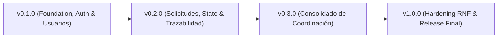

# ITM Service Desk (Backend) - Mapa de Versiones y Ciclo de Vida
**Ubicación:** `docs/version_map.md`  
**Versión Actual en Desarrollo:** `v0.2.0-alpha`  
**Última Actualización:** 2026-11-15  

---

## 1. Estrategia de Versionamiento (SemVer)
El Backend de **ITM Service Desk** se rige por **Semantic Versioning 2.0.0** (`MAJOR.MINOR.PATCH`):
* **MAJOR (`X.0.0`):** Cambios que rompen compatibilidad hacia atrás en los contratos REST JSON, esquema de JWT o transiciones de la máquina de estados.
* **MINOR (`0.Y.0`):** Nuevos endpoints, funcionalidades de negocio (HU/RF) o capacidades compatibles hacia atrás.
* **PATCH (`0.0.Z`):** Corrección de bugs, parches de seguridad, ajustes en consultas Exposed DSL o refactorizaciones sin alterar contratos públicos.

---

## 2. Mapa de Versiones e Hitos (Milestones)



### Tabla de Hitos y Entregables

| Versión | Nombre del Hito | Objetivo Principal | Specs / Épicas Incluidas | Trazabilidad HU / RF / RNF | Estado |
| :--- | :--- | :--- | :--- | :--- | :--- |
| **`v0.1.0`** | Foundation, Auth & Personal | Arquitectura en capas, Ktor Netty, HikariCP + Flyway (usuario semilla Coordinador), registro público de solicitantes, login JWT (1h) con BCrypt, RBAC y gestión de personal interno | `001-project-setup`, `002-auth-users` | **HU-01** (registro), **HU-07**; **RF-01**, **RF-07**; **RNF-01 a RNF-04**, **RNF-06**, **RNF-08** | 🟢 Completado |
| **`v0.2.0`** | Core Service Desk & Trazabilidad | Registro de solicitudes (`SOL-AAAA-NNNNN`, Builder), consulta/cancelación, bandeja y asignación/priorización (SLA 24h/72h/120h), máquina de estados (Patrón State), intervenciones, escalamiento, respuesta final, historial inmutable y cierre automático (24h) | `003-service-requests` (Completado), `004-attention-lifecycle` (Pendiente) | **HU-01** (solicitud), **HU-02**, **HU-03**, **HU-04**, **HU-05**; **RF-02 a RF-05**; **RNF-05 a RNF-09** | 🟡 En progreso (`003` completado) |
| **`v0.3.0`** | Coordinación & Reportes Consolidados | Resumen consolidado para Coordinación (totales por estado, categoría, prioridad, responsable, vencidas y dentro/fuera de plazo), filtros combinados (Builder) y listado general paginado | `005-coordination-reports` | **HU-06**; **RF-06**; **RNF-03**, **RNF-07** | ⚪ Planificado |
| **`v1.0.0`** | Release v1.0 & Quality Gate | Cumplimiento integral RNF-01 a RNF-10 (rendimiento `< 2s` con 1000 solicitudes, paginación 20/pág, zona horaria `America/Bogota`, `.env.example`, README local), cobertura $\ge 90\%$ con Testcontainers PostgreSQL, `ktlint 1.8.x` y auditoría `converge.md` | `006-hardening-release` | **RNF-01 a RNF-10** (auditoría completa de alcance y calidad) | ⚪ Planificado |

> **Nota de Alcance (RNF-10):** Por restricción explícita de alcance del sistema, no se incluyen archivos adjuntos, envío de correos electrónicos, mensajería WhatsApp, pagos, facturación ni integraciones con plataformas externas en ninguna versión del ciclo actual.

---

## 3. Matriz de Dependencias entre Features

```text
[001-project-setup] (Ktor Netty 3.6.x, Exposed DSL 1.6.x, HikariCP, Flyway, ktlint 1.8.x, Testcontainers)
     └── [002-auth-users] (RF-01, RF-07: Registro solicitante, Login JWT 1h + BCrypt, RBAC, Personal interno + Semilla Coordinador)
              └── [003-service-requests] (RF-02, RF-03: Builder de solicitudes, SOL-AAAA-NNNNN, solicitud previa, listado paginado y cancelación)
                       └── [004-attention-lifecycle] (RF-04, RF-05: State Pattern Tablas 3-4, SLA Tabla 5, intervenciones, escalamiento, respuesta, historial inmutable y cierre auto 24h)
                                └── [005-coordination-reports] (RF-06: Totales consolidados, métricas de plazo y filtros con Builder)
                                         └── [006-hardening-release] (RNF-01..RNF-10, cobertura >= 90%, README e instalación local, v1.0.0)
```

---

## 4. Matriz de Compatibilidad Técnica

| Componente | Versión del Software | Dependencia Externa / Runtime | Compatibilidad |
| :--- | :--- | :--- | :--- |
| **Runtime JVM** | `v0.1.0+` | JDK | `21 LTS` |
| **Lenguaje** | `v0.1.0+` | Kotlin | `2.4.x` |
| **Framework API** | `v0.1.0+` | Ktor Server (Netty) + `kotlinx.serialization.json` | `3.6.x` |
| **Base de Datos** | `v0.1.0+` | PostgreSQL + Exposed DSL + HikariCP + Flyway | `PostgreSQL 18.x` / `Exposed 1.6.x` |
| **Seguridad** | `v0.1.0+` | Ktor Auth JWT (`exp = 1h`) + `at.favre.lib:bcrypt` | `bcrypt 0.10.2` + HTTPS/TLS |
| **Zona Horaria & Formato** | `v0.1.0+` | Estándar de fechas y SLA | `America/Bogota` (`dd/mm/aaaa hh:mm` en presentación / ISO-8601 en API) |
| **Calidad & Testing** | `v0.1.0+` | `org.jlleitschuh.gradle.ktlint` + Ktor Server Tests + Testcontainers | `ktlint 1.8.x` / Cobertura $\ge 90\%$ |
| **Consumidor Oficial** | `v0.1.0+` | ITM Service Desk Frontend (Compose Multiplatform 1.12.2) | Web (`wasmJs` en Chrome, Firefox, Edge) y Android (`minSdk 26`, `targetSdk 35/36`) |

---

## 5. Changelog / Registro Histórico

### [v0.2.0-alpha] - 2026-11-15
#### Added
- Implementación completa y verificada de **`003-service-requests`**:
  - Migración Flyway `V3__create_service_requests_tables.sql` (`request_code_sequences`, `service_requests` con columnas nullable para `004`, `request_history` append-only e índices compuestos) y definiciones Exposed 1.6.x DSL (`RequestCodeSequencesTable`, `ServiceRequestsTable`, `RequestHistoryTable`).
  - Capa de dominio pura (`RequestCategory`, `RequestStatus`, `RequestPriority`, `HistoryAction`, `HistoryActorRole`, `ServiceRequest`, `ServiceRequestSummary`, `ApplicantVisibleHistoryEntry`, `ServiceRequestDetail`), **Patrón GoF State** (`ServiceRequestState` con `AbiertaState`..`CanceladaState`), **Patrón GoF Builder** (`ServiceRequestBuilder`, `MyRequestsQueryBuilder` con `page >= 1`, `size in 1..20`) y `RequestValidator` (Tabla 2, formato `^SOL-\d{4}-\d{5,}$`, `reason <= 500`).
  - `ExposedServiceRequestRepository` transaccional con consecutivo atómico anual `SOL-AAAA-NNNNN` (`America/Bogota`) vía `INSERT ... ON CONFLICT DO UPDATE RETURNING`, filtrado de privacidad `RF-03` en historial, paginación `< 2s` sobre `1000` registros (`RNF-07`) y cancelación condicional atómica `WHERE id = ? AND status = 'ABIERTA'`.
  - `ServiceRequestService`, DTOs `@Serializable` estrictos (`ignoreUnknownKeys = false`), `ServiceRequestRouting` bajo `authenticate("auth-jwt")` + `withRole(UserRole.SOLICITANTE)` para `/api/v1/requests` (`POST`, `GET /my`, `GET /{code}`, `POST /{code}/cancel`), pruebas unitarias/Testcontainers y verificación Kover ($\ge 90\%$).

### [v0.1.0] - 2026-11-15
#### Added
- Implementación completa y verificada de **`002-auth-users`**:
  - Migración Flyway `V2__create_revoked_tokens_table.sql` (`revoked_tokens` e índice `idx_revoked_tokens_expires_at`) y alineación de `JwtConfig` / `.env.example` a `JWT_EXPIRATION_SECONDS=3600`.
  - Capa de dominio pura (`User`, `UserProfile`, `StaffSummary`, `IssuedToken`, `AuthSession`, `AuthenticatedIdentity`, `PagedResult`), Builders (`AuthSessionBuilder`, `StaffPageQueryBuilder`) y validador acumulativo de Tabla 1 (`UserValidator`).
  - Repositorios Exposed 1.6.x DSL (`ExposedUserRepository` con mapeo atómico de `SQLState 23505` a `409 Conflict`, `ExposedRevokedTokenRepository` con revocación idempotente y purga de expirados).
  - Servicios de seguridad y aplicación (`BcryptPasswordHasher` costo 12 con hash dummy anti-enumeración, `JwtTokenService` HMAC256 `1h`, `AuthService`, `StaffService`).
  - Seguridad HTTP Ktor (`JwtAuthConfig`, `RoleAuthorizationPlugin` con `withRole(...)`), DTOs `@Serializable` (`ignoreUnknownKeys = false`), rutas `/api/v1/auth/{register,login,me,logout}` y `/api/v1/users/staff`, validado con `ktlintCheck`, Testcontainers PostgreSQL 18 y Kover ($\ge 90\%$).

### [v0.1.0-alpha] - 2026-11-14
#### Added
- Constitución del proyecto Backend (`backend/.specify/memory/constitution.md` v1.0.0).
- Definición del mapa de versiones alineado con las historias **HU-01 a HU-07**, requisitos **RF-01 a RF-07** y **RNF-01 a RNF-10**.
- Implementación completa y verificada de **`001-project-setup`**: proyecto Gradle con Version Catalog (`gradle/libs.versions.toml`), `ktlint 1.8.0`, JetBrains Kover ($\ge 90\%$), `EnvConfig` + `AppConfigBuilder`, HikariCP + Flyway (`V1__create_users_table.sql`) + Exposed 1.6.1 DSL, semilla idempotente del Coordinador (BCrypt costo 12), `IpAllowListPlugin`, `CORS`, `XForwardedHeaders`, `StatusPages`, `GET /api/v1/health`, `infra/Caddyfile.example`, `README.md` y suite TDD con Testcontainers `postgres:18-alpine`.
