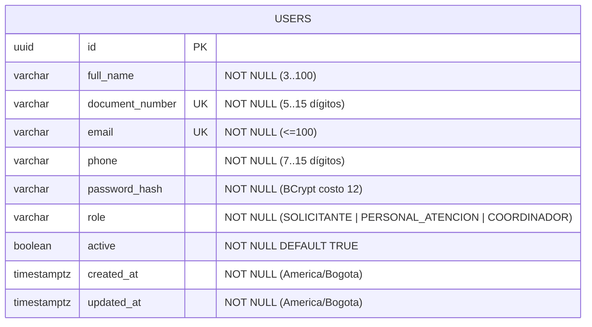
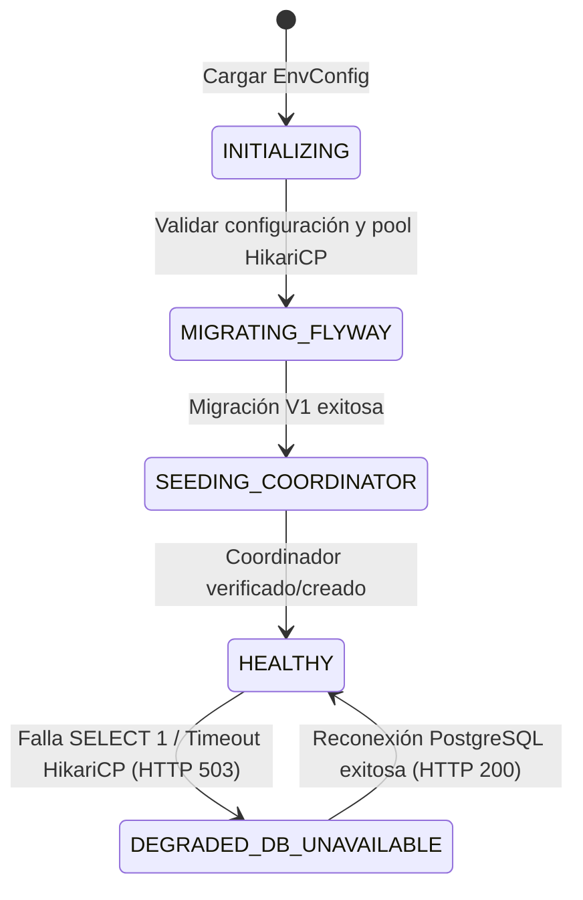

# Modelo de Datos y Entidades: 001-project-setup (Backend)
**Ubicación:** `specs/001-project-setup/data-model.md`  
**Spec Asociada:** `specs/001-project-setup/spec.md`  
**Estado:** Aprobado  

---

## 1. Diagrama Entidad-Relación (Mermaid)

> **Nota de Alcance:** En `001-project-setup` se crea únicamente la tabla `users` (migración `V1__create_users_table.sql`) con todas las restricciones de la Tabla 1 de requisitos y RNF-05 para ejecutar `CoordinatorSeedInitializer` de forma idempotente. Las tablas `service_requests` y `request_history` se incorporarán en `003-service-requests` y `004-attention-lifecycle` mediante nuevas migraciones Flyway (`V2+`).

---

## 2. Entidades de Dominio, Tablas Exposed DSL y Atributos

### Tabla Exposed DSL: `UsersTable` (`users`)
* **Propósito:** Persistencia relacional en PostgreSQL 18.x para todos los actores del sistema (`SOLICITANTE`, `PERSONAL_ATENCION`, `COORDINADOR`), iniciando en `001-project-setup` con la semilla del Coordinador único (RF-01).
* **Columnas y Restricciones (RNF-05 / Tabla 1):**
  * `id`: `UUID` (Clave primaria inmutable, generada en servidor).
  * `full_name`: `VARCHAR(100)` (`NOT NULL`).
  * `document_number`: `VARCHAR(15)` (`NOT NULL`, índice `UNIQUE`).
  * `email`: `VARCHAR(100)` (`NOT NULL`, índice `UNIQUE`, almacenado en minúsculas normalizadas).
  * `phone`: `VARCHAR(15)` (`NOT NULL`).
  * `password_hash`: `VARCHAR(100)` (`NOT NULL`, hash BCrypt costo 12 generado en servidor; nunca expuesto).
  * `role`: `VARCHAR(30)` (`NOT NULL`, constraint `CHECK (role IN ('SOLICITANTE', 'PERSONAL_ATENCION', 'COORDINADOR'))`).
  * `active`: `BOOLEAN` (`NOT NULL DEFAULT TRUE`).
  * `created_at`: `TIMESTAMPTZ` (`NOT NULL DEFAULT NOW()`).
  * `updated_at`: `TIMESTAMPTZ` (`NOT NULL DEFAULT NOW()`).

### Entidad de Dominio: `UserRole` (Enum)
* **Valores:** `SOLICITANTE`, `PERSONAL_ATENCION`, `COORDINADOR`.

### Entidad de Dominio: `SystemHealth`
* **Propósito:** Representa el estado operativo verificado del Backend y la conectividad real contra PostgreSQL 18.
* **Campos:**
  * `status`: Enum `HealthStatus` (`UP`, `DOWN`).
  * `serviceName`: `String` (`"itm-service-desk-backend"`).
  * `databaseStatus`: Enum `HealthStatus` (`UP`, `DOWN`).
  * `checkedAt`: `OffsetDateTime` en zona `America/Bogota`.

### Objetos de Configuración (`AppConfig` + Builders)
* **Propósito:** Encapsular la configuración inmutable cargada desde `EnvConfig` (construida mediante patrón **Builder** para pruebas y arranque productivo).
* **Sub-modelos:**
  * `ServerConfig(port: Int, timezone: String, corsAllowedOrigins: List<String>, allowedClientIps: List<String>)`
  * `DatabaseConfig(jdbcUrl: String, user: String, password: String, maxPoolSize: Int, connectionTimeoutMs: Long, validationTimeoutMs: Long)` *(sobreescribe `toString()` ocultando `password` y credenciales JDBC)*.
  * `JwtConfig(secret: String, issuer: String, audience: String, expirationHours: Long = 8)` *(sobreescribe `toString()` ocultando `secret`)*.
  * `SeedCoordinatorConfig(fullName: String, documentNumber: String, email: String, phone: String, rawPassword: String)` *(sobreescribe `toString()` ocultando `rawPassword`)*.

### Jerarquía de Excepciones de Dominio: `DomainException` (`sealed class`)
* **Propósito:** Permitir que la capa de Servicio/Dominio exprese fallos tipados traducidos uniformemente por `StatusPages` a códigos HTTP coherentes (RNF-01 / RNF-04 / RNF-08).
* **Variantes:**
  * `ValidationException(message, details)` → `400 Bad Request`
  * `UnauthorizedException(message)` → `401 Unauthorized`
  * `ForbiddenException(message)` → `403 Forbidden`
  * `NotFoundException(message)` → `404 Not Found`
  * `ConflictException(message)` → `409 Conflict`
  * `ServiceUnavailableException(message)` → `503 Service Unavailable`

---

## 3. Reglas de Validación e Invariantes del Dominio
1. **Validación de Semilla Coordinador (Tabla 1 / RF-01):**
   - `fullName`: 3 a 100 caracteres; solo letras (incl. acentos/ñ) y espacios.
   - `documentNumber`: 5 a 15 dígitos numéricos (`^[0-9]{5,15}$`).
   - `email`: formato de correo válido, máximo 100 caracteres, normalizado a minúsculas.
   - `phone`: 7 a 15 dígitos numéricos (`^[0-9]{7,15}$`).
   - `rawPassword`: mínimo 8 caracteres, al menos una letra y un dígito antes de aplicar BCrypt costo 12.
2. **Idempotencia de Semilla (RF-01):** Si ya existe al menos un usuario con `role = COORDINADOR`, `CoordinatorSeedInitializer` omite la inserción sin error.
3. **Protección de Secretos (RNF-04):** Ninguna entidad o configuración expone `password`, `passwordHash`, `secret` o credenciales en `toString()`, logs o DTOs de salida.
4. **Integridad Relacional y Temporal (RNF-05 / RNF-09):** Todas las fechas se manejan con zona `America/Bogota` (`UTC-5`) y la BD impone unicidad estricta en `email` y `document_number`.

---

## 4. Transiciones de Estado del Ciclo de Arranque y Salud (State Machine)

