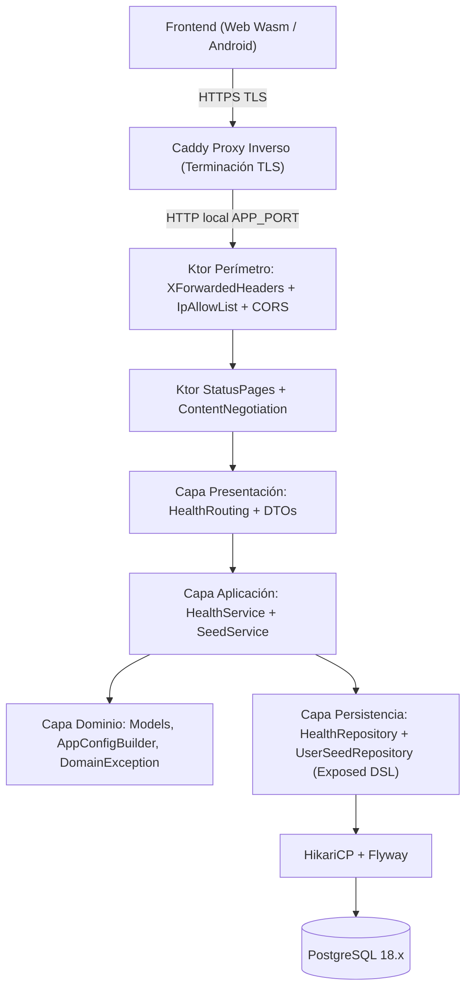

# Plan Técnico de Arquitectura: 001-project-setup (Backend)
**Ubicación:** `specs/001-project-setup/plan.md`  
**Spec Asociada:** `backend/specs/001-project-setup/spec.md`  
**Estado:** Aprobado  

---

## 1. Enfoque Arquitectónico y Diagrama de Solución
> El Backend implementa **Layered Architecture** estricta sobre **Ktor 3.6.x (Netty)** y **JDK 21 LTS / Kotlin 2.4.x**, escuchando HTTP local en `APP_PORT` (8080) detrás del proxy inverso **Caddy** (terminación TLS/HTTPS).  
> El flujo de dependencias es estrictamente unidireccional (`routing -> service -> domain` y `service -> repository -> domain`). La configuración externa se carga sin librerías no aprobadas mediante `EnvConfig` + **Builder Pattern** (`AppConfigBuilder`). La persistencia usa **HikariCP** (`connectionTimeout=2000ms`), **Flyway** (`V1__create_users_table.sql`) y **Exposed 1.6.x DSL**, con carga idempotente del Coordinador semilla (`at.favre.lib:bcrypt` 0.10.2, costo 12). La calidad se impone en build con `gradle/libs.versions.toml`, `.editorconfig`, `org.jlleitschuh.gradle.ktlint` (`1.8.x`) y **JetBrains Kover** ($\ge 90\%$) sobre **Testcontainers PostgreSQL 18**.



---

## 2. Modificaciones de Archivos y Nuevos Componentes

| Archivo / Módulo | Tipo de Cambio | Propósito |
| :--- | :--- | :--- |
| `gradle/libs.versions.toml` | Nuevo | Catálogo centralizado de versiones (Kotlin 2.4.x, Ktor 3.6.x, Exposed 1.6.x, HikariCP, Flyway, PostgreSQL driver, BCrypt 0.10.2, ktlint 1.8.x, Kover, Testcontainers). |
| `build.gradle.kts`, `settings.gradle.kts`, `.editorconfig`, `.gitignore`, `.env.example` | Nuevo | Configuración de Gradle, reglas estrictas ktlint (sin wildcards, 4 espacios, trailing commas, máx 120 chars), umbral Kover $\ge 90\%$ y plantilla `.env.example` sin secretos. |
| `src/main/kotlin/.../domain/model/` (`UserRole.kt`, `SystemHealth.kt`, `DomainException.kt`) | Nuevo | Entidades puras de dominio, `HealthStatus` y jerarquía `sealed class DomainException`. |
| `src/main/kotlin/.../domain/builder/AppConfigBuilder.kt` | Nuevo | **Patrón GoF Builder** para construir y validar `AppConfig` (`ServerConfig`, `DatabaseConfig`, `JwtConfig`, `SeedCoordinatorConfig`) ocultando secretos en `toString()`. |
| `src/main/kotlin/.../domain/repository/` (`HealthRepository.kt`, `UserSeedRepository.kt`) | Nuevo | Interfaces de persistencia en dominio para desacoplar `service` de Exposed. |
| `src/main/kotlin/.../config/EnvConfig.kt` | Nuevo | Loader propio (`.env` local + prioridad `System.getenv()`) sin dependencias externas. |
| `src/main/kotlin/.../config/DatabaseFactory.kt` | Nuevo | Configuración de pool **HikariCP** (`connectionTimeout=2000ms`), ejecución de **Flyway** e inicialización de `Database.connect(dataSource)` de Exposed. |
| `src/main/kotlin/.../config/IpAllowListPlugin.kt` & `SecurityPlugins.kt` | Nuevo | Configuración de `XForwardedHeaders`, filtro `ALLOWED_CLIENT_IPS` (IPs exactas + CIDR, default `127.0.0.1,::1`) y `CORS` estricto (`CORS_ALLOWED_ORIGINS`, sin `*`). |
| `src/main/kotlin/.../config/StatusPagesConfig.kt` | Nuevo | Mapeo uniforme de `DomainException`, errores JSON/serialización (`400`), rutas inexistentes (`404`), fallas JDBC/HikariCP (`503`) y errores inesperados (`500`) al contrato `ApiErrorDto`. |
| `src/main/kotlin/.../repository/` (`UsersTable.kt`, `ExposedHealthRepository.kt`, `ExposedUserSeedRepository.kt`) | Nuevo | Definición **Exposed DSL** y consultas `SELECT 1` / inserción idempotente de Coordinador. |
| `src/main/kotlin/.../service/` (`HealthService.kt`, `CoordinatorSeedService.kt`) | Nuevo | Lógica de verificación de salud y creación idempotente del Coordinador semilla con `BCrypt.withDefaults().hashToString(12, ...)`. |
| `src/main/kotlin/.../routing/` (`HealthRouting.kt`, `dto/HealthResponseDto.kt`, `dto/ApiErrorDto.kt`) | Nuevo | Endpoint `GET /api/v1/health` y DTOs `@Serializable`. |
| `src/main/kotlin/.../Application.kt` | Nuevo | Arranque Netty en `APP_PORT`, zona horaria `America/Bogota` y función `Application.configureModule(appConfig)` reutilizada en tests. |
| `src/main/resources/db/migration/V1__create_users_table.sql` | Nuevo | Migración Flyway inicial de tabla `users` con PK `UUID` y restricciones de Tabla 1 / RNF-05. |
| `infra/Caddyfile.example` & `README.md` | Nuevo | Ejemplo de terminación TLS con Caddy hacia `APP_PORT` e instrucciones locales desde cero (RNF-08). |
| `src/test/kotlin/.../` (`IntegrationTestBase.kt`, `EnvConfigTest.kt`, `AppConfigBuilderTest.kt`, `IpAllowListTest.kt`, `HealthRoutingTest.kt`, `CoordinatorSeedServiceTest.kt`) | Nuevo | Suite unitaria y Ktor Server Tests (`testApplication`) sobre **Testcontainers PostgreSQL 18**, cubriendo `200`, `400`, `403`, `404`, `500`, `503` y verificación Kover $\ge 90\%$. |

---

## 3. Modelo de Datos y Esquemas (`V1__create_users_table.sql`)
```sql
CREATE TABLE IF NOT EXISTS users (
    id UUID PRIMARY KEY,
    full_name VARCHAR(100) NOT NULL,
    document_number VARCHAR(15) NOT NULL UNIQUE,
    email VARCHAR(100) NOT NULL UNIQUE,
    phone VARCHAR(15) NOT NULL,
    password_hash VARCHAR(100) NOT NULL,
    role VARCHAR(30) NOT NULL CHECK (role IN ('SOLICITANTE', 'PERSONAL_ATENCION', 'COORDINADOR')),
    active BOOLEAN NOT NULL DEFAULT TRUE,
    created_at TIMESTAMPTZ NOT NULL DEFAULT NOW(),
    updated_at TIMESTAMPTZ NOT NULL DEFAULT NOW()
);

CREATE INDEX IF NOT EXISTS idx_users_role ON users (role);
```

---

## 4. Riesgos Técnicos y Mitigación
* **Riesgo 1 — Spoofing de cabecera `X-Forwarded-For` en `ALLOWED_CLIENT_IPS`:**
  * *Mitigación:* Configurar `XForwardedHeaders` en Ktor aceptando cabeceras reenviadas únicamente cuando el salto directo proviene de Caddy (`127.0.0.1` / `::1` / red proxy confiable); de lo contrario se usa la IP directa del socket.
* **Riesgo 2 — Bloqueo de 30s al caer PostgreSQL (violaría RNF-07 `< 2s` y RNF-08 `503`):**
  * *Mitigación:* Configurar HikariCP con `connectionTimeout = 2000`, `validationTimeout = 1500` y traducir excepciones `SQLException` / `SQLTransientConnectionException` a `ServiceUnavailableException` (`503`) en `StatusPages`.
* **Riesgo 3 — Fuga de credenciales o contraseñas en logs o VCS:**
  * *Mitigación:* `.env` listado en `.gitignore`; `.env.example` con placeholders seguros; `toString()` sobrescrito en `DatabaseConfig`, `JwtConfig` y `SeedCoordinatorConfig` enmascarando secretos.
* **Riesgo 4 — Desalineación de estilos Kotlin o cobertura `< 90%` en PRs:**
  * *Mitigación:* Integrar `ktlintCheck` y `koverVerify` (`minBound(90)`) en la tarea `check` de Gradle para bloquear merges con violaciones.
