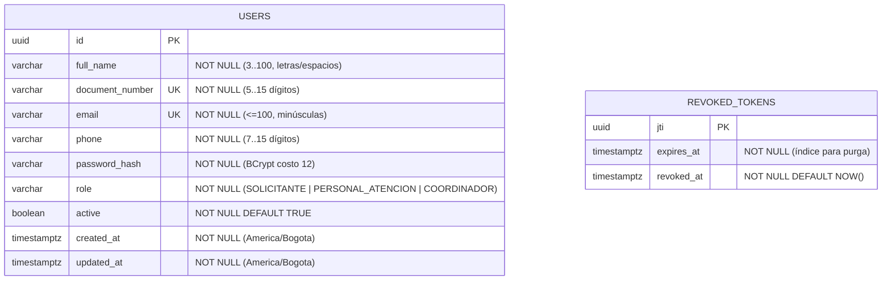
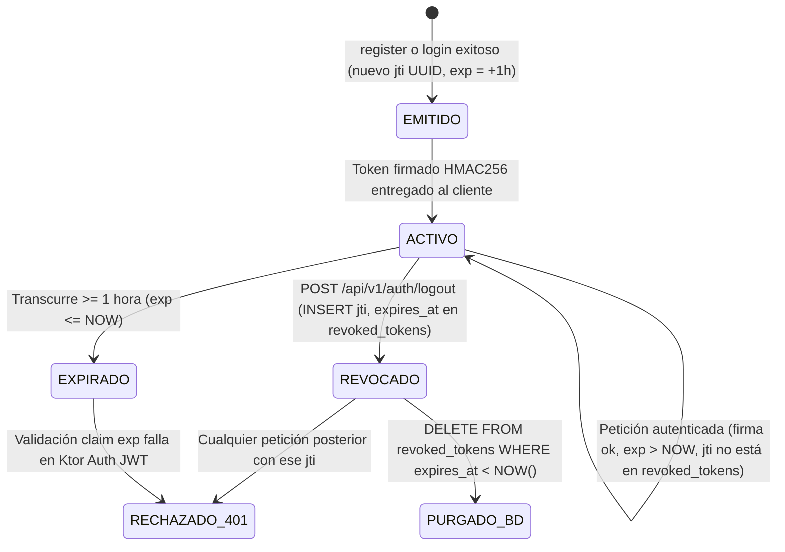

# Modelo de Datos y Entidades: 002-auth-users (Backend)
**Ubicación:** `specs/002-auth-users/data-model.md`  
**Spec Asociada:** `specs/002-auth-users/spec.md`  
**Estado:** Aprobado  

---

## 1. Diagrama Entidad-Relación (Mermaid)

> **Nota sobre migraciones Flyway:**  
> - La tabla `users` ya fue creada en `001-project-setup` mediante `V1__create_users_table.sql` y aquí se amplía su uso mediante repositorios y casos de uso para los tres roles.  
> - En `002-auth-users` se añade la migración **`V2__create_revoked_tokens_table.sql`** para persistir la blacklist de JWT revocados en `logout` y permitir la purga automática de registros expirados (`expires_at < NOW()`).

---

## 2. Entidades de Dominio, Tablas Exposed DSL y Atributos

### Tabla Exposed DSL Existente (Reutilizada): `UsersTable` (`users`)
* **Propósito:** Almacenar de forma unificada a los tres actores (`SOLICITANTE`, `PERSONAL_ATENCION`, `COORDINADOR`) garantizando unicidad estricta de `email` y `document_number`.
* **Columnas clave:** `id` (`UUID` PK), `full_name` (`VARCHAR(100)`), `document_number` (`VARCHAR(15)` UNIQUE), `email` (`VARCHAR(100)` UNIQUE normalizado a minúsculas), `phone` (`VARCHAR(15)`), `password_hash` (`VARCHAR(100)`), `role` (`VARCHAR(30)` CHECK), `active` (`BOOLEAN DEFAULT TRUE`), `created_at` (`TIMESTAMPTZ`), `updated_at` (`TIMESTAMPTZ`).

### Nueva Tabla Exposed DSL: `RevokedTokensTable` (`revoked_tokens`)
* **Propósito:** Blacklist persistente de tokens JWT cerrados explícitamente mediante `POST /api/v1/auth/logout`.
* **Columnas y Restricciones:**
  * `jti`: `UUID` (Clave primaria, corresponde al claim `jti` único de cada JWT).
  * `expires_at`: `TIMESTAMPTZ` (`NOT NULL`, con índice `idx_revoked_tokens_expires_at` para acelerar la purga `DELETE FROM revoked_tokens WHERE expires_at < NOW()`).
  * `revoked_at`: `TIMESTAMPTZ` (`NOT NULL DEFAULT NOW()`).

### Entidades y Modelos Puros de Dominio (`domain/model/`)
*(Libres de dependencias de Ktor y de Exposed según la Constitución)*

1. **`User` (Entidad interna de dominio):**
   * `id: UUID`
   * `fullName: String`
   * `documentNumber: String`
   * `email: String`
   * `phone: String`
   * `passwordHash: String` *(sobreescribe `toString()` ocultando `passwordHash`; jamás sale de la capa de servicio/dominio hacia DTOs o logs)*
   * `role: UserRole` (`SOLICITANTE`, `PERSONAL_ATENCION`, `COORDINADOR`)
   * `active: Boolean`
   * `createdAt: OffsetDateTime` (`America/Bogota`)
   * `updatedAt: OffsetDateTime` (`America/Bogota`)

2. **`UserProfile` (Proyección pública de dominio sin secretos):**
   * `id: UUID`, `fullName: String`, `documentNumber: String`, `email: String`, `phone: String`, `role: UserRole`, `active: Boolean`, `createdAt: OffsetDateTime`.

3. **`StaffSummary` (Proyección liviana para listado de personal interno):**
   * `id: UUID`, `fullName: String`, `email: String`, `role: UserRole`, `createdAt: OffsetDateTime`.

4. **`IssuedToken` y `AuthSession` (Patrón Builder: `AuthSessionBuilder`):**
   * `IssuedToken`: `accessToken: String`, `tokenType: String = "Bearer"`, `jti: UUID`, `issuedAt: OffsetDateTime`, `expiresAt: OffsetDateTime`, `expiresInSeconds: Long = 3600`.
   * `AuthSession`: `token: IssuedToken`, `user: UserProfile`.

5. **`AuthenticatedIdentity` (Identidad resuelta desde un JWT válido):**
   * `userId: UUID`, `email: String`, `role: UserRole`, `jti: UUID`, `expiresAt: OffsetDateTime`.
   * *(La capa `config/security` la envuelve en `JwtUserPrincipal(val identity: AuthenticatedIdentity)` implementando `io.ktor.server.auth.Principal` para no acoplar `domain` con Ktor).*

6. **`StaffPageQuery` (Patrón Builder: `StaffPageQueryBuilder`) y `PagedResult<T>`:**
   * `StaffPageQuery`: `page: Int` (default `1`), `size: Int` (default `20`), `roleFilter: UserRole?` (`null`, `PERSONAL_ATENCION` o `COORDINADOR`).
   * `PagedResult<T>`: `items: List<T>`, `page: Int`, `size: Int`, `totalItems: Long`, `totalPages: Int`.

7. **Actualización en `JwtConfig` (`domain/builder/AppConfigBuilder.kt`):**
   * Ajustar la configuración de expiración JWT a **`expirationSeconds: Long = 3600`** (1 hora) consistente con `spec.md` y `research.md`.

---

## 3. Reglas de Validación e Invariantes del Dominio

1. **Reglas de Campos de Usuario (Tabla 1 de Requisitos):**
   * `fullName`: `trim()` previo; longitud `3..100`; expresión regular `^[\p{L} ]+$` (solo letras Unicode incluyendo tildes/ñ y espacios).
   * `documentNumber`: `trim()` previo; `^[0-9]{5,15}$` (entre 5 y 15 dígitos numéricos).
   * `email`: `trim().lowercase()`; longitud `<= 100`; formato válido de correo electrónico.
   * `phone`: `trim()` previo; `^[0-9]{7,15}$` (entre 7 y 15 dígitos numéricos).
   * `password`: mínimo `8` caracteres, máximo `72` bytes UTF-8 (límite criptográfico de BCrypt para evitar truncamiento silencioso), al menos una letra (`\p{L}`) y al menos un dígito (`[0-9]`).
   * **Acumulación de errores:** `UserValidator` recopila todas las fallas de los campos en `List<ValidationDetail>` y lanza `ValidationException` (`HTTP 400`).

2. **Invariantes de Rol y Registro:**
   * **Auto-registro (`register`):** Asigna obligatoriamente `UserRole.SOLICITANTE` e inicia sesión automáticamente devolviendo un `AuthSession` con JWT nuevo de 1 hora.
   * **Creación de personal (`createStaff`):** Solo ejecutable por `UserRole.COORDINADOR`; únicamente acepta `role` igual a `PERSONAL_ATENCION` o `COORDINADOR` (enviar `SOLICITANTE` u otro valor produce `ValidationException` -> `HTTP 400`).

3. **Unicidad e Integridad (`HTTP 409 Conflict`):**
   * `email` (normalizado a minúsculas) y `documentNumber` son únicos en `users`.
   * Cualquier colisión detectada por consulta previa o violación concurrente `SQLState 23505` en PostgreSQL se traduce a `ConflictException` (`HTTP 409`).

4. **Política de Tokens JWT y Blacklist:**
   * Cada llamada exitosa a `register` o `login` genera un token nuevo con **`jti` único** y expiración exacta `issuedAt + 3600s` (1 hora), sin reutilizar tokens emitidos en logins previos.
   * El usuario con `active == false` no puede autenticarse ni operar (`UnauthorizedException` -> `HTTP 401`).
   * Al invocar `logout`, el `(jti, expiresAt)` vigente se guarda en `revoked_tokens` de forma idempotente y se purgan las filas expiradas (`expires_at < NOW()`).

5. **Invariantes de Paginación de Personal (`StaffPageQuery`):**
   * `page >= 1`; `size` entero entre `1` y `20` (default `20`, RNF-07). Valores fuera de rango o `roleFilter == SOLICITANTE` lanzan `ValidationException` (`HTTP 400`).
   * La consulta excluye siempre usuarios con rol `SOLICITANTE` y ordena de forma determinista por `created_at DESC, id ASC`.

6. **Confidencialidad (RNF-04):**
   * Ninguna entidad, log o DTO serializable expone `password`, `passwordHash` ni `JWT_SECRET`. En `login`, correo inexistente y contraseña errónea producen exactamente el mismo error `UnauthorizedException("Credenciales inválidas.")` (`HTTP 401`).

---

## 4. Ciclo de Vida del Token JWT y Blacklist (State Machine)

