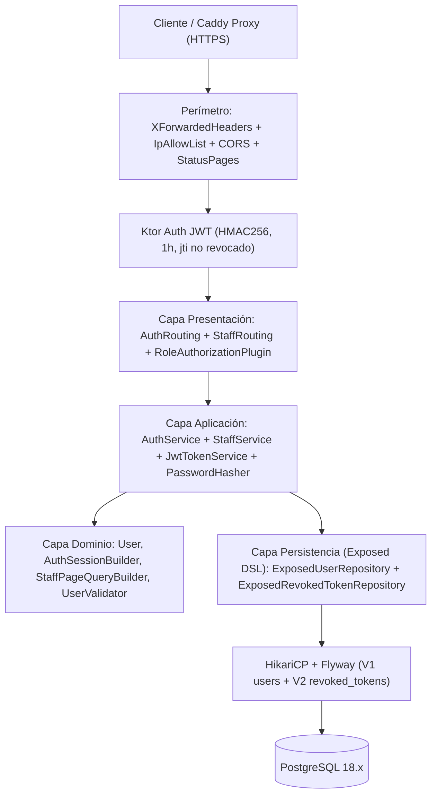

# Plan Técnico de Arquitectura: 002-auth-users (Backend)
**Ubicación:** `specs/002-auth-users/plan.md`  
**Spec Asociada:** `specs/002-auth-users/spec.md`  
**Estado:** Aprobado  

---

## 1. Enfoque Arquitectónico y Diagrama de Solución
> Se extiende la **Layered Architecture** establecida en `001-project-setup` manteniendo flujo estrictamente unidireccional (`routing -> service -> domain` y `service -> repository -> domain`), sin exponer `Exposed` ni `Ktor` dentro de la capa `domain`.
> - **Autenticación JWT (1 hora) y Blacklist:** `Ktor Auth JWT` (`HMAC256`, `exp = iat + 3600s`, `jti` único por emisión) integrado con `ExposedRevokedTokenRepository` (`revoked_tokens`) para invalidación inmediata en `POST /api/v1/auth/logout` y purga automática de registros vencidos (`expires_at < NOW()`).
> - **Autorización RBAC:** Plugin de ruta `RoleAuthorizationPlugin` (`withRole(...)`) en `routing` para distinguir limpiamente `401 Unauthorized` vs `403 Forbidden`, complementado con validación de rol en `service`.
> - **Criptografía y Validación:** Hashing con `at.favre.lib:bcrypt` 0.10.2 (costo 12, salt aleatorio en servidor, verificación temporal uniforme en `login`), validador puro `UserValidator` (Tabla 1 con errores acumulados en `details[]`) y **Patrón Builder** (`AuthSessionBuilder`, `StaffPageQueryBuilder`).



---

## 2. Modificaciones de Archivos y Nuevos Componentes

| Archivo / Módulo | Tipo de Cambio | Propósito |
| :--- | :--- | :--- |
| `gradle/libs.versions.toml` & `build.gradle.kts` | Modificado | Garantizar inclusión de `ktor-server-auth` y `ktor-server-auth-jwt` (sin dependencias fuera de la Constitución). |
| `src/main/resources/db/migration/V2__create_revoked_tokens_table.sql` | Nuevo | Migración Flyway para tabla `revoked_tokens` (`jti` PK, `expires_at`, `revoked_at`) e índice `idx_revoked_tokens_expires_at`. |
| `src/main/kotlin/.../domain/builder/AppConfigBuilder.kt` & `config/EnvConfig.kt` | Modificado | Alinear `JwtConfig` a `expirationSeconds: Long = 3600` (1 hora) y `.env.example` (`JWT_EXPIRATION_SECONDS=3600`). |
| `src/main/kotlin/.../domain/model/` (`User.kt`, `UserProfile.kt`, `StaffSummary.kt`, `IssuedToken.kt`, `AuthSession.kt`, `AuthenticatedIdentity.kt`, `PagedResult.kt`) | Nuevo | Entidades puras de dominio y proyecciones sin secretos (`toString()` enmascarado en `User`). |
| `src/main/kotlin/.../domain/builder/` (`AuthSessionBuilder.kt`, `StaffPageQueryBuilder.kt`) | Nuevo | **Patrón GoF Builder** para construir sesiones JWT+perfil y filtros paginados de personal (`page >= 1`, `size in 1..20`, `role != SOLICITANTE`). |
| `src/main/kotlin/.../domain/validation/UserValidator.kt` | Nuevo | Validador puro de Tabla 1 con normalización (`trim()`, `email.lowercase()`), límite `<= 72` bytes UTF-8 para BCrypt y acumulación de errores en `ValidationException`. |
| `src/main/kotlin/.../domain/repository/` (`UserRepository.kt`, `RevokedTokenRepository.kt`) | Nuevo | Interfaces de persistencia desacopladas en la capa `domain`. |
| `src/main/kotlin/.../domain/security/` (`PasswordHasher.kt`, `TokenProvider.kt`) | Nuevo | Puertos de dominio para hashing/verificación y emisión de tokens JWT. |
| `src/main/kotlin/.../repository/` (`RevokedTokensTable.kt`, `ExposedUserRepository.kt`, `ExposedRevokedTokenRepository.kt`) | Nuevo | Definición Exposed DSL de `revoked_tokens`, CRUD de usuarios, paginación `staff`, captura de `SQLState 23505` -> `ConflictException` y purga `expires_at < NOW()`. |
| `src/main/kotlin/.../service/` (`BcryptPasswordHasher.kt`, `JwtTokenService.kt`, `AuthService.kt`, `StaffService.kt`) | Nuevo | Lógica de registro con auto-login (`SOLICITANTE`), login con emisión siempre fresca (`~250ms` uniforme), `/auth/me`, `/auth/logout` y gestión `/users/staff`. |
| `src/main/kotlin/.../config/security/` (`JwtAuthConfig.kt`, `RoleAuthorizationPlugin.kt`) | Nuevo | Configuración `jwt("auth-jwt")` con chequeo de blacklist en `revoked_tokens`, wrapper `JwtUserPrincipal` y plugin `withRole(...)` (`403 Forbidden`). |
| `src/main/kotlin/.../routing/dto/` (`auth/*`, `users/*`) | Nuevo | DTOs `@Serializable` de entrada/salida (`RegisterRequestDto` sin campo `role`, `LoginRequestDto`, `AuthResponseDto`, `CreateStaffRequestDto`, `UserProfileDto`, `StaffSummaryDto`, `PagedStaffResponseDto`). |
| `src/main/kotlin/.../routing/` (`AuthRouting.kt`, `StaffRouting.kt`) & `Application.kt` | Nuevo / Modificado | Montaje de rutas `/api/v1/auth/*` y `/api/v1/users/staff`, `Json { ignoreUnknownKeys = false }` y cableado en `Application.configureModule(...)`. |
| `src/test/kotlin/.../` (`UserValidatorTest.kt`, `BcryptPasswordHasherTest.kt`, `StaffPageQueryBuilderTest.kt`, `AuthRoutingTest.kt`, `StaffRoutingTest.kt`) | Nuevo | Pruebas unitarias y Ktor Server Tests sobre Testcontainers PostgreSQL 18 cubriendo todos los códigos HTTP (`200`, `201`, `204`, `400`, `401`, `403`, `409`), concurrencia y purga de blacklist, verificando `ktlintCheck` y `koverVerify` ($\ge 90\%$). |

---

## 3. Modelo de Datos y Esquemas (`V2__create_revoked_tokens_table.sql`)
```sql
CREATE TABLE IF NOT EXISTS revoked_tokens (
    jti UUID PRIMARY KEY,
    expires_at TIMESTAMPTZ NOT NULL,
    revoked_at TIMESTAMPTZ NOT NULL DEFAULT NOW()
);

CREATE INDEX IF NOT EXISTS idx_revoked_tokens_expires_at
    ON revoked_tokens (expires_at);
```

---

## 4. Riesgos Técnicos y Mitigación
* **Riesgo 1 — Condición de carrera en registros concurrentes con mismo `email` o `documentNumber`:**
  * *Mitigación:* Combinar validación previa en `AuthService`/`StaffService` con captura explícita de `SQLState 23505` (`unique_violation`) en `ExposedUserRepository`, lanzando `ConflictException` (`HTTP 409`) sin filtrar errores SQL ni producir `500`.
* **Riesgo 2 — Escalamiento de privilegios intentando enviar `role` en `/auth/register`:**
  * *Mitigación:* `RegisterRequestDto` no declara propiedad `role`; con `ignoreUnknownKeys = false` cualquier campo extra devuelve `400 Bad Request` y `AuthService.register` fuerza `UserRole.SOLICITANTE` independientemente de la entrada.
* **Riesgo 3 — Reutilización de token tras `logout` o crecimiento de `revoked_tokens`:**
  * *Mitigación:* `JwtAuthConfig.validate` exige `jti` válido y consulta `!revokedTokenRepository.isRevoked(jti)` por PK antes de aceptar la petición; `logout` inserta `(jti, expiresAt)` con `ON CONFLICT DO NOTHING` y ejecuta `DELETE FROM revoked_tokens WHERE expires_at < NOW()` indexado por `idx_revoked_tokens_expires_at`.
* **Riesgo 4 — Enumeración de correos existentes por tiempo de respuesta en `login`:**
  * *Mitigación:* Cuando el correo no existe, `AuthService.login` ejecuta `passwordHasher.verify(password, dummyBcryptHash)` antes de lanzar `UnauthorizedException("Credenciales inválidas.")`, igualando la latencia de BCrypt costo 12.
* **Riesgo 5 — Desviación de estilo (`ktlint`) o caída de cobertura Kover (`< 90%`):**
  * *Mitigación:* Prohibir importaciones `*`, ejecutar `ktlintCheck` y `koverVerify` en la suite completa de Testcontainers cubriendo ramas negativas (`400`, `401`, `403`, `409`, concurrencia y expiración/purga).
