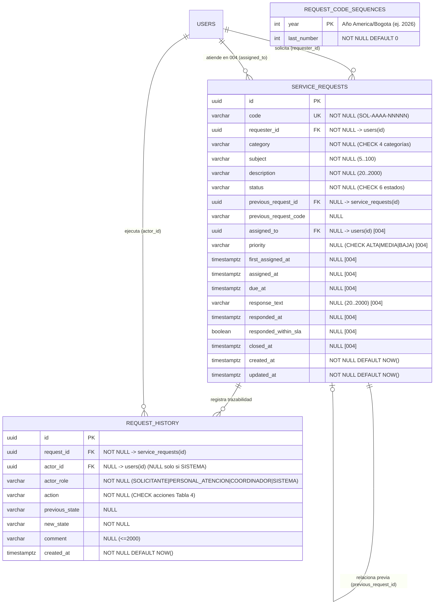
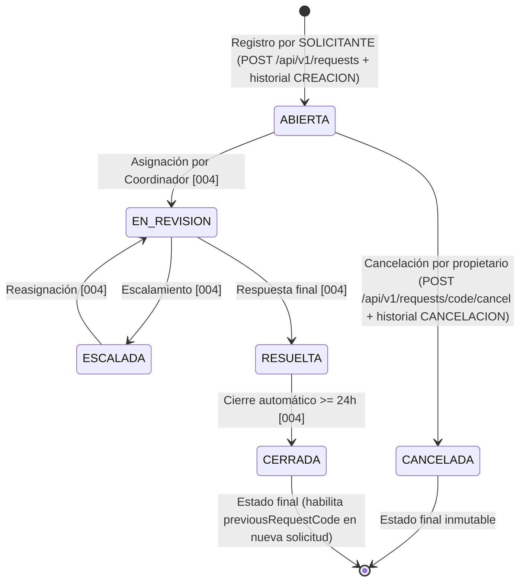

# Modelo de Datos y Entidades: 003-service-requests (Backend)
**Ubicación:** `specs/003-service-requests/data-model.md`  
**Spec Asociada:** `specs/003-service-requests/spec.md`  
**Estado:** Aprobado  

---

## 1. Diagrama Entidad-Relación (Mermaid)

> **Nota sobre migración `V3__create_service_requests_tables.sql`:**  
> Incluye las columnas futuras de asignación, SLA, respuesta y cierre como `NULL`ables con sus constraints `CHECK` y claves foráneas desde el inicio para garantizar pruebas reales en `003` (como respuestas/cierres previos y vinculación `previousRequestCode` en estado `RESUELTA`/`CERRADA`) y evitar alteraciones estructurales en `004-attention-lifecycle`.

---

## 2. Entidades de Dominio, Tablas Exposed DSL y Patrones GoF

### Tablas Exposed 1.6.x DSL (`repository/`)
1. **`RequestCodeSequencesTable` (`request_code_sequences`):** `year` (`INT` PK), `last_number` (`INT`). Soporta incremento atómico anual con `INSERT ... ON CONFLICT (year) DO UPDATE ... RETURNING last_number`.
2. **`ServiceRequestsTable` (`service_requests`):** PK `id` (`UUID`), `code` (`VARCHAR(20)` UNIQUE), FKs `requester_id`, `previous_request_id`, `assigned_to`, restricciones `CHECK` sobre `category`, `status` y `priority`, e índices `(requester_id, created_at DESC, id ASC)` y `(requester_id, status, created_at DESC, id ASC)`.
3. **`RequestHistoryTable` (`request_history`):** Tabla **estrictamente append-only** (sin operaciones `UPDATE` ni `DELETE` en código), PK `id` (`UUID`), FK `request_id`, FK nullable `actor_id`, `actor_role`, `action`, `previous_state`, `new_state`, `comment` (`VARCHAR(2000)`), `created_at` (`TIMESTAMPTZ`) e índice `(request_id, created_at ASC, id ASC)`.

### Entidades y Enums Puros de Dominio (`domain/model/`)
* **`RequestCategory` (`enum`):** `TRAMITE`, `ORIENTACION`, `ATENCION_ADMINISTRATIVA`, `REQUERIMIENTO_SERVICIO`.
* **`RequestStatus` (`enum`):** `ABIERTA`, `EN_REVISION`, `ESCALADA`, `RESUELTA`, `CERRADA`, `CANCELADA`.
* **`RequestPriority` (`enum`):** `ALTA`, `MEDIA`, `BAJA` *(utilizado al leer solicitudes ya asignadas/resueltas y extendido en `004`)*.
* **`HistoryAction` (`enum`):** `CREACION`, `CANCELACION`, `ASIGNACION`, `INTERVENCION`, `ESCALAMIENTO`, `REASIGNACION`, `RESPUESTA`, `CIERRE_AUTOMATICO`.
* **`HistoryActorRole` (`enum`):** `SOLICITANTE`, `PERSONAL_ATENCION`, `COORDINADOR`, `SISTEMA`.
* **`ServiceRequest`:** Modelo completo de solicitud incluyendo `id`, `code`, `requesterId`, `category`, `subject`, `description`, `status`, `previousRequestId`, `previousRequestCode`, `responseText`, `respondedAt`, `closedAt`, `createdAt`, `updatedAt`.
* **`ApplicantVisibleHistoryEntry`:** `id`, `action`, `previousState`, `newState`, `occurredAt`, `comment: String?` *(nunca incluye filas `INTERVENCION` y siempre anula comentarios internos de `ESCALAMIENTO` / `REASIGNACION` según RF-03)*.
* **`ServiceRequestSummary` y `ServiceRequestDetail`:** Proyecciones limpias para listado paginado y vista de detalle con `visibleHistory`.

### Patrones GoF Obligatorios en `003-service-requests`
1. **Patrón State (`domain/state/ServiceRequestState.kt`):**
   * Jerarquía sellada: `AbiertaState`, `EnRevisionState`, `EscaladaState`, `ResueltaState`, `CerradaState`, `CanceladaState`.
   * Contrato `fun cancel(request: ServiceRequest, actorId: UUID, actorRole: UserRole): StateTransition`:
     - Si `actorRole != SOLICITANTE || request.requesterId != actorId` → lanza `ForbiddenException` (`403`).
     - Solo `AbiertaState` transiciona a `CANCELADA`; los demás 5 estados lanzan `ConflictException("Solo es posible cancelar una solicitud que se encuentre en estado Abierta.")` (`409`).
2. **Patrón Builder (`domain/builder/`):**
   * **`ServiceRequestBuilder`:** Construye la entidad `ServiceRequest` garantizando `status = ABIERTA`, código `SOL-AAAA-NNNNN`, timestamps en `America/Bogota` y `previousRequestId`/`previousRequestCode` validados.
   * **`MyRequestsQueryBuilder`:** Construye de forma segura los criterios de paginación del solicitante (`requesterId`, `page >= 1`, `size in 1..20`, `status: RequestStatus?`).

---

## 3. Reglas de Validación e Invariantes del Dominio

1. **Reglas de Creación (Tabla 2 de Requisitos — `RequestValidator`):**
   * `category`: obligatorio; debe coincidir exactamente con uno de los 4 valores de `RequestCategory`.
   * `subject`: `trim()` previo; longitud obligatoria entre `5` y `100` caracteres.
   * `description`: `trim()` previo; longitud obligatoria entre `20` y `2000` caracteres.
   * `previousRequestCode` (opcional): si se envía no en blanco, debe cumplir `^SOL-\d{4}-\d{5,}$`, existir en `service_requests`, tener `requester_id == actorId` y encontrarse en estado `RESUELTA` o `CERRADA`. Cualquier fallo retorna `ValidationException` (`HTTP 400`, `field = "previousRequestCode"`). La solicitud anterior nunca cambia de estado.
   * Campos prohibidos en entrada: `code`, `status`, `createdAt`, `updatedAt`, `requesterId` son asignados exclusivamente por el servidor (`ignoreUnknownKeys = false` → `400`).

2. **Reglas de Consulta y Privacidad (HU-02 / RF-03 / RNF-03 / RNF-04):**
   * `GET /api/v1/requests/my`: exclusivo de `SOLICITANTE` (`403` para otros roles); devuelve únicamente filas donde `requester_id == actorId`, paginadas con `page >= 1` y `size in 1..20` (default `20`), ordenadas `ORDER BY created_at DESC, id ASC`.
   * `GET /api/v1/requests/{code}`: si `{code}` no existe → `404 Not Found` (`"Solicitud no encontrada."`); si existe pero pertenece a otro solicitante (o actor distinto de `SOLICITANTE` propietario en `003`) → `403 Forbidden`; jamás expone `INTERVENCION` ni motivos de `ESCALAMIENTO` / `REASIGNACION`.

3. **Reglas de Cancelación y Transacción Única (Tabla 4 / RNF-05):**
   * `reason` opcional en cancelación (`trim()`, máximo `500` caracteres si se envía).
   * Toda creación y cancelación actualiza/inserta `service_requests` y agrega su entrada inmutable en `request_history` dentro de **una única transacción SQL**.
   * En cancelación, el `UPDATE` condicional `WHERE id = ? AND status = 'ABIERTA'` protege contra asignaciones concurrentes; si actualiza `0` filas, revierte la transacción y lanza `ConflictException` (`409`).

---

## 4. Máquina de Estados: Ciclo de Vida (Foco `003` y Proyección Tabla 4)

