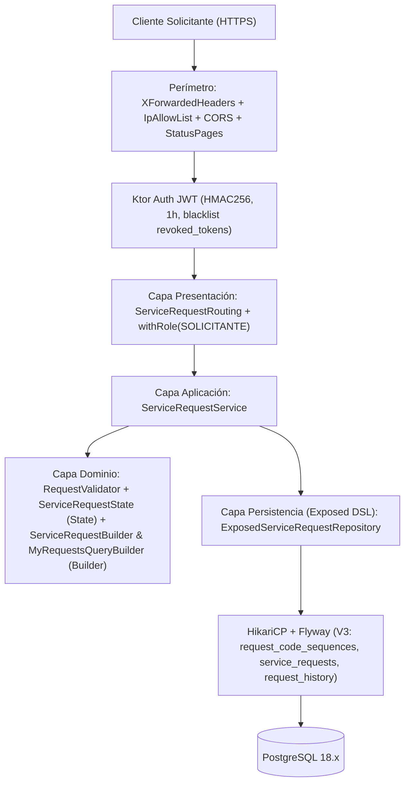

# Plan Técnico de Arquitectura: 003-service-requests (Backend)
**Ubicación:** `specs/003-service-requests/plan.md`  
**Spec Asociada:** `specs/003-service-requests/spec.md`  
**Estado:** Aprobado  

---

## 1. Enfoque Arquitectónico y Diagrama de Solución
> Se amplía la **Layered Architecture** del backend (`routing -> service -> domain` y `service -> repository -> domain`) manteniendo la capa `domain` completamente libre de dependencias de `Ktor` y `Exposed`, y reutilizando el pipeline de autenticación JWT de `1h` con blacklist en `revoked_tokens` junto con `RoleAuthorizationPlugin` (`withRole(UserRole.SOLICITANTE)`).
> - **Generación Atómica de Radicados (`SOL-AAAA-NNNNN`):** Tabla `request_code_sequences` consultada y actualizada atómicamente dentro de la misma transacción JDBC que inserta en `service_requests` y `request_history`, usando año vigente en `America/Bogota` (`INSERT ... ON CONFLICT (year) DO UPDATE SET last_number = request_code_sequences.last_number + 1 RETURNING last_number`) y padding `>= 5` dígitos.
> - **Máquina de Estados y Constructores (GoF):** **Patrón State** (`ServiceRequestState` con `AbiertaState`, `EnRevisionState`, `EscaladaState`, `ResueltaState`, `CerradaState`, `CanceladaState`) para gobernar la cancelación (`ABIERTA -> CANCELADA`, `403` si no es propietario `SOLICITANTE`, `409` en cualquier otro estado), respaldado por `UPDATE ... WHERE id = ? AND status = 'ABIERTA'` en repositorio; y **Patrón Builder** (`ServiceRequestBuilder`, `MyRequestsQueryBuilder`) para instanciación validada y consultas paginadas.
> - **Privacidad de Historial (`RF-03`):** El repositorio proyecta `ApplicantVisibleHistoryEntry` filtrando `action != 'INTERVENCION'` y anulando `comment` (`null`) en eventos `ESCALAMIENTO` y `REASIGNACION`, evitando filtrar notas internas de personal hacia `SOLICITANTE`.



---

## 2. Modificaciones de Archivos y Nuevos Componentes

| Archivo / Módulo | Tipo de Cambio | Propósito |
| :--- | :--- | :--- |
| `src/main/resources/db/migration/V3__create_service_requests_tables.sql` | Nuevo | Migración Flyway con tablas `request_code_sequences`, `service_requests` (incluyendo columnas `NULL`ables de `004` con sus constraints `CHECK` y FKs) y `request_history` append-only más índices compuestos para consulta paginada e historial. |
| `src/main/kotlin/.../domain/model/` (`RequestCategory.kt`, `RequestStatus.kt`, `RequestPriority.kt`, `HistoryAction.kt`, `HistoryActorRole.kt`, `ServiceRequest.kt`, `ServiceRequestSummary.kt`, `ApplicantVisibleHistoryEntry.kt`, `ServiceRequestDetail.kt`) | Nuevo | Enumeraciones y modelos puros de dominio sin dependencias de infraestructura ni serialización HTTP/SQL. |
| `src/main/kotlin/.../domain/state/ServiceRequestState.kt` | Nuevo | **Patrón GoF State** (`AbiertaState` .. `CanceladaState`) que encapsula las invariantes de transición para `cancel(...)` (`403 Forbidden` / `409 Conflict`). |
| `src/main/kotlin/.../domain/builder/` (`ServiceRequestBuilder.kt`, `MyRequestsQueryBuilder.kt`) | Nuevo | **Patrón GoF Builder** para construir nuevas solicitudes (`ABIERTA`, código `SOL-AAAA-NNNNN`, vínculo previo) y criterios de consulta (`requesterId`, `page >= 1`, `size in 1..20`, `status?`). |
| `src/main/kotlin/.../domain/validation/RequestValidator.kt` | Nuevo | Validador puro de Tabla 2 (`category`, `subject` `5..100`, `description` `20..2000`, formato opcional `^SOL-\d{4}-\d{5,}$`, `reason <= 500`) con `trim()` y acumulación de errores en `ValidationException`. |
| `src/main/kotlin/.../domain/repository/ServiceRequestRepository.kt` | Nuevo | Puerto de persistencia desacoplado (`createWithHistory`, `findByCode`, `findPagedByRequester`, `cancelWithHistory`), sin métodos de edición de datos ni borrado (`RNF-05`). |
| `src/main/kotlin/.../repository/` (`RequestCodeSequencesTable.kt`, `ServiceRequestsTable.kt`, `RequestHistoryTable.kt`, `ExposedServiceRequestRepository.kt`) | Nuevo | Tablas Exposed 1.6.x DSL y repositorio transaccional con secuencia atómica `ON CONFLICT DO UPDATE RETURNING`, `UPDATE ... WHERE id = ? AND status = 'ABIERTA'`, filtrado de historial visible al solicitante y paginación determinista. |
| `src/main/kotlin/.../service/ServiceRequestService.kt` | Nuevo | Orquestación de creación (validando propiedad y estado `RESUELTA`/`CERRADA` de `previousRequestCode` -> `400` sin mutar la solicitud previa), listado propio, detalle (`404` `"Solicitud no encontrada."` / `403`) y cancelación. |
| `src/main/kotlin/.../routing/dto/requests/` (`CreateServiceRequestDto.kt`, `CancelServiceRequestDto.kt`, `RequestHistoryItemDto.kt`, `ServiceRequestDetailDto.kt`, `ServiceRequestSummaryDto.kt`, `PagedServiceRequestsResponseDto.kt`) | Nuevo | DTOs `@Serializable` estrictos (sin campos server-owned en creación; `ignoreUnknownKeys = false`). |
| `src/main/kotlin/.../routing/ServiceRequestRouting.kt` & `Application.kt` | Nuevo / Modificado | Montaje de rutas `/api/v1/requests` (`POST`, `GET`, `GET /{code}`, `POST /{code}/cancel`) bajo `jwt("auth-jwt")` + `withRole(UserRole.SOLICITANTE)` e inyección de dependencias en `Application.kt`. |
| `src/test/kotlin/.../` (`RequestValidatorTest.kt`, `ServiceRequestStateTest.kt`, `ServiceRequestBuilderTest.kt`, `ServiceRequestRoutingTest.kt`) | Nuevo | Pruebas unitarias de dominio y pruebas de integración Ktor + Testcontainers PostgreSQL 18 (concurrencia de consecutivos, cancelación concurrente, privacidad de historial, `1000` solicitudes `< 2s`, códigos `200`/`201`/`400`/`401`/`403`/`404`/`409`), verificando `ktlintCheck` y `koverVerify` ($\ge 90\%$). |

---

## 3. Modelo de Datos y Esquemas (`V3__create_service_requests_tables.sql`)
```sql
CREATE TABLE IF NOT EXISTS request_code_sequences (
    year INT PRIMARY KEY,
    last_number INT NOT NULL DEFAULT 0 CHECK (last_number >= 0)
);

CREATE TABLE IF NOT EXISTS service_requests (
    id UUID PRIMARY KEY,
    code VARCHAR(20) NOT NULL UNIQUE,
    requester_id UUID NOT NULL REFERENCES users(id) ON DELETE RESTRICT,
    category VARCHAR(40) NOT NULL CHECK (
        category IN ('TRAMITE', 'ORIENTACION', 'ATENCION_ADMINISTRATIVA', 'REQUERIMIENTO_SERVICIO')
    ),
    subject VARCHAR(100) NOT NULL,
    description VARCHAR(2000) NOT NULL,
    status VARCHAR(20) NOT NULL CHECK (
        status IN ('ABIERTA', 'EN_REVISION', 'ESCALADA', 'RESUELTA', 'CERRADA', 'CANCELADA')
    ),
    previous_request_id UUID NULL REFERENCES service_requests(id) ON DELETE RESTRICT,
    previous_request_code VARCHAR(20) NULL,
    assigned_to UUID NULL REFERENCES users(id) ON DELETE RESTRICT,
    priority VARCHAR(10) NULL CHECK (priority IS NULL OR priority IN ('ALTA', 'MEDIA', 'BAJA')),
    first_assigned_at TIMESTAMPTZ NULL,
    assigned_at TIMESTAMPTZ NULL,
    due_at TIMESTAMPTZ NULL,
    response_text VARCHAR(2000) NULL,
    responded_at TIMESTAMPTZ NULL,
    responded_within_sla BOOLEAN NULL,
    closed_at TIMESTAMPTZ NULL,
    created_at TIMESTAMPTZ NOT NULL DEFAULT NOW(),
    updated_at TIMESTAMPTZ NOT NULL DEFAULT NOW()
);

CREATE INDEX IF NOT EXISTS idx_sr_requester_created
    ON service_requests (requester_id, created_at DESC, id ASC);

CREATE INDEX IF NOT EXISTS idx_sr_requester_status_created
    ON service_requests (requester_id, status, created_at DESC, id ASC);

CREATE INDEX IF NOT EXISTS idx_sr_status_created
    ON service_requests (status, created_at ASC, id ASC);

CREATE INDEX IF NOT EXISTS idx_sr_assigned_due
    ON service_requests (assigned_to, status, due_at);

CREATE TABLE IF NOT EXISTS request_history (
    id UUID PRIMARY KEY,
    request_id UUID NOT NULL REFERENCES service_requests(id) ON DELETE RESTRICT,
    actor_id UUID NULL REFERENCES users(id) ON DELETE RESTRICT,
    actor_role VARCHAR(30) NOT NULL CHECK (
        actor_role IN ('SOLICITANTE', 'PERSONAL_ATENCION', 'COORDINADOR', 'SISTEMA')
    ),
    action VARCHAR(30) NOT NULL CHECK (
        action IN (
            'CREACION', 'CANCELACION', 'ASIGNACION', 'INTERVENCION',
            'ESCALAMIENTO', 'REASIGNACION', 'RESPUESTA', 'CIERRE_AUTOMATICO'
        )
    ),
    previous_state VARCHAR(20) NULL,
    new_state VARCHAR(20) NOT NULL CHECK (
        new_state IN ('ABIERTA', 'EN_REVISION', 'ESCALADA', 'RESUELTA', 'CERRADA', 'CANCELADA')
    ),
    comment VARCHAR(2000) NULL,
    created_at TIMESTAMPTZ NOT NULL DEFAULT NOW()
);

CREATE INDEX IF NOT EXISTS idx_rh_request_created
    ON request_history (request_id, created_at ASC, id ASC);
```

---

## 4. Riesgos Técnicos y Mitigación
* **Riesgo 1 — Duplicación o huecos bajo concurrencia al generar radicados `SOL-AAAA-NNNNN`:**
  * *Mitigación:* Ejecutar el incremento en `request_code_sequences` (`ON CONFLICT DO UPDATE ... RETURNING`) y la inserción de `service_requests` + `request_history` en la misma transacción SQL; validar concurrencia con peticiones simultáneas en `ServiceRequestRoutingTest` sobre PostgreSQL real.
* **Riesgo 2 — Condición de carrera en cancelación simultánea (`cancel` concurrente con atención o doble clic):**
  * *Mitigación:* Validar primero en dominio mediante `ServiceRequestState` y ejecutar actualización condicional en PostgreSQL (`WHERE id = ? AND status = 'ABIERTA'`). Si `updatedRows == 0`, abortar transacción sin insertar historial y responder `HTTP 409 Conflict`.
* **Riesgo 3 — Filtración de notas internas al solicitante en `GET /api/v1/requests/{code}`:**
  * *Mitigación:* Aplicar el filtro directamente en `ExposedServiceRequestRepository` / proyección `ApplicantVisibleHistoryEntry` (`action != INTERVENCION`, `comment = null` para `ESCALAMIENTO` y `REASIGNACION`) y verificar explícitamente con registros sembrados de `INTERVENCION` y `ESCALAMIENTO` en Testcontainers.
* **Riesgo 4 — Degradación de rendimiento al paginar 1000+ solicitudes (`RNF-07 < 2s`):**
  * *Mitigación:* Índices compuestos dedicados `(requester_id, created_at DESC, id ASC)` y `(requester_id, status, created_at DESC, id ASC)`, orden determinista con desempate `id ASC`, límite estricto `size <= 20` y prueba de carga con `1000` filas en Testcontainers.
* **Riesgo 5 — Desviación de estilo (`ktlint`) o caída de cobertura Kover (`< 90%`):**
  * *Mitigación:* Prohibir importaciones `*`, cubrir todas las ramas de `RequestValidator`, los 6 estados de `ServiceRequestState`, `ServiceRequestBuilder`, `MyRequestsQueryBuilder` y los casos negativos HTTP (`400`, `401`, `403`, `404`, `409`), ejecutando `ktlintCheck` y `koverVerify`.
