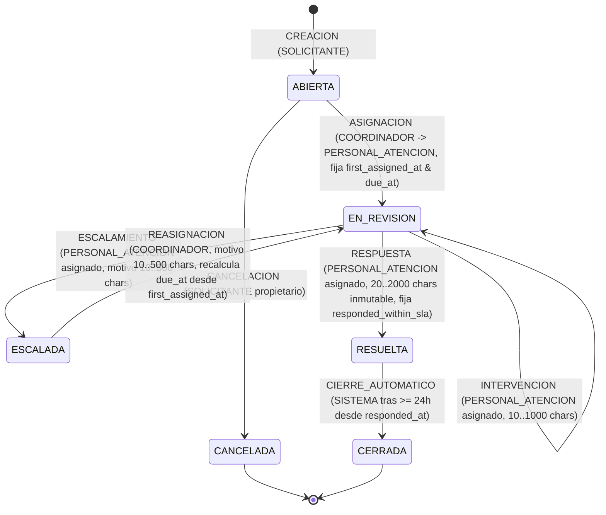

# Modelo de Datos y Entidades: 004-attention-lifecycle (Backend)
**Ubicación en Repositorio:** `backend/specs/004-attention-lifecycle/data-model.md`  
**Spec Asociada:** `backend/specs/004-attention-lifecycle/spec.md`  
**Estado:** Aprobado  

---

## 1. Diagrama de Estados Completo (`ServiceRequestState`) y Migración `V4`



> **Continuidad con `V3` y Migración Incremental `V4__add_autoclose_partial_index.sql`:**  
> Todas las columnas de negocio (`assigned_to`, `priority`, `first_assigned_at`, `assigned_at`, `due_at`, `response_text`, `responded_at`, `responded_within_sla`, `closed_at`) e índices base (`idx_sr_status_created`, `idx_sr_assigned_due`) ya fueron creados en `V3`.  
> En `004` solo se añade el índice parcial dedicado para acelerar el barrido periódico de cierre automático sin escaneo completo de la tabla:
> ```sql
> CREATE INDEX IF NOT EXISTS idx_sr_autoclose
>     ON service_requests (responded_at ASC, id ASC)
>     WHERE status = 'RESUELTA';
> ```

---

## 2. Entidades, Puertos de Dominio y Patrones GoF

### Puertos Temporales y Políticos (`domain/time/` & `domain/model/`)
* **`TimeProvider` (`interface`):** `fun now(): OffsetDateTime` (implementación de producción `BogotaTimeProvider` en zona `America/Bogota`, `-05:00`).
* **`RequestPriority` (`enum` extendido de `003`):**
  * `ALTA` → `slaHours = 24L`
  * `MEDIA` → `slaHours = 72L`
  * `BAJA` → `slaHours = 120L`
  * Helper de dominio: `fun computeDueAt(firstAssignedAt: OffsetDateTime): OffsetDateTime = firstAssignedAt.plusHours(slaHours)`.
* **`ServiceRequest` (extensión de modelo de `003`):**
  * Incluye `assignedTo: UUID?`, `priority: RequestPriority?`, `firstAssignedAt: OffsetDateTime?`, `assignedAt: OffsetDateTime?`, `dueAt: OffsetDateTime?`, `responseText: String?`, `respondedAt: OffsetDateTime?`, `respondedWithinSla: Boolean?`, `closedAt: OffsetDateTime?`.
  * Propiedad derivada: `fun isOverdue(now: OffsetDateTime): Boolean = (status == RequestStatus.EN_REVISION || status == RequestStatus.ESCALADA) && dueAt != null && now.isAfter(dueAt)`.
* **`AttentionRequestSummary`:**
  * `id: UUID`, `code: String`, `subject: String`, `category: RequestCategory`, `status: RequestStatus`, `priority: RequestPriority?`, `requesterId: UUID`, `requesterName: String`, `assignedToId: UUID?`, `assignedToName: String?`, `firstAssignedAt: OffsetDateTime?`, `dueAt: OffsetDateTime?`, `isOverdue: Boolean`, `createdAt: OffsetDateTime`.
* **`InternalHistoryEntry`:**
  * `id: UUID`, `action: HistoryAction`, `previousState: RequestStatus?`, `newState: RequestStatus`, `actorId: UUID?`, `actorName: String` *(`"Sistema"` cuando `actorRole == SISTEMA`)*, `actorRole: HistoryActorRole`, `comment: String?`, `occurredAt: OffsetDateTime` *(incluye `INTERVENCION` y motivos de `ESCALAMIENTO` / `REASIGNACION`)*.
* **`AttentionRequestDetail`:**
  * Todos los campos de `ServiceRequest` + `requesterName`, `assignedToName: String?`, `isOverdue: Boolean`, `history: List<InternalHistoryEntry>`.

### Patrones GoF (`domain/state/` y `domain/builder/`)
1. **Patrón State Completo (`domain/state/ServiceRequestState.kt`):**
   * Jerarquía sellada sobre los 6 estados: `AbiertaState`, `EnRevisionState`, `EscaladaState`, `ResueltaState`, `CerradaState`, `CanceladaState`.
   * Contratos completos de transición (retornan `AttentionTransition` con valores exactos para actualizar `service_requests` + la entrada inmutable para `request_history`, o lanzan `ForbiddenException` `403` / `ConflictException` `409`):
     - `assign(request, coordinatorId, coordinatorRole, assigneeId, priority, now)` *(solo `AbiertaState`, `COORDINADOR`)*.
     - `addIntervention(request, actorId, actorRole, comment, now)` *(solo `EnRevisionState`, `PERSONAL_ATENCION` asignado)*.
     - `escalate(request, actorId, actorRole, reason, now)` *(solo `EnRevisionState`, `PERSONAL_ATENCION` asignado)*.
     - `reassign(request, coordinatorId, coordinatorRole, assigneeId, reason, newPriority?, now)` *(solo `EscaladaState`, `COORDINADOR`, preserva `firstAssignedAt` y recalcula `dueAt = firstAssignedAt + effectivePriority.slaHours`)*.
     - `respond(request, actorId, actorRole, responseText, now)` *(solo `EnRevisionState`, `PERSONAL_ATENCION` asignado, calcula `respondedWithinSla = !now.isAfter(dueAt)`)*.
     - `autoClose(request, now)` *(solo `ResueltaState`, cuando `!respondedAt.plusHours(24).isAfter(now)`, actor `SISTEMA`, `comment = "Cierre automático"`)*.
2. **Patrón Builder (`domain/builder/AttentionQueryBuilder.kt`):**
   * Construye consultas validadas para bandeja de Coordinación (`allowedStatuses = {ABIERTA, ESCALADA}`, `page >= 1`, `size in 1..20`, orden `CREATED_AT_ASC`) y bandeja de Personal (`assignedTo = actorId`, `status?`, orden `DUE_AT_ASC_NULLS_LAST` o `CREATED_AT_ASC`).

### Puerto de Persistencia (`domain/repository/AttentionRepository.kt`)
* `findPendingForCoordination(query: AttentionPageQuery, now: OffsetDateTime): PagedResult<AttentionRequestSummary>`
* `findAssignedToAgent(query: AttentionPageQuery, now: OffsetDateTime): PagedResult<AttentionRequestSummary>`
* `findInternalDetailByCode(code: String, now: OffsetDateTime): AttentionRequestDetail?`
* `applyTransitionWithHistory(expectedCurrentStatus: RequestStatus, transition: AttentionTransition): ServiceRequest?` *(ejecuta `UPDATE ... WHERE id = ? AND status = expectedCurrentStatus` + `INSERT INTO request_history` en la misma transacción; retorna `null` si `updatedRows == 0` para disparar `ConflictException`)*.
* `autoCloseEligibleRequests(cutoff: OffsetDateTime, now: OffsetDateTime, batchSize: Int = 100): Int` *(transaccional atómico con `FOR UPDATE SKIP LOCKED`)*.

---

## 3. Reglas de Validación e Invariantes (`AttentionValidator` + SLA)
1. **Reglas de Entrada (`AttentionValidator` — errores acumulados en `ValidationException` `400`):**
   * **Asignación (`assign`):** `assigneeId` UUID válido; `priority` obligatorio (`ALTA` | `MEDIA` | `BAJA`). El servicio verifica además que `assigneeId` exista en `users` con `role == PERSONAL_ATENCION` (de lo contrario `400`).
   * **Reasignación (`reassign`):** `assigneeId` UUID válido (`PERSONAL_ATENCION`); `reason` `trim()` entre **`10` y `500`** caracteres; `priority` opcional (`ALTA` | `MEDIA` | `BAJA`; si es `null` conserva la prioridad previa).
   * **Intervención (`addIntervention`):** `comment` `trim()` entre **`10` y `1000`** caracteres (Tabla 5 / HU-04).
   * **Escalamiento (`escalate`):** `reason` `trim()` entre **`10` y `500`** caracteres (HU-04).
   * **Respuesta final (`respond`):** `responseText` `trim()` entre **`20` y `2000`** caracteres (Tabla 5 / HU-05).
2. **Invariantes de Propiedad, Estado e Inmutabilidad:**
   * Solo `assigned_to == actorId` (`PERSONAL_ATENCION`) puede intervenir, escalar o responder (`403` para cualquier otro usuario, incluido `COORDINADOR`).
   * `first_assigned_at`, `response_text`, `responded_at`, `responded_within_sla` y todas las filas de `request_history` son estrictamente inmutables una vez escritos (`RNF-05`).
   * `isOverdue == true` nunca bloquea transiciones ni consultas (HU-04.5).
