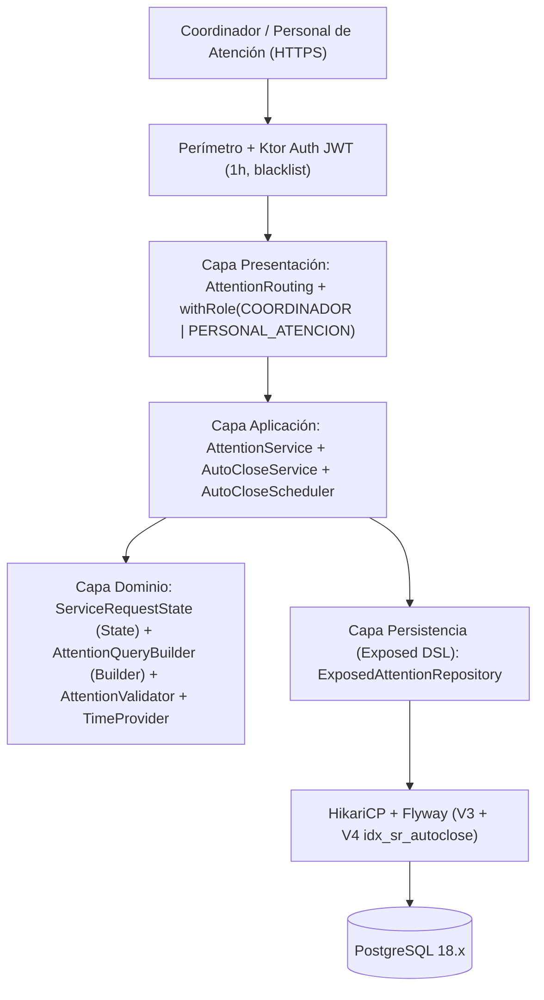

# Plan Técnico de Arquitectura: 004-attention-lifecycle (Backend)
**Ubicación en Repositorio:** `backend/specs/004-attention-lifecycle/plan.md`  
**Spec Asociada:** `backend/specs/004-attention-lifecycle/spec.md`  
**Estado:** Aprobado  

---

## 1. Enfoque Arquitectónico y Diagrama de Solución
> Se extiende la **Layered Architecture** del Backend (`routing -> service -> domain` y `service -> repository -> domain`) manteniendo la capa `domain` aislada de Ktor y Exposed, completando el **Patrón GoF State** (`ServiceRequestState`) y aplicando **Patrón GoF Builder** (`AttentionQueryBuilder`) junto con un reloj inyectable (`TimeProvider`) en zona `America/Bogota`.
> - **Gestión de Atención y SLA:** `AttentionService` valida entradas mediante `AttentionValidator`, verifica rol/propiedad del agente asignado y delega las transiciones en `ServiceRequestState` (`assign`, `addIntervention`, `escalate`, `reassign`, `respond`), asegurando que `dueAt` (`ALTA=24h`, `MEDIA=72h`, `BAJA=120h`) se ancle siempre a `firstAssignedAt` (incluso en reasignación) y guardando cada cambio en transacción única (`UPDATE ... WHERE id = ? AND status = ?` + `INSERT INTO request_history`).
> - **Cierre Automático a las 24h (`SISTEMA`):** `AutoCloseService` selecciona y cierra atómicamente en lotes (`FOR UPDATE SKIP LOCKED`) las solicitudes `RESUELTA` con `responded_at <= now - 24h`, respaldado por el índice parcial `V4__add_autoclose_partial_index.sql` y ejecutado periódicamente mediante `AutoCloseScheduler` en corutinas nativas de Ktor (`ApplicationStarted`/`ApplicationStopping`), sin librerías externas de scheduling.



---

## 2. Modificaciones de Archivos y Nuevos Componentes

| Archivo / Módulo | Tipo de Cambio | Propósito |
| :--- | :--- | :--- |
| `src/main/resources/db/migration/V4__add_autoclose_partial_index.sql` | Nuevo | Índice parcial `idx_sr_autoclose ON service_requests (responded_at ASC, id ASC) WHERE status = 'RESUELTA'` para barrido rápido de cierre automático. |
| `.env.example` & `config/EnvConfig.kt` / `domain/builder/AppConfigBuilder.kt` | Modificado | Agregar parámetro opcional `AUTO_CLOSE_INTERVAL_SECONDS` (default `60`) para el intervalo del scheduler interno. |
| `src/main/kotlin/.../domain/time/` (`TimeProvider.kt`, `BogotaTimeProvider.kt`) | Nuevo | Puerto de reloj inyectable en `America/Bogota` (`-05:00`) para cálculos deterministas de SLA, `isOverdue` y cierre automático 24h. |
| `src/main/kotlin/.../domain/model/` (`RequestPriority.kt`, `ServiceRequest.kt`, `AttentionModels.kt`) | Modificado / Nuevo | Enriquecer `RequestPriority` con `slaHours` (`24`/`72`/`120`) y `computeDueAt`, ampliar `ServiceRequest` (`isOverdue`), y crear `AttentionRequestSummary`, `InternalHistoryEntry`, `AttentionRequestDetail` y `AttentionTransition`. |
| `src/main/kotlin/.../domain/state/ServiceRequestState.kt` | Modificado | Completar los 6 estados con `assign`, `addIntervention`, `escalate`, `reassign`, `respond` y `autoClose` (`403 Forbidden` / `409 Conflict`). |
| `src/main/kotlin/.../domain/builder/AttentionQueryBuilder.kt` | Nuevo | **Patrón GoF Builder** para construir criterios validados de bandeja de Coordinación (`ABIERTA`/`ESCALADA`, `created_at ASC`) y Personal (`assigned_to`, `size in 1..20`). |
| `src/main/kotlin/.../domain/validation/AttentionValidator.kt` | Nuevo | Validador puro para `assign`, `reassign` (`10..500`), `addIntervention` (`10..1000`), `escalate` (`10..500`) y `respond` (`20..2000`) con `trim()` y errores en `ValidationException`. |
| `src/main/kotlin/.../domain/repository/AttentionRepository.kt` | Nuevo | Puerto de persistencia para bandejas paginadas, detalle interno con nombres, transición condicional atómica y `autoCloseEligibleRequests`. |
| `src/main/kotlin/.../repository/ExposedAttentionRepository.kt` | Nuevo | Consultas Exposed DSL con alias de `UsersTable` (sin N+1), `UPDATE ... WHERE id = ? AND status = ?`, inserción append-only en `request_history` y barrido atómico `FOR UPDATE SKIP LOCKED` para cierre 24h. |
| `src/main/kotlin/.../service/` (`AttentionService.kt`, `AutoCloseService.kt`, `AutoCloseScheduler.kt`) | Nuevo | Lógica de negocio de atención, verificación de `assigneeId` con rol `PERSONAL_ATENCION`, cálculo de `respondedWithinSla` y ciclo periódico en corutina Ktor. |
| `src/main/kotlin/.../routing/dto/attention/*` & `routing/AttentionRouting.kt` | Nuevo | DTOs `@Serializable` estrictos (`ignoreUnknownKeys = false`) y montaje de `/api/v1/attention/*` con `withRole(...)`. |
| `src/main/kotlin/.../Application.kt` | Modificado | Inyección de `TimeProvider`, `ExposedAttentionRepository`, `AttentionService`, `AutoCloseService`, arranque/cierre de `AutoCloseScheduler` y registro de `AttentionRouting`. |
| `src/test/kotlin/.../` (`AttentionValidatorTest.kt`, `ServiceRequestStateLifecycleTest.kt`, `AttentionQueryBuilderTest.kt`, `AutoCloseServiceTest.kt`, `AttentionRoutingTest.kt`) | Nuevo | Tests unitarios y de integración sobre Testcontainers PostgreSQL 18 cubriendo SLA (`24h`/`72h`/`120h`), no-reinicio al reasignar, intervenciones ocultas en `/api/v1/requests/{code}` pero visibles en `/api/v1/attention/requests/{code}`, `isOverdue`, cierre automático 24h (`SISTEMA`), concurrencia `409`, `1000` solicitudes `< 2s`, `ktlintCheck` y `koverVerify` ($\ge 90\%$). |

---

## 3. Esquema de Migración (`V4__add_autoclose_partial_index.sql`)
```sql
CREATE INDEX IF NOT EXISTS idx_sr_autoclose
    ON service_requests (responded_at ASC, id ASC)
    WHERE status = 'RESUELTA';
```

---

## 4. Riesgos Técnicos y Mitigación
* **Riesgo 1 — Reinicio accidental del reloj SLA al reasignar tras escalamiento:**
  * *Mitigación:* `ServiceRequestState.reassign` lee obligatoriamente `request.firstAssignedAt` (inmutable en `UPDATE` SQL) para computar `dueAt = firstAssignedAt + effectivePriority.slaHours`; las pruebas unitarias e integración verifican explícitamente que `firstAssignedAt` no cambia y el `dueAt` resultante retrocede o ajusta desde esa marca original.
* **Riesgo 2 — Doble cierre o conflicto entre cierre automático (`SISTEMA`) y lecturas/operaciones concurrentes:**
  * *Mitigación:* `autoCloseEligibleRequests` selecciona lotes con `FOR UPDATE SKIP LOCKED` y ejecuta `UPDATE ... WHERE id = ? AND status = 'RESUELTA'`, registrando `CIERRE_AUTOMATICO` una sola vez en la misma transacción.
* **Riesgo 3 — Fuga de acciones internas hacia roles no autorizados (ej. `COORDINADOR` intentando intervenir o `PERSONAL_ATENCION` leyendo caso ajeno):**
  * *Mitigación:* Doble barrera RBAC en `AttentionRouting` (`withRole(...)`) + validación de `assignedTo == actorId` y `actorRole == PERSONAL_ATENCION` dentro de `ServiceRequestState` y `AttentionService`, cubierta con matriz completa de pruebas `403`.
* **Riesgo 4 — Corutina de `AutoCloseScheduler` generando errores al detener Ktor o en tests:**
  * *Mitigación:* Hook en `ApplicationStopping` que cancela el `Job`, intervalo configurable, captura controlada de excepciones por ciclo y ejecución directa síncrona de `AutoCloseService.closeEligibleRequests()` en pruebas.
* **Riesgo 5 — Desviación de estilo (`ktlint`) o cobertura Kover `< 90%`:**
  * *Mitigación:* Sin importaciones `*`, pruebas para cada estado y rama negativa (`400`, `401`, `403`, `404`, `409`, concurrencia, vencimiento y cierre automático), validado con `./gradlew check koverVerify`.
