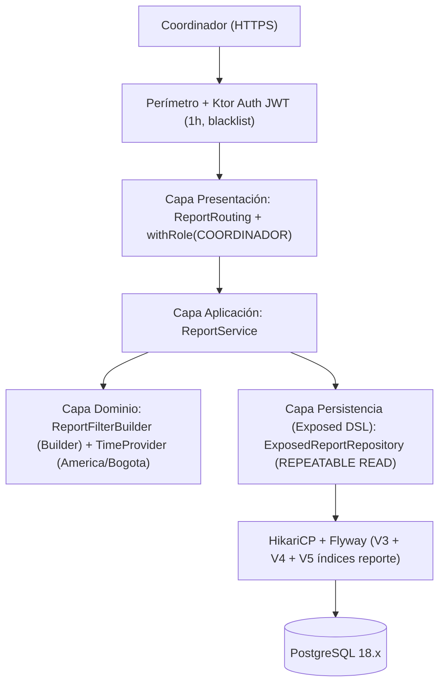

# Plan Técnico de Arquitectura: Consolidado y Reportes de Coordinación (Backend)

**Feature:** `005-coordination-reports`
**Subproyecto:** Backend (Kotlin + Ktor + Exposed DSL + PostgreSQL)
**Spec Asociada:** `specs/005-coordination-reports/spec.md`
**Versión:** 1.0.0
**Fecha:** 2026-11-14
**Estado:** Aprobado

---

## 1. Enfoque Arquitectónico y Diagrama de Solución

Se extiende la **Layered Architecture** del Backend (`routing -> service -> domain` y `service -> repository -> domain`), manteniendo la capa `domain` aislada de Ktor y Exposed y aplicando el **Patrón GoF Builder** (`ReportFilterBuilder`) junto con el reloj inyectable (`TimeProvider` en zona `America/Bogota`) y agregaciones SQL puras sobre PostgreSQL 18:

- **Consistencia Matemática y Agregación SQL (`RNF-07`):** `ExposedReportRepository` traduce `ReportFilterCriteria` mediante un único predicado compartido `ServiceRequestsTable.toFilterOp(criteria)` y ejecuta las agregaciones del resumen consolidado (`COUNT`, `GROUP BY status`, `GROUP BY category`, `GROUP BY priority`, `GROUP BY assigned_to`, conteo de vencidas `due_at < now` en estados `EN_REVISION`/`ESCALADA`, y `responded_within_sla`) dentro de una transacción `TRANSACTION_REPEATABLE_READ` (`readOnly = true`), garantizando `< 2s` con `1.000+` solicitudes y suma exacta frente al listado paginado.
- **Cero Duplicación con `004`:** El acceso al detalle completo e historial interno desde el listado general reutiliza `GET /api/v1/attention/requests/{code}` (`004-attention-lifecycle`).



---

## 2. Modificaciones de Archivos y Nuevos Componentes

| Archivo / Módulo | Tipo de Cambio | Propósito |
| :--- | :--- | :--- |
| `src/main/resources/db/migration/V5__add_coordination_reports_indexes.sql` | Nuevo | Índices `idx_sr_created_desc` e `idx_sr_report_filters` sobre `service_requests` para acelerar orden global y filtros combinados (`RNF-07`). |
| `src/main/kotlin/.../domain/model/ReportModels.kt` | Nuevo | Modelos puros: `ReportFilterCriteria`, `CoordinationReportPageQuery`, `AssigneeMetric`, `CoordinationReportSummary` y `CoordinationReportRequestItem`. |
| `src/main/kotlin/.../domain/builder/ReportFilterBuilder.kt` | Nuevo | **Patrón GoF Builder** con validación acumulativa (`createdFrom`, `createdTo` en `America/Bogota`, `status`, `category`, `priority`, `assignedToId`, `page >= 1`, `size in 1..20`). |
| `src/main/kotlin/.../domain/repository/ReportRepository.kt` | Nuevo | Puerto de persistencia: `getSummary(criteria, now)` y `findRequests(query, now)`. |
| `src/main/kotlin/.../repository/ExposedReportRepository.kt` | Nuevo | Consultas agregadas SQL (`GROUP BY` + predicados condicionales), `toFilterOp(criteria)` compartido, joins con alias de `UsersTable` (`requester` / `assignee`) y lectura `TRANSACTION_REPEATABLE_READ`. |
| `src/main/kotlin/.../service/ReportService.kt` | Nuevo | Orquestación de `ReportFilterBuilder`, inyección de `TimeProvider.now()`, normalización garantizada de ceros en los 6 estados / 4 categorías / 3 prioridades y retorno a routing. |
| `src/main/kotlin/.../routing/dto/reports/ReportDtos.kt` & `routing/ReportRouting.kt` | Nuevo | DTOs `@Serializable` estrictos (`CoordinationReportSummaryDto`, `AssigneeMetricDto`, `CoordinationReportRequestItemDto`, `PagedCoordinationReportRequestsResponseDto`) y endpoints `GET /api/v1/reports/summary` y `GET /api/v1/reports/requests` con `withRole(UserRole.COORDINADOR)`. |
| `src/main/kotlin/.../Application.kt` | Modificado | Inyección de `ExposedReportRepository`, `ReportService` y registro de `ReportRouting`. |
| `src/test/kotlin/.../` (`ReportFilterBuilderTest.kt`, `ReportServiceTest.kt`, `ReportRoutingTest.kt`) | Nuevo | Tests unitarios y de integración sobre Testcontainers PostgreSQL 18 cubriendo totales globales, filtros combinados, frontera horaria `America/Bogota`, RBAC `401`/`403`, validaciones `400`, prueba de rendimiento `< 2s` con `1.000` solicitudes, `ktlintCheck` y `koverVerify` ($\ge 90\%$). |

---

## 3. Esquema de Migración (`V5__add_coordination_reports_indexes.sql`)

```sql
CREATE INDEX IF NOT EXISTS idx_sr_created_desc
    ON service_requests (created_at DESC, id DESC);

CREATE INDEX IF NOT EXISTS idx_sr_report_filters
    ON service_requests (status, category, priority, assigned_to, created_at DESC);
```

---

## 4. Riesgos Técnicos y Mitigación

- **Riesgo 1 — Diferencias de conteo entre `/summary` y `/requests` bajo escrituras concurrentes:**
  - *Mitigación:* Un solo predicado SQL `toFilterOp(criteria)` compartido entre ambas consultas y aislamiento `TRANSACTION_REPEATABLE_READ` (`readOnly = true`) dentro de `getSummary`.
- **Riesgo 2 — Desplazamiento de día por diferencia UTC vs. `America/Bogota`:**
  - *Mitigación:* `ReportFilterBuilder` parsea `YYYY-MM-DD` en `ZoneId.of("America/Bogota")` usando rango semiabierto `[startOfDay(createdFrom), startOfDay(createdTo + 1 día))`; verificado explícitamente con casos de frontera a las `23:30-05:00` en `ReportFilterBuilderTest` y `ReportRoutingTest`.
- **Riesgo 3 — Mapas incompletos cuando una dimensión tiene `0` registros bajo un filtro:**
  - *Mitigación:* `ReportService` / `ExposedReportRepository` inicializa explícitamente las 6 claves de `RequestStatus`, 4 claves de `RequestCategory` y 3 claves de `RequestPriority` con `0L` antes de aplicar resultados SQL, además de reportar `unassignedPriorityCount` y `unassignedCount`.
- **Riesgo 4 — Degradación sobre `1.000` solicitudes (`RNF-07`):**
  - *Mitigación:* Cero `SELECT *` ni agrupación en JVM; índices `V5` y test automatizado sembrando `1.000` solicitudes en PostgreSQL Testcontainers midiendo latencia `< 2000 ms`.
- **Riesgo 5 — Fuga RBAC o caída de cobertura Kover `< 90%` / `ktlint`:**
  - *Mitigación:* `withRole(UserRole.COORDINADOR)` en `ReportRouting`, pruebas negativas completas (`401`, `403`, `400`) y ejecución final `./gradlew ktlintCheck check koverVerify`.
