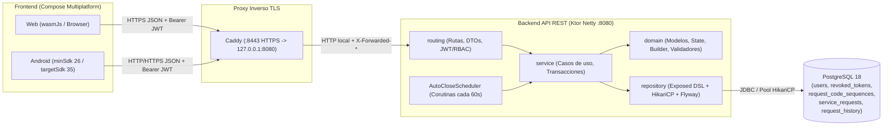
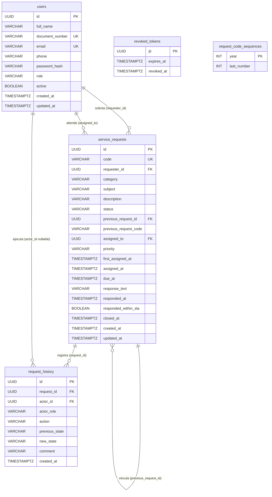
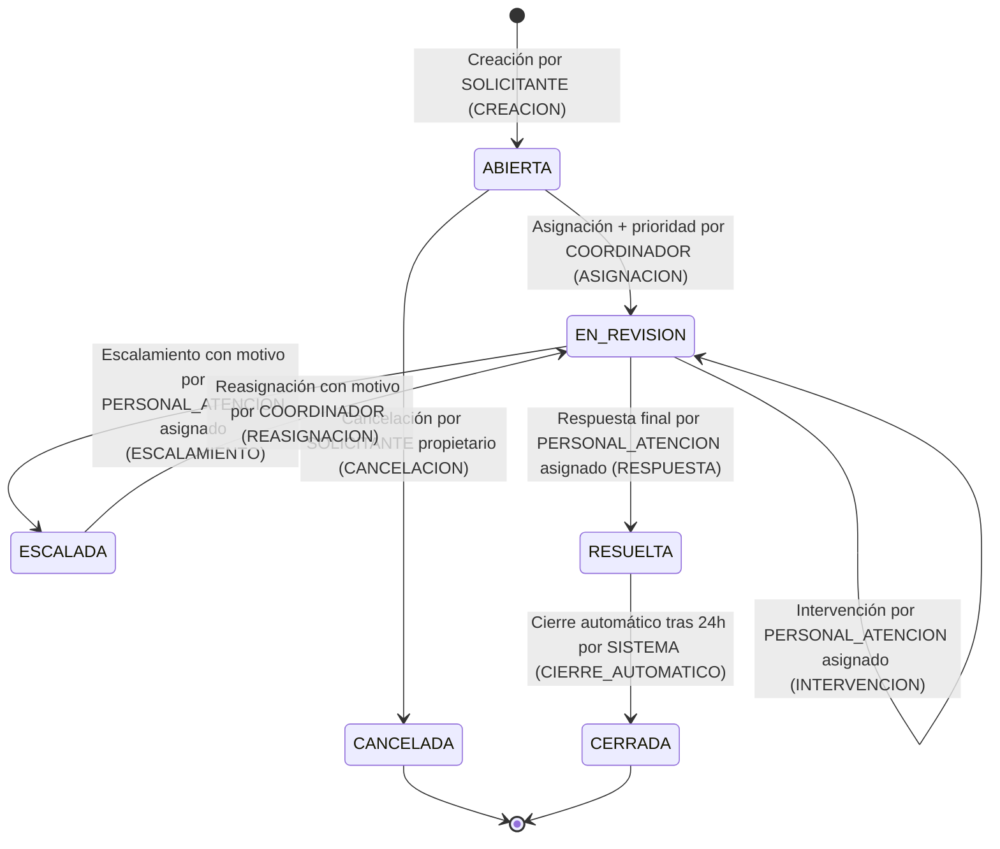

# Documento de Diseño Técnico — ITM Service Desk

**Sistema:** Sistema de Gestión de Solicitudes de Servicio (`ITM Service Desk`)  
**Propósito:** Sustentar las decisiones de arquitectura, tecnologías, modelo de datos, API REST, máquina de estados, seguridad y organización del código.

---

## 1. Arquitectura Cliente–Servidor

El sistema implementa una arquitectura **cliente–servidor desacoplada**, donde un cliente multiplataforma (**Compose Multiplatform** para Web `wasmJs` y Android) se comunica exclusivamente mediante **API REST/JSON** sobre **HTTPS** (terminación TLS con **Caddy**) con un backend **Ktor** conectado a **PostgreSQL 18**.



---

## 2. Tecnologías Elegidas y Justificación

### Backend (`backend/`)
| Tecnología | Versión | Justificación de la elección |
| :--- | :--- | :--- |
| **Kotlin / JDK** | `2.4.21` / `JDK 21 LTS` | Tipado estático, null-safety para evitar errores en tiempo de ejecución y compatibilidad de contratos compartidos conceptualmente con el frontend KMP. |
| **Ktor Server (Netty)** | `3.6.1` | Framework ligero y explícito basado en corutinas; permite configurar plugins puntuales (`Auth JWT`, `CORS`, `StatusPages`, `XForwardedHeaders`) sin magia oculta y probar rutas en memoria con `testApplication`. |
| **Exposed DSL + HikariCP** | `1.6.1` / `7.1.0` | DSL tipado sobre SQL que evita consultas N+1, da control exacto de transacciones (`REPEATABLE READ` en reportes, `FOR UPDATE SKIP LOCKED` en cierre automático) y gestión eficiente de conexiones con timeouts estrictos. |
| **Flyway** | `13.12.2` | Evolución determinista y versionada del esquema (`V1` a `V5`), evitando `SchemaUtils.create` en producción. |
| **PostgreSQL** | `18.x` | Soporte robusto de integridad referencial, restricciones `CHECK`, índices parciales (`V4`) y agregaciones SQL rápidas para reportes (`< 2s`). |
| **BCrypt + JWT (`HMAC256`)** | `at.favre.lib:bcrypt 0.10.2` | Derivación lenta con salt aleatorio en servidor (`costo 12`) y sesiones stateless verificables con revocación por `jti` en base de datos. |
| **Caddy** | Proxy TLS local/prod | Delegación limpia de HTTPS/TLS sin acoplar certificados al código Netty (`CaddyBootstrapper` lo inicia automáticamente en desarrollo si está instalado). |
| **Testcontainers + Kover + ktlint** | `1.21.4` / `0.9.11` / `1.8.0` | Pruebas de integración contra PostgreSQL 18 real, umbral mínimo de cobertura $\ge 90\%$ y cumplimiento automático del estilo Kotlin. |

### Frontend (`frontend/`)
| Tecnología | Versión | Justificación de la elección |
| :--- | :--- | :--- |
| **Compose Multiplatform + Material 3** | `1.12.2` / `1.9.0` | Comparte el 100 % de la lógica de presentación, validación, red y pantallas entre **Web (`wasmJs`)** y **Android**, garantizando consistencia visual y funcional. |
| **Ktor Client + `kotlinx.serialization`** | `3.6.1` / `1.13.0` | Cliente HTTP multiplataforma (`JS fetch` en Web, `OkHttp` en Android, `MockEngine` en tests) con interceptor centralizado de JWT y detección global de `401`. |
| **Koin + Navigation Compose + ViewModel** | `4.2.2` / `2.9.2` / `2.10.0` | Inyección de dependencias liviana, navegación tipada con guardas RBAC (`RequireRole`) y patrón **MVVM + UDF**. |
| **BuildKonfig + `kotlinx-datetime`** | `0.24.0` / `0.8.0` | Inyección de URLs de API por entorno (`debug`/`release`) y formateo determinista `dd/mm/aaaa hh:mm` en `America/Bogota`. |

---

## 3. Modelo de Datos y Garantía de Integridad

El esquema se gestiona mediante 5 migraciones Flyway (`V1` a `V5`) en `backend/src/main/resources/db/migration/`:



### Mecanismos de integridad
- **Claves foráneas `ON DELETE RESTRICT`:** Impiden eliminar usuarios o solicitudes referenciadas en BD.
- **Restricciones `CHECK` y `UNIQUE`:** Validan enums (`role`, `category`, `status`, `priority`, `actor_role`, `action`) y unicidad de `document_number`, `email` y `code`.
- **Consecutivo anual atómico:** `request_code_sequences` utiliza `INSERT ... ON CONFLICT (year) DO UPDATE SET last_number = last_number + 1 RETURNING last_number` dentro de la misma transacción de creación para garantizar códigos únicos `SOL-AAAA-NNNNN` sin condiciones de carrera.
- **Índices dedicados:** Índices para consultas del solicitante (`idx_sr_requester_created`, `idx_sr_requester_status_created`), bandejas (`idx_sr_status_created`, `idx_sr_assigned_due`), historial (`idx_rh_request_created`), índice parcial de cierre automático (`idx_sr_autoclose` en `V4`) e índices de reportes (`idx_sr_created_desc`, `idx_sr_report_filters` en `V5`).

---

## 4. Diseño de la API REST y Justificación de Operaciones (No-CRUD)

La API expone **21 endpoints** bajo el prefijo `/api/v1` (tabla completa en el [README.md](../README.md)).

### Contrato estándar de error (`ApiErrorDto` en `StatusPagesConfig.kt`)
Toda respuesta `4xx` / `5xx` retorna un formato JSON uniforme en español sin trazas internas:
```json
{
  "timestamp": "2026-11-18T08:50:00-05:00",
  "status": 400,
  "error": "VALIDATION_ERROR",
  "message": "Los datos proporcionados contienen errores de validación.",
  "path": "/api/v1/requests",
  "details": [
    { "field": "subject", "message": "El asunto debe tener entre 5 y 100 caracteres." }
  ]
}
```
Códigos HTTP utilizados: `200 OK`, `201 Created`, `204 No Content`, `400 Bad Request` (validación/JSON inválido), `401 Unauthorized` (sin JWT, expirado o en blacklist), `403 Forbidden` (rol o propiedad insuficiente), `404 Not Found`, `409 Conflict` (duplicado o estado inválido en máquina de estados) y `503 Service Unavailable` (fallo de BD).

### ¿Por qué NO todos los recursos tienen CRUD completo?
Las operaciones de la API responden a las reglas del proceso institucional y de auditoría, no a un CRUD genérico:
1. **No existe `DELETE /api/v1/requests/{code}` ni `PUT/PATCH` libre sobre solicitudes:** Por `RNF-05` y trazabilidad, una solicitud radicada **nunca puede borrarse ni editarse**. Si el solicitante ya no la requiere mientras sigue sin asignar, ejecuta `POST /api/v1/requests/{code}/cancel`, que conserva el registro y transiciona su estado a `CANCELADA` dejando evidencia en `request_history`.
2. **El historial (`request_history`) es estrictamente de solo lectura / append-only:** No hay endpoints de actualización ni borrado; cada acción de negocio añade un nuevo evento cronológico.
3. **La respuesta final (`POST .../respond`) es inmutable:** Una vez emitida (`EN_REVISION` → `RESUELTA`), no puede sobreescribirse. Si el solicitante no queda conforme, abre una nueva solicitud vinculada mediante `previousRequestCode` sin alterar la anterior.
4. **Personal interno (`/api/v1/users/staff`) y Reportes (`/api/v1/reports/*`):** Los reportes son estrictamente de lectura (`GET`); y el módulo de personal solo requiere creación y listado paginado (`RF-07`), quedando fuera del alcance la edición o borrado de cuentas (`RNF-10`).

---

## 5. Estados, Reglas de Negocio y Patrones GoF

### Máquina de Estados (`ServiceRequestState` — Patrón GoF State)



### Reglas clave del flujo
- **Patrón State (`ServiceRequestState`):** Cada estado (`AbiertaState`, `EnRevisionState`, `EscaladaState`, `ResueltaState`, `CerradaState`, `CanceladaState`) encapsula qué acciones permite y lanza `ForbiddenException` (`403`) o `ConflictException` (`409`) ante intentos inválidos, respaldado en PostgreSQL con `UPDATE ... WHERE id = ? AND status = ?`.
- **Patrón Builder:** `AppConfigBuilder`, `ServiceRequestBuilder`, `MyRequestsQueryBuilder`, `StaffPageQueryBuilder`, `AttentionQueryBuilder`, `ReportFilterBuilder` y `AuthSessionBuilder` validan parámetros acumulativamente y construyen objetos de dominio inmutables.
- **Política SLA e invariante de reasignación:**
  - Prioridades: `ALTA = 24 horas`, `MEDIA = 72 horas`, `BAJA = 120 horas` calculadas con `TimeProvider` en zona `America/Bogota`.
  - Al asignar inicialmente (`ABIERTA` → `EN_REVISION`), se fija `first_assigned_at = now` y `due_at = first_assigned_at + slaHours`.
  - Al reasignar tras escalamiento (`ESCALADA` → `EN_REVISION`), **`first_assigned_at` nunca se reinicia**; `due_at` se recalcula como `first_assigned_at + effectivePriority.slaHours`.
  - `isOverdue` es informativo y no bloquea intervenciones, escalamientos ni respuestas.
- **Cierre automático (`AutoCloseScheduler` + `AutoCloseService`):** Corre periódicamente con corutinas Ktor (`AUTO_CLOSE_INTERVAL_SECONDS=60`) usando `FOR UPDATE SKIP LOCKED` sobre `idx_sr_autoclose` para cerrar en lotes solicitudes `RESUELTA` con `responded_at <= now - 24h`.

---

## 6. Permisos y Seguridad

1. **Control de Acceso Basado en Roles (RBAC):**
   - `RoleAuthorizationPlugin` (`withRole(...)`) en rutas Ktor + verificación de rol y propiedad en la capa `service` y `ServiceRequestState`.
   - `POST /api/v1/auth/register` fuerza siempre `UserRole.SOLICITANTE` y deserializa con `ignoreUnknownKeys = false` para impedir escalamiento de privilegios.
2. **Autenticación JWT y Blacklist:**
   - Tokens `HMAC256` con vigencia de 1 hora (`3600s`) y `jti` único.
   - `JwtAuthConfig` verifica en cada petición protegida que el `jti` no exista en `revoked_tokens` y que el usuario esté activo (`active = true`). `POST /api/v1/auth/logout` revoca el `jti` y purga tokens ya expirados.
3. **Contraseñas y Almacenamiento en Cliente:**
   - Servidor: BCrypt (`costo 12`, salt aleatorio, límite `72` bytes UTF-8) + verificación dummy en login para evitar enumeración temporal de correos.
   - Frontend: `WebSessionStorage` usa memoria + `window.sessionStorage` (prohibido `localStorage`); `AndroidSessionStorage` usa `EncryptedSharedPreferences` (`AES256_GCM`).
4. **Seguridad Perimetral y Secretos:**
   - Caddy termina TLS (`https://localhost:8443` → `127.0.0.1:8080`), `IpAllowListPlugin` restringe IPs según `ALLOWED_CLIENT_IPS`, `CORS` valida lista explícita (`CORS_ALLOWED_ORIGINS`, prohibido `*`), y `.env` está excluido en `.gitignore` manteniendo únicamente `.env.example` sin credenciales reales.

---

## 7. Organización del Código

- **Backend (`backend/src/main/kotlin/com/itm/servicedesk/`):** Arquitectura en capas unidireccional (`routing -> service -> domain` y `service -> repository -> domain`, sin dependencias de Ktor/Exposed dentro de `domain/`):
  - `config/`: arranque de BD (`DatabaseFactory`), `EnvConfig`, `CaddyBootstrapper`, `SecurityPlugins`, `StatusPagesConfig`, `IpAllowListPlugin`, `security/`.
  - `routing/` y `routing/dto/`: endpoints Ktor y DTOs `@Serializable`.
  - `service/`: orquestación de casos de uso y `AutoCloseScheduler`.
  - `domain/`: `model/`, `state/`, `builder/`, `validation/`, `repository/` (interfaces), `security/` (interfaces), `time/` (`TimeProvider`).
  - `repository/`: tablas e implementaciones Exposed DSL.
- **Frontend (`frontend/composeApp/src/`):** Arquitectura **MVVM + UDF** en Kotlin Multiplatform:
  - `commonMain`: `core/` (`config`, `di`, `network`, `storage`, `time`), `data/` (`dto`, `mapper`, `remote`, `repository`), `domain/` (`model`, `repository`, `validation`), `viewmodel/`, `ui/` (`components`, `navigation`, `screens`, `theme`).
  - `androidMain` / `wasmJsMain`: implementaciones `actual` (`resolveApiBaseUrl`, `PlatformHttpEngine`, `SessionStorage`, `TimeZoneInitializer`) y puntos de entrada (`MainActivity`, `Main.kt`).
