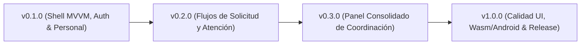

# ITM Service Desk (Frontend) - Mapa de Versiones y Ciclo de Vida
**Ubicación:** `docs/version_map.md`  
**Versión Actual:** `v0.3.0` (`004-attention-lifecycle` y `005-coordination-reports` completadas)  
**Última Actualización:** 2026-11-18  

---

## 1. Estrategia de Versionamiento (SemVer)
El Frontend de **ITM Service Desk** se rige por **Semantic Versioning 2.0.0** (`MAJOR.MINOR.PATCH`):
* **MAJOR (`X.0.0`):** Cambios que rompen compatibilidad con los contratos REST del Backend, flujo de sesión JWT o estructura de navegación principal.
* **MINOR (`0.Y.0`):** Nuevas pantallas, flujos por rol (HU/RF), ViewModels o capacidades compatibles con la API vigente.
* **PATCH (`0.0.Z`):** Corrección de bugs de UI/estado, mejoras visuales Material 3, ajustes en Mappers o refactorizaciones sin alterar flujos ni contratos.

---

## 2. Mapa de Versiones e Hitos (Milestones)



### Tabla de Hitos y Entregables

| Versión | Nombre del Hito | Objetivo Principal | Specs / Épicas Incluidas | Trazabilidad HU / RF / RNF | Estado |
| :--- | :--- | :--- | :--- | :--- | :--- |
| **`v0.1.0`** | Shell MVVM, Auth & Personal | Configuración Compose Multiplatform 1.12.2 (Material 3 en español), Koin, Jetpack Navigation, Ktor Client 3.6.x (OkHttp / JS fetch), `SessionStorage` `expect/actual` (`EncryptedSharedPreferences` / `sessionStorage`), Login, Registro público (Tabla 1), cierre de sesión/manejo `401` y módulo de Coordinador para registrar/listar personal interno | `001-project-setup` (✅ Completada), `002-auth-users` (✅ Completada) | **HU-01** (registro), **HU-07**; **RF-01**, **RF-07**; **RNF-01 a RNF-04**, **RNF-06**, **RNF-09** | ✅ Completada |
| **`v0.2.0`** | Flujos de Solicitud y Atención | Pantallas por rol: registro de solicitudes (Tabla 2 + solicitud previa opcional), mis solicitudes paginadas (20/pág) con filtro de estado, detalle con código visible, formato `dd/mm/aaaa hh:mm` (`America/Bogota`) y confirmación de cancelación; bandeja de Coordinador para asignar/priorizar/reasignar; bandeja de Personal asignado (marca `Vencida`, intervenciones, escalamiento y confirmación de respuesta) | `003-service-requests` (✅ Completada), `004-attention-lifecycle` (✅ Completada) | **HU-01** (solicitud), **HU-02**, **HU-03**, **HU-04**, **HU-05**; **RF-02 a RF-05**; **RNF-06**, **RNF-07**, **RNF-09** | ✅ Completada |
| **`v0.3.0`** | Panel Consolidado de Coordinación | Vista ejecutiva para Coordinador con totales por estado, categoría, prioridad, responsable, vencidas y resueltas dentro/fuera de plazo; filtros dinámicos (rango de fechas, categoría, prioridad, responsable) y acceso al listado general + detalle/historial completo | `005-coordination-reports` (✅ Completada) | **HU-06**; **RF-06**; **RNF-03**, **RNF-07**, **RNF-09** | ✅ Completada |
| **`v1.0.0`** | Release v1.0 & Quality Gate | Validación responsiva completa en Web (`wasmJs`: Chrome, Firefox, Edge) y Android (`minSdk 26`, `targetSdk` 35/36), verificación de cero datos simulados en producción, cobertura $\ge 90\%$ (`kotlin-test`, `kotlinx-coroutines-test`, `Ktor MockEngine`, `Compose UI Test`), `ktlint 1.8.x` y auditoría `converge.md` | `006-hardening-release` | **RNF-01 a RNF-10** (auditoría completa de UI, seguridad y alcance) | ⚪ Planificado |

> **Nota de Alcance (RNF-10):** Por restricción explícita del sistema, la interfaz no contempla carga de archivos adjuntos, notificaciones por correo/WhatsApp, pasarelas de pago, facturación ni integraciones externas. El solicitante consulta su avance directamente en la aplicación.

---

## 3. Matriz de Dependencias entre Features

```text
[001-project-setup] (CMP 1.12.2 Material 3, Koin, Navigation, Ktor Client 3.6.x, SessionStorage expect/actual, ktlint 1.8.x)
     └── [002-auth-users] (RF-01, RF-07: Login JWT, Registro solicitante Tabla 1, Guardas RBAC, Gestión de personal interno)
              └── [003-service-requests] (RF-02, RF-03: Crear solicitud Tabla 2, Mis solicitudes 20/pág, Detalle, Cancelar con confirmación)
                       └── [004-attention-lifecycle] (RF-04, RF-05: Bandeja Coordinador asignar/reasignar, Bandeja Personal intervenciones/escalar/responder)
                                └── [005-coordination-reports] (RF-06: Resumen consolidado, métricas SLA y filtros por fecha/categoría/prioridad/responsable)
                                         └── [006-hardening-release] (Responsividad Web Wasm & Android, cobertura >= 90%, MockEngine + Compose UI Test, v1.0.0)
```

---

## 4. Matriz de Compatibilidad Técnica

| Componente | Versión del Software | Dependencia Externa / Runtime | Compatibilidad |
| :--- | :--- | :--- | :--- |
| **Lenguaje Multiplataforma** | `v0.1.0+` | Kotlin Multiplatform | `2.4.x` |
| **UI & Design System** | `v0.1.0+` | Compose Multiplatform + Material 3 | `1.12.2` |
| **Target Web** | `v0.1.0+` | Kotlin/Wasm (`wasmJs` con WasmGC) | Navegadores modernos: Chrome, Firefox y Edge actuales |
| **Target Android** | `v0.1.0+` | Android SDK | `minSdk 26` (Android 8.0) / `targetSdk` y `compileSdk` 35/36 |
| **Red & Serialización** | `v0.1.0+` | Ktor Client (`OkHttp` / `JS fetch`) + `kotlinx.serialization.json` | `3.6.x` consumiendo Backend API REST v0.1.0+ |
| **Almacenamiento Seguro JWT** | `v0.1.0+` | `EncryptedSharedPreferences` (Android) / `sessionStorage` + memoria (Web) | Aislamiento vía `expect/actual`; prohibido `localStorage` |
| **Navegación & DI** | `v0.1.0+` | Jetpack Navigation Compose Multiplatform + Koin Multiplatform | Compatible con CMP `1.12.2` y Kotlin `2.4.x` |
| **Calidad & Testing** | `v0.1.0+` | `ktlint 1.8.x` + `kotlin-test` + `kotlinx-coroutines-test` + `Ktor MockEngine` + `Compose UI Test` | Cobertura global $\ge 90\%$ |

---

## 5. Changelog / Registro Histórico

### [v0.2.0-alpha] - 2026-11-15
#### Added
- Épica `003-service-requests` (flujo completo del `SOLICITANTE`, `T01` a `T07`) implementada y verificada:
  - Modelos de dominio (`RequestCategory`, `RequestStatus`, `RequestHistoryAction`, `ServiceRequestSummary`, `ServiceRequestDetail`, `ServiceRequestsPage`), interfaz `ServiceRequestRepository` y `RequestFormValidator` (Tabla 2: `subject` `5..100`, `description` `20..2000`, `previousRequestCode` `^SOL-\d{4}-\d{5,}$`, `cancelReason <= 500`).
  - DTOs `@Serializable` (`CreateServiceRequestDto` limpio sin campos gestionados por el servidor), mappers (`RequestMapper`, `RequestUiMapper` / `ServiceRequestUiMapper`), `RequestRemoteDataSource` y `ServiceRequestRepositoryImpl` cableado en `AppModules`.
  - ViewModels MVVM (`MyRequestsViewModel` con `size = 20` y reinicio a `page = 1` por filtro, `CreateRequestViewModel` con prellenado opcional de solicitud previa, `RequestDetailViewModel` con modal de cancelación `RNF-09` y recarga automática ante `409 Conflict`).
  - Componentes (`RequestStatusChip`, `CancelRequestDialog`), pantallas responsivas (`MyRequestsScreen` integrada en `ApplicantHomeScreen`, `CreateRequestScreen`, `RequestDetailScreen`) y rutas tipadas en `AppNavHost` protegidas con `RequireRole(UserRole.SOLICITANTE)`.
  - Suite completa de pruebas unitarias, `MockEngine`, `Compose UI Test` y RBAC en verde en Android y `wasmJs`, `ktlintCheck` limpio y cobertura Kover $\ge 90\%$.

### [v0.1.0] - 2026-11-15
#### Added
- Épica `002-auth-users` implementada y verificada (`T01` a `T07`):
  - Modelos de dominio, contratos de repositorio y `UserFormValidator` multiplataforma (`Char.isLetter()`, `Char.isDigit()`, tope BCrypt 72 bytes UTF-8).
  - DTOs `@Serializable` (`RegisterRequestDto` sin campo `role` y `toString()` enmascarado), mappers (`AuthMapper`, `StaffMapper`, `StaffUiMapper`), data sources remotos y exclusión de `/api/v1/auth/{login,register,logout}` del disparo global `SessionExpired` en `HttpClientFactory`.
  - Repositorios `AuthRepositoryImpl` (cierre de sesión resiliente en `204` y `401`) y `StaffRepositoryImpl` (paginación uniforme `size = 20`).
  - ViewModels MVVM (`SessionViewModel`, `LoginViewModel`, `RegisterViewModel`, `StaffListViewModel`, `CreateStaffViewModel`) con `UiState` inmutables, enmascaramiento de secretos y cableado Koin.
  - Componentes compartidos (`ConfirmationDialog`, `PasswordTextField`, `AuthenticatedTopBar`, `RequireRole`), pantallas (`LoginScreen`, `RegisterScreen`, `ApplicantHomeScreen`, `AgentHomeScreen`, `CoordinatorHomeScreen`, `StaffListScreen`, `CreateStaffScreen`) y navegación tipada con guardas RBAC en `AppNavHost`.
  - Suite completa de pruebas unitarias, `MockEngine` y `Compose UI Test` pasando en Android y `wasmJs`, `ktlintCheck` limpio y cobertura Kover $\ge 90\%$.

### [v0.1.0-alpha] - 2026-11-14
#### Added
- Constitución del proyecto Frontend (`frontend/.specify/memory/constitution.md` v1.0.0).
- Definición del mapa de versiones alineado con **HU-01 a HU-07**, **RF-01 a RF-07**, **RNF-01 a RNF-10** y los hitos del Backend.
- Épica `001-project-setup` implementada y verificada: estructura KMP + Compose Multiplatform (`androidTarget` + `wasmJs`), `BuildKonfig`, `DateFormatter` (`America/Bogota`, `dd/mm/aaaa hh:mm`), `SessionStorage` `expect/actual`, `HttpClientFactory` con interceptor JWT/401, `SystemHealthRepository`, Koin DI, `StartupScreen` + `AppNavHost`, `ktlint` y cobertura Kover $\ge 90\%$.

