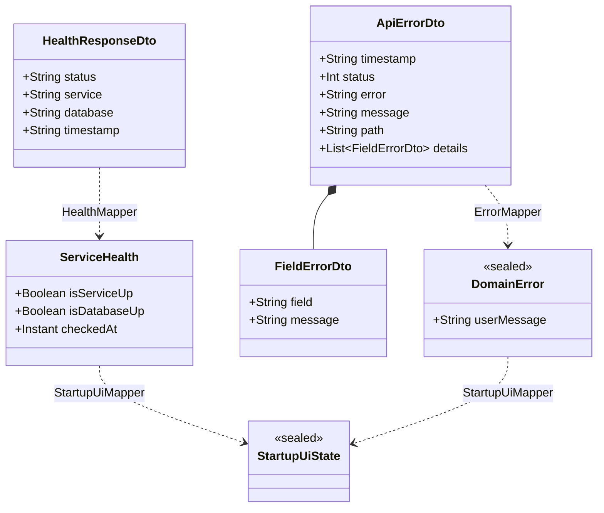
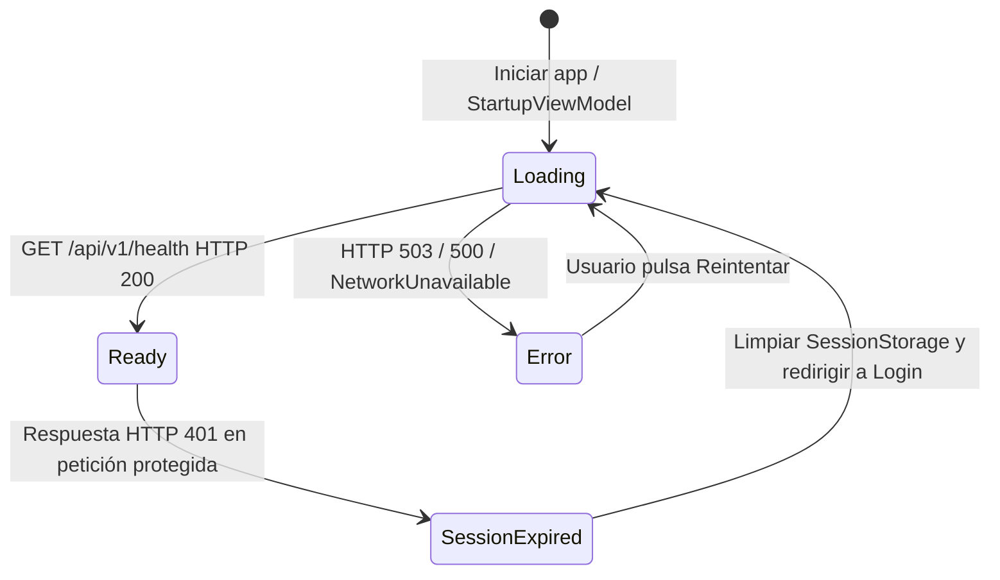

# Modelo de Datos y Entidades: 001-project-setup (Frontend)
**Ubicación:** `specs/001-project-setup/data-model.md`  
**Spec Asociada:** `specs/001-project-setup/spec.md`  
**Estado:** Aprobado  

---

## 1. Diagrama de Modelos y Flujo por Capas (Mermaid)

---

## 2. Entidades y Modelos por Capa (MVVM + Repository + Mapper)

### Capa Data (`data/dto`) — Contratos JSON `@Serializable`
* **`HealthResponseDto`:**
  * `status`: `String` (`"UP"` | `"DOWN"`).
  * `service`: `String` (`"itm-service-desk-backend"`).
  * `database`: `String` (`"UP"` | `"DOWN"`).
  * `timestamp`: `String` (ISO-8601 con offset `-05:00`).
* **`ApiErrorDto`:**
  * `timestamp`: `String` (ISO-8601).
  * `status`: `Int` (`400`, `401`, `403`, `404`, `409`, `500`, `503`).
  * `error`: `String` (código simbólico ej. `"SERVICE_UNAVAILABLE"`).
  * `message`: `String` (mensaje controlado en español).
  * `path`: `String`.
  * `details`: `List<FieldErrorDto>` (opcional, vacío por defecto).
* **`FieldErrorDto`:**
  * `field`: `String` (nombre de campo validado).
  * `message`: `String` (mensaje de validación para mostrar junto al campo según RNF-09).

### Capa Dominio (`domain/model` y `domain/repository`)
* **`ServiceHealth`:**
  * `isServiceUp`: `Boolean`
  * `isDatabaseUp`: `Boolean`
  * `checkedAt`: `Instant` (`kotlinx-datetime`)
* **`AppResult<out T>` (`sealed interface`):**
  * `Success<T>(val data: T)`
  * `Failure(val error: DomainError)`
* **`DomainError` (`sealed interface`):**
  * `BadRequest(userMessage: String, fieldErrors: Map<String, String>)` → HTTP `400`
  * `Unauthorized(userMessage: String)` → HTTP `401`
  * `Forbidden(userMessage: String)` → HTTP `403`
  * `NotFound(userMessage: String)` → HTTP `404`
  * `Conflict(userMessage: String)` → HTTP `409`
  * `ServiceUnavailable(userMessage: String)` → HTTP `503`
  * `UnexpectedServerError(userMessage: String)` → HTTP `500` u otros `5xx`
  * `NetworkUnavailable(userMessage: String)` → Timeout / sin conexión / error de transporte
* **`SessionEvent` (`sealed interface`):**
  * `SessionExpired` (disparado al recibir HTTP `401` en ruta protegida)
  * `LoggedOut` (disparado al cerrar sesión explícitamente)
* **`SessionStorage` (`core/storage`, contrato `expect/actual`):**
  * `suspend fun saveToken(token: String)`
  * `suspend fun getToken(): String?`
  * `suspend fun clearToken()`

### Capa ViewModel / UI (`viewmodel`)
* **`StartupUiState` (`sealed interface`):**
  * `Loading`: Estado inicial mientras se consulta la disponibilidad del servicio.
  * `Ready(serviceLabel: String, databaseLabel: String, formattedCheckedAt: String)`: Listo; `formattedCheckedAt` en formato `dd/mm/aaaa hh:mm` (`America/Bogota`).
  * `Error(title: String, message: String, canRetry: Boolean = true)`: Estado controlado con mensaje en español y acción de reintento.

---

## 3. Reglas de Validación e Invariantes del Dominio Frontend
1. **Aislamiento Estricto de Capas (Mapper Pattern):**
   - Los DTOs (`HealthResponseDto`, `ApiErrorDto`, `FieldErrorDto`) están confinados exclusivamente a `data/dto`, `data/remote` y `data/mapper`. Ningún `ViewModel` ni `@Composable` puede importarlos.
2. **Invariante de Seguridad de Sesión (`SessionStorage`):**
   - En `wasmJsMain`, el JWT reside únicamente en memoria + `window.sessionStorage` (nunca en `localStorage`).
   - En `androidMain`, el JWT reside cifrado con `EncryptedSharedPreferences` (Android Keystore).
   - Ante cualquier respuesta `401`, el interceptor invoca `clearToken()` antes de emitir `SessionEvent.SessionExpired`.
3. **Invariante de Formato Temporal (`America/Bogota`, RNF-09):**
   - Todo `Instant` proveniente de DTOs se transforma mediante `DateFormatter` (`kotlinx-datetime`) en zona `TimeZone.of("America/Bogota")` con patrón estricto `dd/mm/aaaa hh:mm` antes de llegar al `@Composable`.
4. **Invariante de Mensajes Seguros (RNF-04):**
   - Si el servidor devuelve un `500` o falla el parseo de `ApiErrorDto`, `ErrorMapper` sustituye el error por un mensaje genérico amigable en español (nunca muestra JSON crudo, URLs internas ni stacktraces en la UI).

---

## 4. Transiciones de Estado (`StartupUiState` & Sesión Global)

