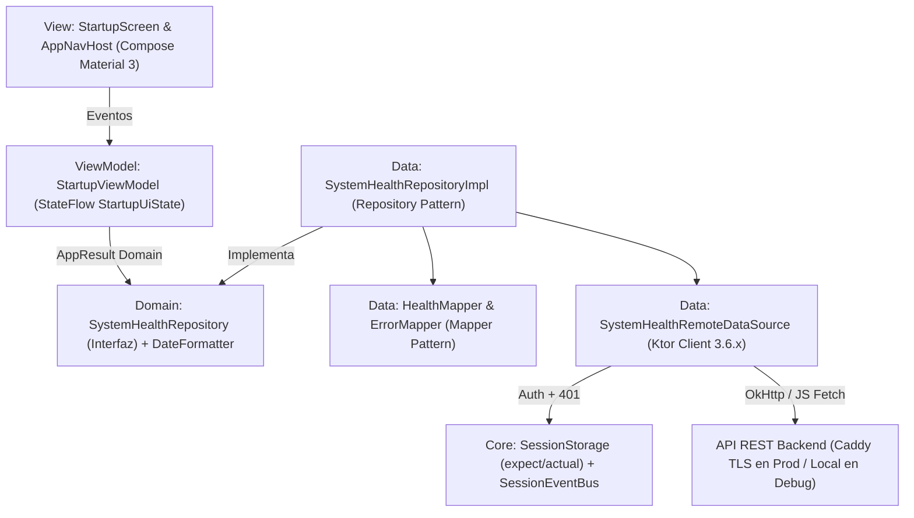

# Plan Técnico de Arquitectura: 001-project-setup (Frontend)
**Ubicación:** `specs/001-project-setup/plan.md`  
**Spec Asociada:** `frontend/specs/001-project-setup/spec.md`  
**Estado:** Aprobado  

---

## 1. Enfoque Arquitectónico y Diagrama de Solución
> El Frontend en **Kotlin Multiplatform 2.4.x** y **Compose Multiplatform 1.12.2 (Material 3)** implementa **MVVM + UDF** con **Repository Pattern** y **Mapper Pattern** compartidos en `commonMain` para **Web (`wasmJs`)** y **Android (`minSdk 26`, `targetSdk`/`compileSdk` 35/36)**.  
> La URL base de API se resuelve en tiempo de compilación mediante **BuildKonfig** + `expect fun resolveApiBaseUrl()`. El cliente **Ktor 3.6.x** delega al motor nativo (`OkHttp` en Android, `JS fetch` en `wasmJs`, `MockEngine` en `commonTest`), inyecta automáticamente el JWT desde `SessionStorage` (`expect/actual`: memoria + `sessionStorage` en Web; `EncryptedSharedPreferences` en Android) y gestiona globalmente `401` mediante `SessionEventBus`. Las fechas ISO-8601 se formatean con **`kotlinx-datetime`** a `dd/mm/aaaa hh:mm` (`America/Bogota`). La calidad se garantiza con `libs.versions.toml`, `ktlint 1.8.x` y **JetBrains Kover** ($\ge 90\%$).



---

## 2. Modificaciones de Archivos y Nuevos Componentes

| Archivo / Módulo | Tipo de Cambio | Propósito |
| :--- | :--- | :--- |
| `gradle/libs.versions.toml`, `build.gradle.kts`, `settings.gradle.kts`, `composeApp/build.gradle.kts`, `.editorconfig` | Nuevo | Version Catalog (Kotlin 2.4.x, CMP 1.12.2, Ktor Client 3.6.x, Koin, Jetpack Navigation, `kotlinx-datetime`, BuildKonfig, ktlint 1.8.x, Kover $\ge 90\%$). |
| `composeApp/src/commonMain/.../core/config/ApiEndpointConfig.kt` | Nuevo | `expect fun resolveApiBaseUrl(): String` leyendo constantes `BuildKonfig` (`IS_RELEASE`, `RELEASE_API_URL`, `WEB_DEV_API_URL`, `ANDROID_DEV_API_URL` sobreescribible vía `-PapiBaseUrl`). |
| `composeApp/src/commonMain/.../core/storage/SessionStorage.kt` & `SessionEventBus.kt` | Nuevo | Contrato `SessionStorage` y bus reactivo `SharedFlow<SessionEvent>` (`SessionExpired`, `LoggedOut`). |
| `composeApp/src/commonMain/.../core/network/HttpClientFactory.kt` | Nuevo | `createHttpClient(engine, baseUrl, sessionStorage, sessionEventBus)` con `ContentNegotiation`, `HttpTimeout`, inyector `Authorization: Bearer` y detector global de `401`. |
| `composeApp/src/commonMain/.../core/time/DateFormatter.kt` | Nuevo | Formateador `Instant -> "dd/mm/aaaa hh:mm"` en `TimeZone.of("America/Bogota")` usando `kotlinx-datetime`. |
| `composeApp/src/commonMain/.../core/di/AppModules.kt` | Nuevo | Módulos Koin compartidos (`networkModule`, `repositoryModule`, `viewModelModule`) + `platformModule()`. |
| `composeApp/src/commonMain/.../data/dto/` (`HealthResponseDto.kt`, `ApiErrorDto.kt`) | Nuevo | Contratos JSON `@Serializable` 1:1 con el Backend. |
| `composeApp/src/commonMain/.../data/mapper/` (`HealthMapper.kt`, `ErrorMapper.kt`) | Nuevo | **Mapper Pattern**: `DTO -> Domain` (`ServiceHealth`, `DomainError`) y manejo seguro de códigos `400/401/403/404/409/500/503`. |
| `composeApp/src/commonMain/.../data/remote/SystemHealthRemoteDataSource.kt` & `data/repository/SystemHealthRepositoryImpl.kt` | Nuevo | **Repository Pattern**: Consumo real de `GET /api/v1/health` y retorno tipado `AppResult<ServiceHealth>`. |
| `composeApp/src/commonMain/.../domain/` (`model/ServiceHealth.kt`, `model/DomainError.kt`, `model/AppResult.kt`, `repository/SystemHealthRepository.kt`) | Nuevo | Modelos puros de dominio e interfaz de repositorio. |
| `composeApp/src/commonMain/.../viewmodel/StartupViewModel.kt` & `StartupUiState.kt` | Nuevo | Gestión de `StateFlow<StartupUiState>` (`Loading`, `Ready`, `Error`) y acción `retry()`. |
| `composeApp/src/commonMain/.../ui/` (`theme/Theme.kt`, `navigation/AppNavHost.kt`, `screens/StartupScreen.kt`) | Nuevo | Tema Material 3 en español, grafo raíz Jetpack Navigation y pantalla inicial responsiva con `testTag`/semántica accesible. |
| `composeApp/src/androidMain/.../` (`MainActivity.kt`, `ServiceDeskApp.kt`, `AndroidSessionStorage.kt`, `PlatformActuals.kt`, `src/debug/res/xml/network_security_config.xml`) | Nuevo | Motor `OkHttp`, `EncryptedSharedPreferences` (`AES256_GCM`), `resolveApiBaseUrl()` Android y cleartext limitado solo a `debug` (`10.0.2.2`, `localhost`, red local). |
| `composeApp/src/wasmJsMain/.../` (`main.kt`, `WebSessionStorage.kt`, `PlatformActuals.kt`, `resources/index.html`) | Nuevo | Motor `JS fetch`, `window.sessionStorage` + memoria (prohibido `localStorage`), `resolveApiBaseUrl()` Web y punto de entrada Wasm. |
| `composeApp/src/commonTest/.../` (`DateFormatterTest.kt`, `HealthMapperTest.kt`, `ErrorMapperTest.kt`, `HttpClientAuthTest.kt`, `SystemHealthRepositoryTest.kt`, `StartupViewModelTest.kt`, `StartupScreenTest.kt`) | Nuevo | Tests con `kotlin-test`, `kotlinx-coroutines-test`, `Ktor MockEngine` (`200/400/401/403/404/409/500/503`) y `Compose UI Test` verificando cobertura $\ge 90\%$ con Kover. |

---

## 3. Esquemas de Configuración de Entorno y Seguridad (`BuildKonfig` & Android Debug)

### Esquema `BuildKonfig` (`composeApp/build.gradle.kts`)
```kotlin
buildkonfig {
    packageName = "com.itm.servicedesk.config"
    defaultConfigs {
        buildConfigField(BOOLEAN, "IS_RELEASE", isRelease.toString())
        buildConfigField(STRING, "RELEASE_API_URL", releaseApiUrl)
        buildConfigField(STRING, "WEB_DEV_API_URL", webDevApiUrl)       // default: http://localhost:8080
        buildConfigField(STRING, "ANDROID_DEV_API_URL", androidDevApiUrl) // default: http://10.0.2.2:8080
    }
}
```

### Política de Red Android (`src/debug/res/xml/network_security_config.xml`)
* **Build `debug`:** Permite HTTP únicamente para `10.0.2.2`, `localhost`, `127.0.0.1` y rangos de desarrollo local definidos.
* **Build `release`:** `android:usesCleartextTraffic="false"` estricto (solo HTTPS/TLS hacia Caddy).

---

## 4. Riesgos Técnicos y Mitigación
* **Riesgo 1 — Persistencia insegura de JWT en navegador (XSS):**
  * *Mitigación:* `WebSessionStorage` usa exclusivamente memoria + `window.sessionStorage` (prohibido `localStorage` por verificación en código y pruebas).
* **Riesgo 2 — Bloqueo del hilo UI en Android al inicializar `EncryptedSharedPreferences`:**
  * *Mitigación:* Inicialización perezosa en `Dispatchers.IO` manteniendo caché en memoria sincronizada.
* **Riesgo 3 — Fuga de tráfico HTTP sin cifrar en APK `release`:**
  * *Mitigación:* Aislar `network_security_config.xml` exclusivamente bajo el source set `src/debug/`, dejando `release` bloqueando cleartext por defecto.
* **Riesgo 4 — Dificultad de probar `Dispatchers.Main` o red en `commonTest`:**
  * *Mitigación:* Inyectar `CoroutineDispatcher` en ViewModels (usar `StandardTestDispatcher` en `kotlinx-coroutines-test`) y `MockEngine` en `createHttpClient(...)` para aislar pruebas al 100%.
