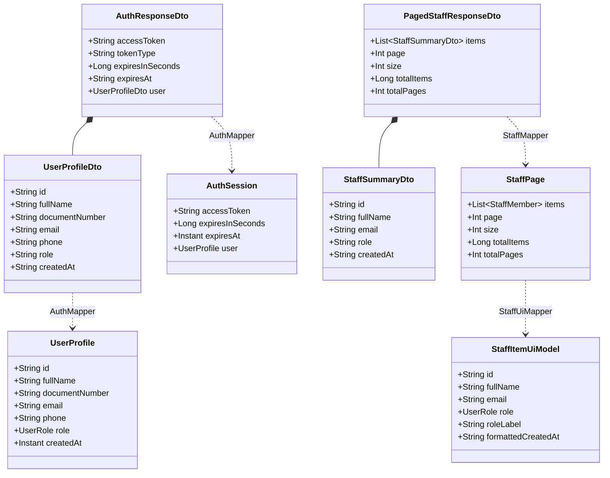
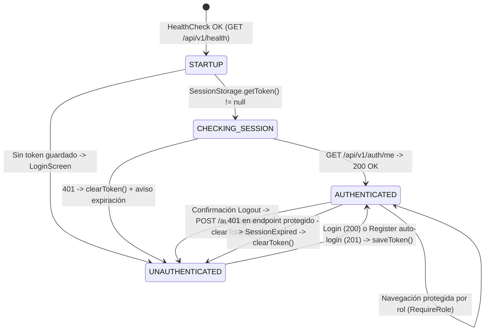

# Modelo de Datos y Entidades: 002-auth-users (Frontend)
**Ubicación:** `specs/002-auth-users/data-model.md`  
**Spec Asociada:** `specs/002-auth-users/spec.md`  
**Estado:** Aprobado  

---

## 1. Diagrama de Modelos y Flujo por Capas (Mermaid)

---

## 2. Entidades y Modelos por Capa (MVVM + Repository + Mapper)

### Capa Data (`data/dto`) — Contratos JSON `@Serializable`
*(Alineados 1:1 con `backend/specs/002-auth-users/contracts.md`)*
* **`RegisterRequestDto`:** `fullName: String`, `documentNumber: String`, `email: String`, `phone: String`, `password: String` *(sin campo `role`)*.
* **`LoginRequestDto`:** `email: String`, `password: String`.
* **`AuthResponseDto`:** `accessToken: String`, `tokenType: String`, `expiresInSeconds: Long`, `expiresAt: String`, `user: UserProfileDto`.
* **`UserProfileDto`:** `id: String`, `fullName: String`, `documentNumber: String`, `email: String`, `phone: String`, `role: String`, `createdAt: String`.
* **`CreateStaffRequestDto`:** `fullName: String`, `documentNumber: String`, `email: String`, `phone: String`, `password: String`, `role: String`.
* **`StaffSummaryDto`:** `id: String`, `fullName: String`, `email: String`, `role: String`, `createdAt: String`.
* **`PagedStaffResponseDto`:** `items: List<StaffSummaryDto>`, `page: Int`, `size: Int`, `totalItems: Long`, `totalPages: Int`.

### Capa Dominio (`domain/model` y `domain/repository`)
*(Libre de dependencias de DTOs JSON y componentes Compose)*
* **`UserRole` (`enum`):** `SOLICITANTE`, `PERSONAL_ATENCION`, `COORDINADOR`.
* **`UserProfile`:** `id: String`, `fullName: String`, `documentNumber: String`, `email: String`, `phone: String`, `role: UserRole`, `createdAt: Instant`.
* **`AuthSession`:** `accessToken: String`, `expiresInSeconds: Long`, `expiresAt: Instant`, `user: UserProfile` *(sobreescribe `toString()` enmascarando `accessToken`)*.
* **`StaffMember`:** `id: String`, `fullName: String`, `email: String`, `role: UserRole`, `createdAt: Instant`.
* **`StaffPage`:** `items: List<StaffMember>`, `page: Int`, `size: Int`, `totalItems: Long`, `totalPages: Int`.
* **`RegisterCommand` / `LoginCommand` / `CreateStaffCommand`:** Comandos de entrada hacia repositorios *(sobreescriben `toString()` enmascarando `password`)*.
* **Interfaces de Repositorio (`domain/repository/`):**
  * **`AuthRepository`:** `register(command): AppResult<AuthSession>`, `login(command): AppResult<AuthSession>`, `getCurrentUser(): AppResult<UserProfile>`, `logout(): AppResult<Unit>`.
  * **`StaffRepository`:** `listStaff(page: Int, size: Int, roleFilter: UserRole?): AppResult<StaffPage>`, `createStaff(command): AppResult<UserProfile>`.

### Capa ViewModel / UI (`viewmodel`) — `StateFlow` Inmutables
* **`SessionUiState` (`sealed interface`):**
  * `Checking`: Verificando token guardado en `SessionStorage` contra `/api/v1/auth/me`.
  * `Unauthenticated(noticeMessage: String? = null)`: Sin sesión activa (opcionalmente con aviso tras expiración `401` o cierre exitoso).
  * `Authenticated(user: UserProfile, isConfirmingLogout: Boolean = false, isLoggingOut: Boolean = false, errorMessage: String? = null)`: Sesión activa con rol verificado.
* **`LoginUiState`:** `email`, `password` *(enmascarada en `toString()`)*, `isPasswordVisible`, `fieldErrors: Map<String, String>`, `generalError: String?`, `isSubmitting: Boolean`.
* **`RegisterUiState`:** `fullName`, `documentNumber`, `email`, `phone`, `password` *(enmascarada en `toString()`)*, `isPasswordVisible`, `fieldErrors: Map<String, String>`, `generalError: String?`, `isSubmitting: Boolean`.
* **`StaffListUiState`:** `items: List<StaffItemUiModel>`, `page: Int`, `size: Int`, `totalItems: Long`, `totalPages: Int`, `selectedRoleFilter: UserRole?`, `isLoading: Boolean`, `errorMessage: String?`.
* **`StaffItemUiModel`:** `id: String`, `fullName: String`, `email: String`, `role: UserRole`, `roleLabel: String` (*"Personal de atención"* | *"Coordinador"*), `formattedCreatedAt: String` (`dd/mm/aaaa hh:mm` en `America/Bogota`).
* **`CreateStaffUiState`:** `fullName`, `documentNumber`, `email`, `phone`, `password` *(enmascarada en `toString()`)*, `isPasswordVisible`, `selectedRole: UserRole = UserRole.PERSONAL_ATENCION`, `fieldErrors: Map<String, String>`, `generalError: String?`, `isConfirmDialogOpen: Boolean`, `isSubmitting: Boolean`, `successMessage: String?`.

---

## 3. Reglas de Validación e Invariantes (`UserFormValidator`)
1. **Validación portable en `commonMain` (paridad 1:1 con Tabla 1 del Backend):**
   * `fullName`: `trim()` previo; longitud `3..100`; `trimmed.all { it == ' ' || it.isLetter() }` (compatible idénticamente entre Android JVM y Web `wasmJs`).
   * `documentNumber`: `trim()` previo; `^[0-9]{5,15}$`.
   * `email`: `trim().lowercase()`; longitud `<= 100`; formato de correo válido.
   * `phone`: `trim()` previo; `^[0-9]{7,15}$`.
   * `password`: longitud `>= 8`, `encodeToByteArray().size <= 72` (límite BCrypt del servidor), al menos una letra (`Char.isLetter()`) y al menos un dígito (`Char.isDigit()`).
   * `login`: exige `email` válido no vacío y `password` no vacía antes de enviar.
2. **Invariantes de Rol y Seguridad (RNF-03 / RNF-04):**
   * `CreateStaffUiState` solo permite elegir `PERSONAL_ATENCION` o `COORDINADOR` (rechaza cualquier uso de `SOLICITANTE`).
   * Las contraseñas jamás se almacenan en `SessionStorage`, ni en argumentos de `Navigation`, ni en logs (`toString()` enmascarado con `***`) y se limpian del `UiState` inmediatamente al completarse `login`, `register` o `createStaff`.
3. **Formato de Fechas y Paginación (RNF-07 / RNF-09):**
   * `StaffUiMapper` formatea `Instant` con `DateFormatter` en zona `America/Bogota` (`dd/mm/aaaa hh:mm`) y traduce `UserRole` a etiquetas en español.
   * `StaffListViewModel` opera estrictamente con `size = 20` y `page >= 1`.

---

## 4. Máquina de Estados de Sesión y Navegación Autenticada

