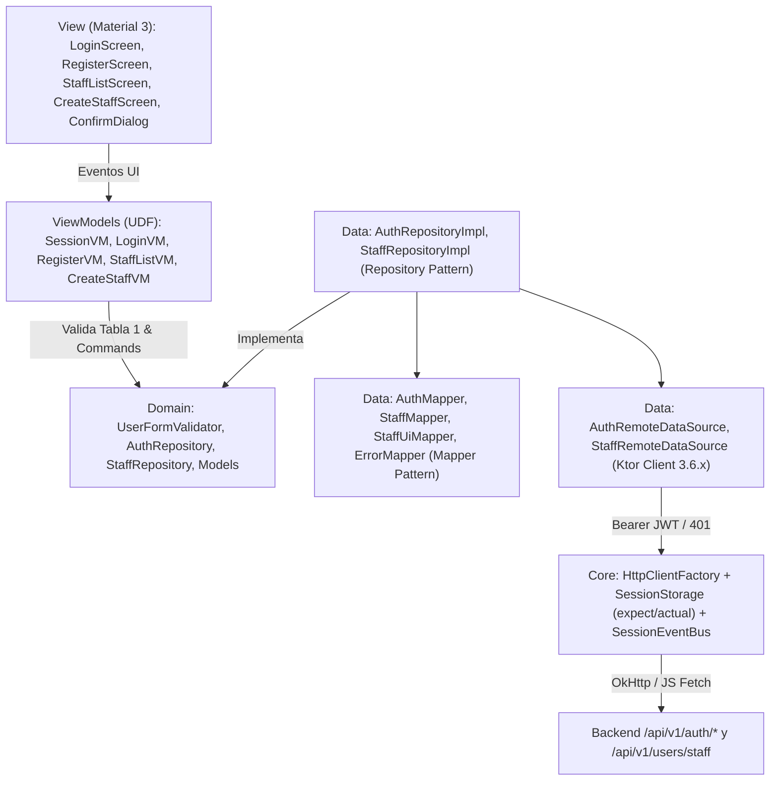

# Plan Técnico de Arquitectura: 002-auth-users (Frontend)
**Ubicación:** `specs/002-auth-users/plan.md`  
**Spec Asociada:** `specs/002-auth-users/spec.md`  
**Estado:** Aprobado  

---

## 1. Enfoque Arquitectónico y Diagrama de Solución
> Se construye sobre el esqueleto **Compose Multiplatform 1.12.2 (Material 3)** y **Kotlin Multiplatform 2.4.x** (`wasmJs` + Android) siguiendo **MVVM + UDF** estricto, **Repository Pattern** y **Mapper Pattern**, sin exponer DTOs HTTP ni lógica de red en las pantallas ni en los ViewModels.
> - **Gestión de Sesión JWT (1 hora):** Tras `StartupScreen`, `SessionViewModel` restaura sesión mediante `GET /api/v1/auth/me` si existe token en `SessionStorage`; ante `register` (auto-login) o `login`, persiste el nuevo JWT de 1 hora por plataforma (`sessionStorage` en Web; `EncryptedSharedPreferences` en Android); y ante `logout` confirmado (`RNF-09`) invoca `POST /api/v1/auth/logout` limpiando localmente token y backstack incluso ante `401`.
> - **Guardias RBAC y Navegación Tipada:** `AppNavHost` protege rutas con `RequireRole(...)`, ocultando opciones de Coordinación a otros roles y mostrando vistas adaptativas (Web desktop y móvil Android) para el listado paginado de personal (`20/pág`, `dd/mm/aaaa hh:mm` en `America/Bogota`).



---

## 2. Modificaciones de Archivos y Nuevos Componentes

| Archivo / Módulo (`composeApp/src/`) | Tipo de Cambio | Propósito |
| :--- | :--- | :--- |
| `commonMain/.../domain/model/` (`UserRole.kt`, `UserProfile.kt`, `AuthSession.kt`, `StaffMember.kt`, `StaffPage.kt`, `AuthCommands.kt`) | Nuevo | Modelos puros de dominio en KMP (`toString()` enmascarado en contraseñas y `accessToken`). |
| `commonMain/.../domain/validation/UserFormValidator.kt` | Nuevo | Validador portable `commonMain` (`Char.isLetter()`, `encodeToByteArray().size <= 72`) alineado 1:1 con Tabla 1 del Backend. |
| `commonMain/.../domain/repository/` (`AuthRepository.kt`, `StaffRepository.kt`) | Nuevo | Contratos puros de repositorio para autenticación, perfil, cierre de sesión y gestión paginada de personal. |
| `commonMain/.../data/dto/` (`AuthDtos.kt`, `StaffDtos.kt`) | Nuevo | DTOs `@Serializable` de request/response 1:1 con `contracts.md` (`RegisterRequestDto` sin campo `role`). |
| `commonMain/.../data/mapper/` (`AuthMapper.kt`, `StaffMapper.kt`, `StaffUiMapper.kt`, `ErrorMapper.kt`) | Nuevo / Modificado | Transformación `DTO -> Domain -> UiModel`, etiquetas de rol en español, fechas `dd/mm/aaaa hh:mm` (`America/Bogota`) y mapeo de `details[]` (`400`) y `409 Conflict`. |
| `commonMain/.../data/remote/` (`AuthRemoteDataSource.kt`, `StaffRemoteDataSource.kt`) | Nuevo | Llamadas Ktor Client hacia `/api/v1/auth/{register,login,me,logout}` y `/api/v1/users/staff`. |
| `commonMain/.../data/repository/` (`AuthRepositoryImpl.kt`, `StaffRepositoryImpl.kt`) | Nuevo | Orquestación de red + `SessionStorage.saveToken`/`clearToken` + emisión en `SessionEventBus`. |
| `commonMain/.../core/network/HttpClientFactory.kt` & `core/di/AppModules.kt` | Modificado | Reforzar exclusión de `SessionExpired` en `/auth/login` y `/auth/register`, manejar `401` en `/auth/logout` como cierre limpio y registrar dependencias Koin (`Single`/`ViewModel`). |
| `commonMain/.../viewmodel/` (`SessionViewModel.kt`, `LoginViewModel.kt`, `RegisterViewModel.kt`, `StaffListViewModel.kt`, `CreateStaffViewModel.kt` + `*UiState.kt`) | Nuevo | Gestión reactiva `StateFlow`, validación de entrada, limpieza inmediata de contraseñas tras éxito y control de diálogos `RNF-09`. |
| `commonMain/.../ui/components/` (`ConfirmationDialog.kt`, `PasswordTextField.kt`, `AuthenticatedTopBar.kt`, `RequireRole.kt`) | Nuevo | Componentes reutilizables Material 3 en español con `Modifier.testTag` semánticos. |
| `commonMain/.../ui/screens/` (`auth/LoginScreen.kt`, `auth/RegisterScreen.kt`, `home/{Applicant,Agent,Coordinator}HomeScreen.kt`, `staff/StaffListScreen.kt`, `staff/CreateStaffScreen.kt`) | Nuevo | Pantallas responsivas Web (`wasmJs`) + Android con soporte de ancho máximo en formularios, vista adaptativa tabla/tarjetas y paginación 20/pág. |
| `commonMain/.../ui/navigation/` (`Routes.kt`, `AppNavHost.kt`) | Modificado | Rutas tipadas `@Serializable`, guardia RBAC `RequireRole`, redirección inicial post-`Startup` y limpieza de backstack en login/logout/expiración. |
| `commonTest/.../` (`UserFormValidatorTest.kt`, `AuthMapperTest.kt`, `StaffUiMapperTest.kt`, `AuthRepositoryTest.kt`, `StaffRepositoryTest.kt`, `SessionViewModelTest.kt`, `LoginViewModelTest.kt`, `RegisterViewModelTest.kt`, `StaffListViewModelTest.kt`, `CreateStaffViewModelTest.kt`, `LoginScreenTest.kt`, `RegisterScreenTest.kt`, `StaffScreensTest.kt`, `RoleGuardAndLogoutTest.kt`) | Nuevo | Tests unitarios, `Ktor MockEngine` y `Compose UI Test` cubriendo validaciones, `200/201/204/400/401/403/409`, confirmaciones `RNF-09`, `ktlintCheck` y `koverVerify` ($\ge 90\%$). |

---

## 3. Esquema de Navegación Protegida y Guardias RBAC (`AppNavHost`)
```kotlin
// Esquema conceptual de rutas tipadas y protección por rol en AppNavHost
@Serializable object StartupRoute
@Serializable object LoginRoute
@Serializable object RegisterRoute
@Serializable object ApplicantHomeRoute
@Serializable object AgentHomeRoute
@Serializable object CoordinatorHomeRoute
@Serializable object StaffListRoute
@Serializable object CreateStaffRoute
```
* Al completarse `StartupUiState.Ready`, `SessionViewModel.restoreSession()` determina si navegar a `LoginRoute` o al Home del rol recuperado vía `GET /api/v1/auth/me`.
* Ante `SessionEvent.SessionExpired` o `SessionEvent.LoggedOut`, el host limpia la pila de navegación (`popUpTo(0) { inclusive = true }`) y posiciona `LoginRoute`.
* `StaffListRoute` y `CreateStaffRoute` envuelven su contenido con `RequireRole(allowedRoles = setOf(UserRole.COORDINADOR))`.

---

## 4. Riesgos Técnicos y Mitigación
* **Riesgo 1 — Bucle de redirección al fallar credenciales (`401`) en `LoginScreen`:**
  * *Mitigación:* Excluir `/api/v1/auth/login` y `/api/v1/auth/register` del interceptor de `SessionEvent.SessionExpired` en `HttpClientFactory` y manejar `DomainError.Unauthorized` directamente en `LoginViewModel`.
* **Riesgo 2 — Comportamiento desigual de Regex Unicode entre Android JVM y Web `wasmJs`:**
  * *Mitigación:* Reemplazar `\p{L}` por utilidades estándar multiplataforma de Kotlin (`Char.isLetter()`, `Char.isDigit()`, `encodeToByteArray().size <= 72`) verificadas en `commonTest`.
* **Riesgo 3 — Permanencia de contraseñas en memoria o estados guardados tras autenticación:**
  * *Mitigación:* Prohibir `rememberSaveable` para campos sensibles, sobreescribir `toString()` con `"***"`, y resetear el campo `password` en los `ViewModel` inmediatamente tras `register`, `login` y `createStaff`.
* **Riesgo 4 — Pérdida de sesión del Coordinador al registrar personal interno (`POST /api/v1/users/staff`):**
  * *Mitigación:* `StaffRemoteDataSource.createStaff` no invoca `SessionStorage.saveToken(...)` ni altera `SessionUiState`; tras `201 Created`, solo actualiza `StaffListViewModel` y conserva intacto el JWT vigente del Coordinador.
* **Riesgo 5 — Caída de cobertura Kover (`< 90%`) o violaciones de `ktlint`:**
  * *Mitigación:* Cubrir todas las ramas de `ErrorMapper`, `UserFormValidator`, `ViewModels` (con `MockEngine` + `StandardTestDispatcher`) y pantallas (`Compose UI Test`) ejecutando `./gradlew ktlintCheck check koverVerify`.
