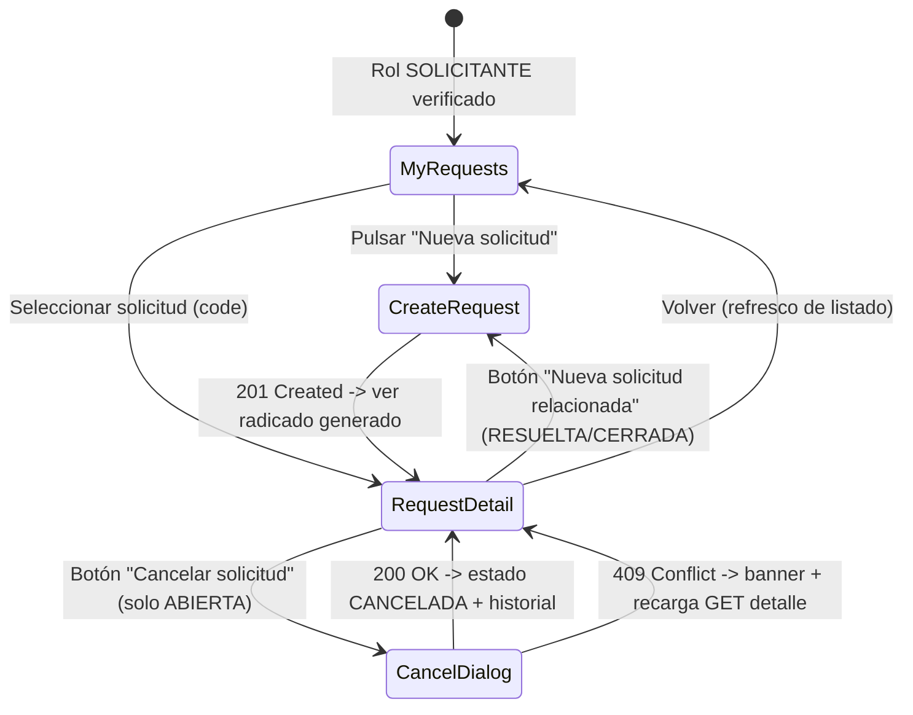

# Modelo de Datos y Entidades: 003-service-requests (Frontend)
**Ubicación:** `specs/003-service-requests/data-model.md`  
**Spec Asociada:** `specs/003-service-requests/spec.md`  
**Estado:** Aprobado  

---

## 1. Diagrama de Modelos y Flujo por Capas (Mermaid)

```mermaid
classDiagram
    class PagedServiceRequestsResponseDto {
        +List~ServiceRequestSummaryDto~ items
        +Int page
        +Int size
        +Long totalItems
        +Int totalPages
    }
    class ServiceRequestSummaryDto {
        +String id
        +String code
        +String subject
        +String category
        +String status
        +String? previousRequestCode
        +String createdAt
    }
    class ServiceRequestDetailDto {
        +String id
        +String code
        +String category
        +String subject
        +String description
        +String status
        +String? previousRequestCode
        +String? responseText
        +String? respondedAt
        +String? closedAt
        +String createdAt
        +String updatedAt
        +List~RequestHistoryItemDto~ history
    }
    class RequestHistoryItemDto {
        +String id
        +String action
        +String? previousState
        +String newState
        +String occurredAt
        +String? comment
    }
    class ServiceRequestsPage {
        +List~ServiceRequestSummary~ items
        +Int page
        +Int size
        +Long totalItems
        +Int totalPages
    }
    class ServiceRequestDetail {
        +String id
        +String code
        +RequestCategory category
        +String subject
        +String description
        +RequestStatus status
        +String? previousRequestCode
        +String? responseText
        +Instant? respondedAt
        +Instant? closedAt
        +Instant createdAt
        +Instant updatedAt
        +List~ServiceRequestHistoryEntry~ history
    }
    class RequestSummaryUiModel {
        +String id
        +String code
        +String subject
        +RequestCategory category
        +String categoryLabel
        +RequestStatus status
        +String statusLabel
        +String? previousRequestCode
        +String formattedCreatedAt
    }
    class RequestDetailUiModel {
        +String code
        +String categoryLabel
        +RequestStatus status
        +String statusLabel
        +String subject
        +String description
        +String? previousRequestCode
        +String? responseText
        +String? formattedRespondedAt
        +String? formattedClosedAt
        +String formattedCreatedAt
        +String formattedUpdatedAt
        +Boolean canCancel
        +Boolean canCreateRelated
        +List~RequestHistoryItemUiModel~ history
    }

    PagedServiceRequestsResponseDto *-- ServiceRequestSummaryDto
    ServiceRequestDetailDto *-- RequestHistoryItemDto
    PagedServiceRequestsResponseDto ..> ServiceRequestsPage : RequestMapper
    ServiceRequestDetailDto ..> ServiceRequestDetail : RequestMapper
    ServiceRequestsPage ..> RequestSummaryUiModel : RequestUiMapper
    ServiceRequestDetail ..> RequestDetailUiModel : RequestUiMapper
```

---

## 2. Entidades y Modelos por Capa (MVVM + Repository + Mapper)

### Capa Data (`data/dto/requests`) — Contratos JSON `@Serializable`
*(Alineados 1:1 con `backend/specs/003-service-requests/contracts.md`)*
* **`CreateServiceRequestDto`:** `category: String`, `subject: String`, `description: String`, `previousRequestCode: String? = null` *(sin `code`, `status`, `createdAt` ni `requesterId`)*.
* **`CancelServiceRequestDto`:** `reason: String? = null`.
* **`RequestHistoryItemDto`:** `id: String`, `action: String`, `previousState: String?`, `newState: String`, `occurredAt: String`, `comment: String?`.
* **`ServiceRequestDetailDto`:** `id: String`, `code: String`, `category: String`, `subject: String`, `description: String`, `status: String`, `previousRequestCode: String?`, `responseText: String?`, `respondedAt: String?`, `closedAt: String?`, `createdAt: String`, `updatedAt: String`, `history: List<RequestHistoryItemDto>`.
* **`ServiceRequestSummaryDto`:** `id: String`, `code: String`, `subject: String`, `category: String`, `status: String`, `previousRequestCode: String?`, `createdAt: String`.
* **`PagedServiceRequestsResponseDto`:** `items: List<ServiceRequestSummaryDto>`, `page: Int`, `size: Int`, `totalItems: Long`, `totalPages: Int`.

### Capa Dominio (`domain/model` y `domain/repository`)
*(Libre de dependencias HTTP JSON y Compose)*
* **`RequestCategory` (`enum`):** `TRAMITE`, `ORIENTACION`, `ATENCION_ADMINISTRATIVA`, `REQUERIMIENTO_SERVICIO`.
* **`RequestStatus` (`enum`):** `ABIERTA`, `EN_REVISION`, `ESCALADA`, `RESUELTA`, `CERRADA`, `CANCELADA`.
* **`RequestHistoryAction` (`enum`):** `CREACION`, `CANCELACION`, `ASIGNACION`, `INTERVENCION`, `ESCALAMIENTO`, `REASIGNACION`, `RESPUESTA`, `CIERRE_AUTOMATICO`.
* **`ServiceRequestSummary`:** `id`, `code`, `subject`, `category: RequestCategory`, `status: RequestStatus`, `previousRequestCode: String?`, `createdAt: Instant`.
* **`ServiceRequestHistoryEntry`:** `id`, `action: RequestHistoryAction`, `previousState: RequestStatus?`, `newState: RequestStatus`, `occurredAt: Instant`, `comment: String?`.
* **`ServiceRequestDetail`:** `id`, `code`, `category: RequestCategory`, `subject`, `description`, `status: RequestStatus`, `previousRequestCode: String?`, `responseText: String?`, `respondedAt: Instant?`, `closedAt: Instant?`, `createdAt: Instant`, `updatedAt: Instant`, `history: List<ServiceRequestHistoryEntry>`.
* **`ServiceRequestsPage`:** `items: List<ServiceRequestSummary>`, `page: Int`, `size: Int`, `totalItems: Long`, `totalPages: Int`.
* **`CreateServiceRequestCommand` / `CancelServiceRequestCommand`:** Comandos validados desde ViewModel hacia repositorio.
* **Interfaz de Repositorio (`domain/repository/ServiceRequestRepository.kt`):**
  * `suspend fun create(command: CreateServiceRequestCommand): AppResult<ServiceRequestDetail>`
  * `suspend fun getMyRequests(page: Int, size: Int = 20, statusFilter: RequestStatus? = null): AppResult<ServiceRequestsPage>`
  * `suspend fun getDetail(code: String): AppResult<ServiceRequestDetail>`
  * `suspend fun cancel(command: CancelServiceRequestCommand): AppResult<ServiceRequestDetail>`

### Capa ViewModel / UI (`viewmodel/requests` y `ui/mapper`) — `StateFlow` Inmutables
* **`MyRequestsUiState`:**
  * `items: List<RequestSummaryUiModel> = emptyList()`, `page: Int = 1`, `size: Int = 20`, `totalItems: Long = 0`, `totalPages: Int = 1`, `selectedStatusFilter: RequestStatus? = null`, `isLoading: Boolean = true`, `errorMessage: String? = null`.
* **`RequestSummaryUiModel`:**
  * `id`, `code`, `subject`, `category: RequestCategory`, `categoryLabel: String` (*"Trámite"*, *"Orientación"*, *"Atención administrativa"*, *"Requerimiento de servicio"*), `status: RequestStatus`, `statusLabel: String`, `previousRequestCode: String?`, `formattedCreatedAt: String` (`dd/mm/aaaa hh:mm`).
* **`CreateRequestUiState`:**
  * `category: RequestCategory? = null`, `subject: String = ""`, `description: String = ""`, `previousRequestCode: String = ""`, `fieldErrors: Map<String, String> = emptyMap()`, `generalError: String? = null`, `isSubmitting: Boolean = false`, `createdCode: String? = null`.
* **`RequestDetailUiState` (`sealed interface`):**
  * `Loading(code: String)`
  * `Error(code: String, message: String, isNotFound: Boolean = false, isForbidden: Boolean = false)`
  * `Content(detail: RequestDetailUiModel, isCancelDialogOpen: Boolean = false, cancelReason: String = "", cancelReasonError: String? = null, isCancelling: Boolean = false, actionError: String? = null, successNotice: String? = null)`
* **`RequestDetailUiModel`:**
  * `id`, `code`, `category: RequestCategory`, `categoryLabel`, `status: RequestStatus`, `statusLabel`, `subject`, `description`, `previousRequestCode: String?`, `responseText: String?`, `formattedRespondedAt: String?`, `formattedClosedAt: String?`, `formattedCreatedAt: String`, `formattedUpdatedAt: String`, `canCancel: Boolean` (`status == ABIERTA`), `canCreateRelated: Boolean` (`status == RESUELTA || status == CERRADA`), `history: List<RequestHistoryItemUiModel>`.
* **`RequestHistoryItemUiModel`:**
  * `id`, `actionLabel: String`, `transitionLabel: String`, `formattedOccurredAt: String`, `comment: String?`.

---

## 3. Reglas de Validación e Invariantes (`RequestFormValidator`)
1. **Validación portable en `commonMain` (paridad 1:1 con Tabla 2 del Backend):**
   * `category`: obligatorio (debe seleccionarse una de las 4 opciones).
   * `subject`: `trim()` previo; longitud obligatoria entre `5` y `100` caracteres.
   * `description`: `trim()` previo; longitud obligatoria entre `20` y `2000` caracteres.
   * `previousRequestCode`: opcional; si tras `trim()` no está vacío, se normaliza a mayúsculas y debe cumplir `^SOL-\d{4}-\d{5,}$` antes de enviar (las reglas de existencia, propiedad y estado `RESUELTA`/`CERRADA` se reciben y mapean desde el Backend en `fieldErrors["previousRequestCode"]`).
   * `cancelReason`: opcional; tras `trim()`, longitud máxima `500` caracteres.
2. **Invariantes UI de Estado y Privacidad (RF-03 / RNF-09):**
   * El botón **"Cancelar solicitud"** solo está habilitado cuando `canCancel == true` (`status == ABIERTA`), y exige confirmación previa en `CancelRequestDialog`.
   * El botón **"Nueva solicitud relacionada"** solo está disponible cuando `canCreateRelated == true` (`status == RESUELTA || status == CERRADA`) y pre-llena `previousRequestCode` en `CreateRequestScreen`.
   * Todas las marcas temporales mostradas al usuario se transforman a `dd/mm/aaaa hh:mm` en zona `America/Bogota` mediante `DateFormatter` y todas las etiquetas se traducen vía `RequestUiMapper`.

---

## 4. Diagrama de Navegación y Estados de la Pantalla de Detalle

