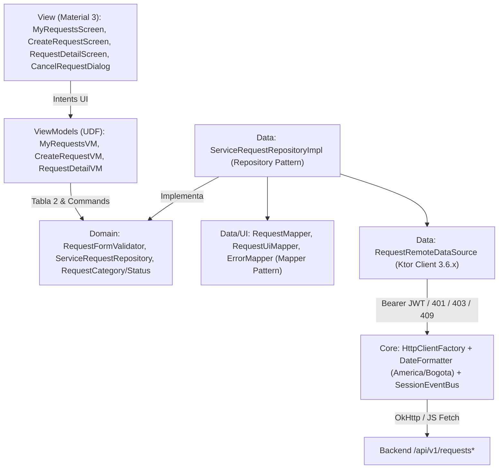

# Plan Técnico de Arquitectura: 003-service-requests (Frontend)
**Ubicación:** `specs/003-service-requests/plan.md`  
**Spec Asociada:** `specs/003-service-requests/spec.md`  
**Estado:** Aprobado  

---

## 1. Enfoque Arquitectónico y Diagrama de Solución
> Se construye sobre la base **Compose Multiplatform 1.12.2 (Material 3)** y **Kotlin Multiplatform 2.4.x** (`wasmJs` + Android) manteniendo estrictamente **MVVM + UDF + Repository Pattern + Mapper Pattern**, reutilizando el pipeline autenticado de `002-auth-users` (`HttpClientFactory` con Bearer JWT de 1 hora, manejo de `401 -> SessionExpired` y guardia `RequireRole(UserRole.SOLICITANTE)`).
> - **Reemplazo del Shell de Solicitante (`ApplicantHomeRoute`):** `ApplicantHomeScreen` deja de ser un placeholder de `002` y pasa a hospedar `MyRequestsScreen` con paginación `20/pág`, filtro por los 6 estados oficiales, acceso a detalle y radicación de solicitudes.
> - **Radicación y Vinculación Previa (`CreateRequestScreen`):** `RequestFormValidator` aplica Tabla 2 y formato `^SOL-\d{4}-\d{5,}$` de forma portable en `commonMain`, combinándose con `ErrorMapper` para resaltar errores de negocio devueltos por el servidor (`previousRequestCode` inválido, ajeno o no `RESUELTA`/`CERRADA`) y navegando al detalle del radicado generado (`201 Created`).
> - **Trazabilidad, Respuesta Oficial y Cancelación Segura (`RequestDetailScreen`):** Presenta fechas en `dd/mm/aaaa hh:mm` (`America/Bogota`) y etiquetas en español vía `RequestUiMapper`, bloque destacado de respuesta oficial cuando esté `Resuelta`/`Cerrada` con enlace **"Nueva solicitud relacionada"**, y confirmación modal (`CancelRequestDialog`, `RNF-09`) exclusiva para `ABIERTA` con sincronización automática ante `409 Conflict`.



---

## 2. Modificaciones de Archivos y Nuevos Componentes

| Archivo / Módulo (`composeApp/src/`) | Tipo de Cambio | Propósito |
| :--- | :--- | :--- |
| `commonMain/.../domain/model/` (`RequestCategory.kt`, `RequestStatus.kt`, `RequestHistoryAction.kt`, `ServiceRequestModels.kt`, `RequestCommands.kt`) | Nuevo | Enums y entidades puras de dominio KMP (`ServiceRequestSummary`, `ServiceRequestDetail`, `ServiceRequestHistoryEntry`, `ServiceRequestsPage`). |
| `commonMain/.../domain/validation/RequestFormValidator.kt` | Nuevo | Validador portable `commonMain` para Tabla 2 (`category`, `subject` `5..100`, `description` `20..2000`), patrón `^SOL-\d{4}-\d{5,}$` y `cancelReason <= 500` con `trim()` previo. |
| `commonMain/.../domain/repository/ServiceRequestRepository.kt` | Nuevo | Interfaz pura de repositorio (`create`, `getMyRequests`, `getDetail`, `cancel`). |
| `commonMain/.../data/dto/requests/ServiceRequestDtos.kt` | Nuevo | DTOs `@Serializable` 1:1 con `contracts.md` (`CreateServiceRequestDto`, `CancelServiceRequestDto`, `ServiceRequestDetailDto`, `ServiceRequestSummaryDto`, `PagedServiceRequestsResponseDto`, `RequestHistoryItemDto`). |
| `commonMain/.../data/mapper/` (`RequestMapper.kt`, `RequestUiMapper.kt`) | Nuevo | **Patrón Mapper:** `DTO -> Domain` (`Instant`, enums) y `Domain -> UiModel` (etiquetas en español para categorías/estados/acciones, `dd/mm/aaaa hh:mm` en `America/Bogota`, flags `canCancel` / `canCreateRelated`). |
| `commonMain/.../data/remote/RequestRemoteDataSource.kt` | Nuevo | Llamadas Ktor Client hacia `POST /api/v1/requests`, `GET /api/v1/requests/my`, `GET /api/v1/requests/{code}` y `POST /api/v1/requests/{code}/cancel`. |
| `commonMain/.../data/repository/ServiceRequestRepositoryImpl.kt` | Nuevo | Implementación de `ServiceRequestRepository` reutilizando mapeo uniforme de errores HTTP (`400`, `401`, `403`, `404`, `409`). |
| `commonMain/.../core/di/AppModules.kt` | Modificado | Registrar `RequestRemoteDataSource`, `ServiceRequestRepositoryImpl`, `RequestMapper`, `RequestUiMapper`, `MyRequestsViewModel`, `CreateRequestViewModel` y `RequestDetailViewModel`. |
| `commonMain/.../viewmodel/requests/` (`MyRequestsUiState.kt`, `MyRequestsViewModel.kt`, `CreateRequestUiState.kt`, `CreateRequestViewModel.kt`, `RequestDetailUiState.kt`, `RequestDetailViewModel.kt`) | Nuevo | Gestión reactiva `StateFlow` (paginación `size = 20`, filtro de estado, anti-doble envío `isSubmitting`, diálogo de cancelación y recarga automática tras `409`). |
| `commonMain/.../ui/components/` (`RequestStatusChip.kt`, `CancelRequestDialog.kt`) | Nuevo | Chips semánticos por estado/categoría en español y modal de confirmación de cancelación (`RNF-09`) con motivo opcional (`<= 500`) y contador. |
| `commonMain/.../ui/screens/requests/` (`MyRequestsScreen.kt`, `CreateRequestScreen.kt`, `RequestDetailScreen.kt`) & `home/ApplicantHomeScreen.kt` | Nuevo / Modificado | Pantallas responsivas Web (`wasmJs`) + Android M3; reemplazo del placeholder en `ApplicantHomeScreen` por `MyRequestsScreen`. |
| `commonMain/.../ui/navigation/` (`Routes.kt`, `AppNavHost.kt`) | Modificado | Rutas tipadas `CreateRequestRoute(previousRequestCode: String? = null)` y `RequestDetailRoute(code: String)` bajo `RequireRole(UserRole.SOLICITANTE)`. |
| `commonTest/.../` (`RequestFormValidatorTest.kt`, `RequestMapperTest.kt`, `RequestUiMapperTest.kt`, `ServiceRequestRepositoryTest.kt`, `MyRequestsViewModelTest.kt`, `CreateRequestViewModelTest.kt`, `RequestDetailViewModelTest.kt`, `MyRequestsScreenTest.kt`, `CreateRequestScreenTest.kt`, `RequestDetailScreenTest.kt`) | Nuevo | Tests unitarios, `Ktor MockEngine` (`200`/`201`/`400`/`401`/`403`/`404`/`409`) y `Compose UI Test` verificando confirmaciones `RNF-09`, visibilidad condicional de botones, formato `dd/mm/aaaa hh:mm`, `ktlintCheck` y `koverVerify` ($\ge 90\%$). |

---

## 3. Esquema de Navegación del Módulo Solicitante (`AppNavHost`)
```kotlin
// Extensión de rutas tipadas para 003-service-requests (protegidas con RequireRole(SOLICITANTE))
@Serializable data class CreateRequestRoute(val previousRequestCode: String? = null)
@Serializable data class RequestDetailRoute(val code: String)
```
* Desde `ApplicantHomeRoute` (`MyRequestsScreen`):
  * Pulsar **"Nueva solicitud"** → `CreateRequestRoute(previousRequestCode = null)`.
  * Seleccionar tarjeta/fila de solicitud → `RequestDetailRoute(code = item.code)`.
* Desde `CreateRequestRoute`:
  * Al recibir `201 Created` → navega a `RequestDetailRoute(code = created.code)` reemplazando `CreateRequestRoute` en el backstack (`popUpTo<CreateRequestRoute> { inclusive = true }`).
* Desde `RequestDetailRoute`:
  * Pulsar **"Nueva solicitud relacionada"** (solo `RESUELTA` o `CERRADA`) → `CreateRequestRoute(previousRequestCode = detail.code)`.
  * Al volver a `ApplicantHomeRoute` → `MyRequestsViewModel.refresh()` mantiene actualizada la lista tras creaciones o cancelaciones.

---

## 4. Riesgos Técnicos y Mitigación
* **Riesgo 1 — Estado desactualizado en `MyRequestsScreen` después de radicar o cancelar una solicitud:**
  * *Mitigación:* Disparar recarga limpia desde el `ViewModel` al reingresar a `ApplicantHomeRoute` sin duplicar cachés locales, preservando filtro y reiniciando o manteniendo página de forma predecible.
* **Riesgo 2 — Condición de carrera al intentar cancelar una solicitud que acaba de ser asignada en el servidor:**
  * *Mitigación:* Capturar `409 Conflict` en `RequestDetailViewModel`, cerrar `CancelRequestDialog`, mostrar el mensaje exacto del Backend en banner visible y ejecutar `loadDetail(code)` para actualizar el estado real en pantalla (ocultando inmediatamente **"Cancelar solicitud"**).
* **Riesgo 3 — Falla de parseo si el Backend introduce valores nuevos o nulos en historial:**
  * *Mitigación:* Validar mapeo seguro en `RequestMapper` para respetar `history[]` ya filtrado por el servidor (`comment` nullable, `previousState` nullable en `CREACION`) y renderizar transiciones limpias sin asumir campos no nulos.
* **Riesgo 4 — Doble radicación o doble cancelación por clics repetidos en Web/móvil:**
  * *Mitigación:* Deshabilitar controles de envío mientras `isSubmitting == true` / `isCancelling == true` e ignorar eventos repetidos en los `ViewModel`.
* **Riesgo 5 — Desviación de estilo (`ktlint`) o caída de cobertura Kover (`< 90%`):**
  * *Mitigación:* Probar todas las ramas de `RequestFormValidator`, `RequestMapper`, `RequestUiMapper`, flujos negativos (`400`, `401`, `403`, `404`, `409`, fallo de red + Reintentar) y árboles semánticos Compose, ejecutando `./gradlew ktlintCheck check koverVerify`.
