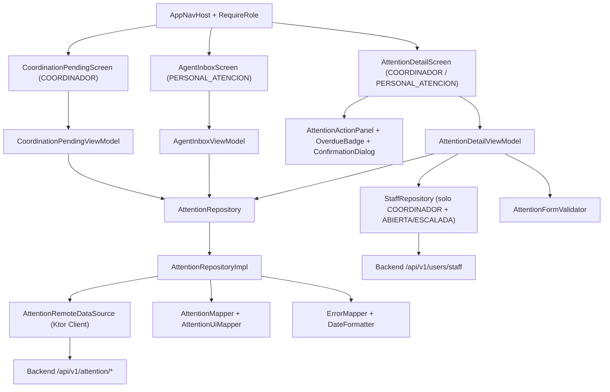

# Plan de Implementación Técnico: Ciclo de Atención y Escalamiento (Frontend)

**Feature:** `004-attention-lifecycle`  
**Subproyecto:** Frontend (Kotlin Multiplatform + Compose Multiplatform)  
**Versión:** 1.0.0  
**Fecha:** 2026-11-14  
**Estado:** Aprobado  

---

## 1. Alineación con la Constitución y Alcance

Este plan materializa las especificaciones aprobadas en `spec.md`, `research.md`, `data-model.md` y `contracts.md` para `004-attention-lifecycle`, obedeciendo estrictamente `frontend/.specify/memory/constitution.md`:

- **Stack y Targets:** Kotlin Multiplatform 2.4.x, Compose Multiplatform 1.12.2 (Material 3, interfaz 100% en español, fechas en formato `dd/mm/aaaa hh:mm` en zona horaria `America/Bogota` vía `kotlinx-datetime`), compilación objetivo `wasmJs` y Android (`minSdk 26`, `compileSdk`/`targetSdk` 35/36).
- **Red y Serialización:** Ktor Client 3.6.x (`OkHttp` en Android / `JS fetch` en `wasmJs`), `kotlinx.serialization.json` con `ignoreUnknownKeys = false` para detectar cualquier desviación contractual de forma temprana.
- **Arquitectura:** MVVM + Unidirectional Data Flow (UDF) + Repository + Mapper + Validación en dominio (`AttentionFormValidator`). Cero llamadas HTTP o lógica de parseo dentro de composables.
- **Integración incremental sin regresiones:**
  - Reemplaza los placeholders `CoordinatorHome` y `AgentHome` introducidos en `002-auth-users`, conservando el acceso explícito del `COORDINADOR` a `StaffListRoute`.
  - Mantiene intacto el flujo del `SOLICITANTE` (`003-service-requests`: `MyRequestsScreen`, `CreateRequestScreen`, `RequestDetailScreen`).
- **Calidad:** `ktlint 1.8.x` sin advertencias, JetBrains Kover $\ge 90\%$ de cobertura y compilación verificada en `wasmJs` y Android Debug.

---

## 2. Arquitectura de Capas y Flujo UDF

---

## 3. Plan de Archivos y Componentes

| Ruta Relativa (`frontend/composeApp/src/...`) | Acción | Responsabilidad |
| :--- | :--- | :--- |
| `commonMain/.../domain/model/AttentionModels.kt` | Crear | Modelos de dominio: `RequestPriority`, `HistoryActorRole`, `AttentionRequestSummary`, `AttentionRequestsPage`, `InternalHistoryEntry`, `AttentionRequestDetail`, y comandos (`AssignRequestCommand`, `ReassignRequestCommand`, `AddInterventionCommand`, `EscalateRequestCommand`, `RespondRequestCommand`). |
| `commonMain/.../domain/validation/AttentionFormValidator.kt` | Crear | Validaciones de entrada en cliente (`assigneeId`, `priority`, `reason` `10..500`, `comment` `10..1000`, `responseText` `20..2000`) alineadas con el backend. |
| `commonMain/.../domain/repository/AttentionRepository.kt` | Crear | Contrato de repositorio para bandejas, detalle interno y las 5 transiciones operativas. |
| `commonMain/.../data/dto/attention/AttentionDtos.kt` | Crear | DTOs serializables (`AssignRequestDto`, `ReassignRequestDto`, `AddInterventionRequestDto`, `EscalateRequestDto`, `RespondRequestDto`, `AttentionRequestSummaryDto`, `PagedAttentionRequestsResponseDto`, `InternalRequestHistoryItemDto`, `AttentionRequestDetailDto`). |
| `commonMain/.../data/mapper/AttentionMapper.kt` | Crear | Transformación DTOs <-> Dominio (manejo de `RequestPriority`, `HistoryActorRole`, fechas ISO-8601 y campos opcionales). |
| `commonMain/.../data/mapper/AttentionUiMapper.kt` | Crear | Formateo de presentación en español (`"Alta (24 h)"`, `"Media (72 h)"`, `"Baja (120 h)"`, `"Vencida"`, `"Respondida dentro del plazo"`, `"Respondida fuera del plazo"`, `"Sistema"`, fechas `dd/mm/aaaa hh:mm` en `America/Bogota`). |
| `commonMain/.../data/remote/AttentionRemoteDataSource.kt` | Crear | Llamadas HTTP Ktor a los 8 endpoints de `/api/v1/attention/*` con manejo tipado de query params (`page`, `size=20`, `status`). |
| `commonMain/.../data/repository/AttentionRepositoryImpl.kt` | Crear | Implementación de `AttentionRepository` orquestando `AttentionRemoteDataSource`, `AttentionMapper` y `ErrorMapper`. |
| `commonMain/.../core/di/AppModules.kt` | Modificar | Registrar `AttentionRemoteDataSource`, `AttentionRepository`, `AttentionFormValidator`, `CoordinationPendingViewModel`, `AgentInboxViewModel` y `AttentionDetailViewModel`. |
| `commonMain/.../viewmodel/attention/CoordinationPendingUiState.kt` | Crear | Estado UI de bandeja de coordinación (filtro `ABIERTA`/`ESCALADA`, lista paginada, carga/error/recarga). |
| `commonMain/.../viewmodel/attention/CoordinationPendingViewModel.kt` | Crear | Lógica UDF de `GET /api/v1/attention/coordination/pending` (`size=20`, orden servidor `created_at ASC`). |
| `commonMain/.../viewmodel/attention/AgentInboxUiState.kt` | Crear | Estado UI de bandeja del agente (filtro `EN_REVISION`/`ESCALADA`/`RESUELTA`/`CERRADA`, lista paginada). |
| `commonMain/.../viewmodel/attention/AgentInboxViewModel.kt` | Crear | Lógica UDF de `GET /api/v1/attention/my-assigned` (`size=20`). |
| `commonMain/.../viewmodel/attention/AttentionDetailUiState.kt` | Crear | Estado UI completo de detalle interno, catálogo de agentes elegibles, pestaña activa (`AgentActionTab`), borradores independientes por pestaña y `PendingConfirmationAction`. |
| `commonMain/.../viewmodel/attention/AttentionDetailViewModel.kt` | Crear | Orquestación de detalle, carga condicional multipágina de `StaffRepository`, validaciones, confirmaciones y recarga automática tras `409 Conflict`. |
| `commonMain/.../ui/components/OverdueBadge.kt` | Crear | Etiqueta visual `"Vencida"` de carácter estrictamente informativo. |
| `commonMain/.../ui/components/AttentionActionPanel.kt` | Crear | Panel contextual de acciones por rol/estado (`Assign`/`Reassign` para `COORDINADOR`; `AgentActionTab` con `Intervención`, `Escalar` y `Responder` para `PERSONAL_ATENCION`), conectado a `ConfirmationDialog`. |
| `commonMain/.../ui/screens/attention/CoordinationPendingScreen.kt` | Crear | Bandeja de pendientes de coordinación + acceso a gestión de personal (`StaffListRoute`). |
| `commonMain/.../ui/screens/attention/AgentInboxScreen.kt` | Crear | Bandeja de solicitudes asignadas al agente. |
| `commonMain/.../ui/screens/attention/AttentionDetailScreen.kt` | Crear | Vista interna completa: resumen, indicador SLA, descripción, bloque de respuesta oficial, `AttentionActionPanel` e historial interno cronológico. |
| `commonMain/.../ui/screens/.../CoordinatorHomeScreen.kt` y `AgentHomeScreen.kt` | Modificar | Sustituir los placeholders de `002` conectando directamente con `CoordinationPendingScreen` y `AgentInboxScreen`. |
| `commonMain/.../ui/navigation/Routes.kt` y `AppNavHost.kt` | Modificar | Agregar `AttentionDetailRoute(val code: String)` y actualizar destinos de `CoordinatorHomeRoute` y `AgentHomeRoute` bajo `RequireRole`. |

---

## 4. Navegación Tipada y Guardias RBAC

| Ruta Tipada | Roles Permitidos (`RequireRole`) | Destino Renderizado | Origen Principal |
| :--- | :--- | :--- | :--- |
| `CoordinatorHomeRoute` | `UserRole.COORDINADOR` | `CoordinationPendingScreen` (con acceso a `StaffListRoute`) | Login como `COORDINADOR` |
| `AgentHomeRoute` | `UserRole.PERSONAL_ATENCION` | `AgentInboxScreen` | Login como `PERSONAL_ATENCION` |
| `AttentionDetailRoute(val code: String)` | `UserRole.COORDINADOR`, `UserRole.PERSONAL_ATENCION` | `AttentionDetailScreen(code)` | Click en tarjeta desde cualquiera de las dos bandejas |

---

## 5. Mitigación de Riesgos Técnicos y Reglas de Negocio Críticas

1. **Evitación de `403` y soporte de >20 agentes en selector:**
   - `AttentionDetailViewModel` invocará `StaffRepository` (`GET /api/v1/users/staff?page={n}&size=20&role=PERSONAL_ATENCION`) **únicamente** cuando el usuario autenticado tenga rol `COORDINADOR` y la solicitud se encuentre en `ABIERTA` o `ESCALADA`.
   - Si `totalPages > 1`, el ViewModel acumulará automáticamente las páginas restantes hasta `totalPages` para que ningún agente quede fuera del selector al asignar o reasignar. Un usuario `PERSONAL_ATENCION` jamás disparará esta petición.
2. **Concurrencia optimista y errores `409 Conflict`:**
   - Si el backend responde `409` en `assign`, `reassign`, `interventions`, `escalate` o `respond` (por ejemplo, transición simultánea o auto-cierre por vencimiento del plazo de revisión), el ViewModel cerrará inmediatamente el `ConfirmationDialog`, expondrá el mensaje devuelto por el servidor y lanzará una recarga completa de `getInternalDetail(code)` para sincronizar estado e historial reales.
3. **Vencimiento SLA no bloqueante (`isOverdue`):**
   - `OverdueBadge` (`"Vencida"`) es puramente informativo; ningún botón operativo (`Asignar`, `Reasignar`, `Agregar intervención`, `Escalar`, `Enviar respuesta`) será deshabilitado por `isOverdue == true`.
4. **Aislamiento de borradores por pestaña (`EN_REVISION`):**
   - Dentro de `AttentionDetailUiState`, los borradores y errores de `AgentActionTab` (`commentDraft`, `escalationReasonDraft`, `responseDraft`) se almacenan en propiedades independientes para evitar pérdida de texto si el agente alterna entre pestañas antes de enviar.
5. **Confirmaciones obligatorias (RNF-09):**
   - `Assign`, `Reassign`, `Escalate` y `Respond` abren `ConfirmationDialog` mediante `PendingConfirmationAction` antes de invocar la mutación remota. El registro de intervención (`AddIntervention`) no altera el estado ni cierra la solicitud, por lo que se envía tras validar longitud `10..1000`.

---

## 6. Estrategia de Verificación y Puertas de Calidad

1. **Pruebas Unitarias y de Contratos (`commonTest`):**
   - `AttentionFormValidatorTest`: límites exactos (`9/10`, `500/501`, `1000/1001`, `19/20`, `2000/2001`, `assigneeId` vacío/blanco, `priority` nula).
   - `AttentionMapperTest` y `AttentionUiMapperTest`: mapeo completo de estados, prioridades (`24 h`/`72 h`/`120 h`), `actorRole = SISTEMA -> "Sistema"`, `respondedWithinSla` (`true`/`false`/`null`) y formato `dd/mm/aaaa hh:mm` en `America/Bogota`.
   - `AttentionRepositoryImplTest` con `Ktor MockEngine`: verificación de paths, query params, payloads JSON estrictos y manejo de `400`, `403`, `404`, `409`.
   - `CoordinationPendingViewModelTest`, `AgentInboxViewModelTest` y `AttentionDetailViewModelTest`: filtros, paginación, carga multipágina de agentes solo para `COORDINADOR`, preservación de borradores entre pestañas y recarga automática tras `409`.
2. **Pruebas de Interfaz (`Compose UI Test`):**
   - `CoordinationPendingScreenTest`, `AgentInboxScreenTest` y `AttentionDetailScreenTest`: visibilidad condicional del `AttentionActionPanel` por rol/estado, `OverdueBadge` no bloqueante, flujo completo de `ConfirmationDialog` y renderizado de historial incluyendo entradas de `"Sistema"`.
3. **Comandos de Validación Final:**
   - `./gradlew ktlintCheck`
   - `./gradlew koverVerify` (cobertura $\ge 90\%$)
   - `./gradlew compileKotlinWasmJs assembleDebug`
