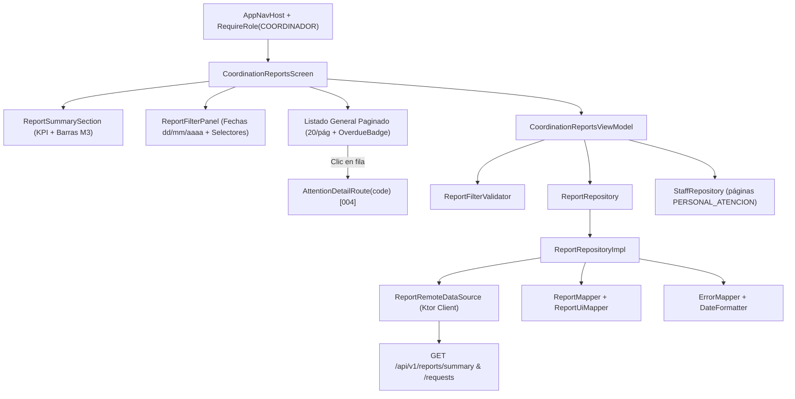

# Plan de Implementación Técnico: Consolidado y Reportes de Coordinación (Frontend)

**Feature:** `005-coordination-reports`
**Subproyecto:** Frontend (Kotlin Multiplatform + Compose Multiplatform)
**Versión:** 1.0.0
**Fecha:** 2026-11-14
**Estado:** Aprobado

---

## 1. Alineación con la Constitución y Alcance

Este plan materializa `spec.md`, `research.md`, `data-model.md` y `contracts.md` de **`005-coordination-reports` (Frontend)** obedeciendo `frontend/.specify/memory/constitution.md`:

- **Stack y Targets:** Kotlin Multiplatform 2.4.x, Compose Multiplatform 1.12.2 (Material 3, interfaz 100% en español, fechas `dd/mm/aaaa hh:mm` en `America/Bogota` vía `kotlinx-datetime`), compilación en `wasmJs` Web y Android (`minSdk 26`, `compileSdk`/`targetSdk` 35/36).
- **Red y Serialización:** Ktor Client 3.6.x + `kotlinx.serialization.json` con `ignoreUnknownKeys = false`.
- **Arquitectura:** MVVM + UDF + Repository + Mapper + Validación en dominio (`ReportFilterValidator`); componentes visuales nativos Material 3 sin librerías de gráficos externas.
- **Reutilización y Continuidad:**
  - Enlace directo desde `CoordinationPendingScreen` (`004`) hacia `CoordinationReportsRoute` sin alterar la lógica de bandejas de atención ni de gestión de personal (`StaffListRoute`).
  - Reutilización directa de `StaffRepository` (`002`), `OverdueBadge` (`004`) y `AttentionDetailRoute(code)` (`004`) para inspeccionar el detalle completo e historial interno desde cualquier fila del reporte.

---

## 2. Arquitectura de Capas y Flujo UDF

---

## 3. Plan de Archivos y Componentes

| Ruta Relativa (`frontend/composeApp/src/...`) | Acción | Responsabilidad |
| :--- | :--- | :--- |
| `commonMain/.../domain/model/ReportModels.kt` | Crear | Modelos puros: `ReportFilterQuery`, `AssigneeMetric`, `CoordinationReportSummary`, `CoordinationReportRequestItem`, `CoordinationReportRequestsPage`. |
| `commonMain/.../domain/validation/ReportFilterValidator.kt` | Crear | Parseo y validación de calendario gregoriano `dd/mm/aaaa` vía `kotlinx-datetime`, verificación `fromDate <= toDate` y normalización a `YYYY-MM-DD`. |
| `commonMain/.../domain/repository/ReportRepository.kt` | Crear | Interfaz `getSummary(filter)` y `getRequests(filter, page, size = 20)`. |
| `commonMain/.../data/dto/reports/ReportDtos.kt` | Crear | DTOs `@Serializable` estrictos (`AssigneeMetricDto`, `CoordinationReportSummaryDto`, `CoordinationReportRequestItemDto`, `PagedCoordinationReportRequestsResponseDto`). |
| `commonMain/.../data/mapper/ReportMapper.kt` | Crear | Mapeo DTO <-> Dominio (incluyendo parseo de mapas enum y timestamps ISO-8601 a `Instant`). |
| `commonMain/.../data/mapper/ReportUiMapper.kt` | Crear | Transformación a `CoordinationReportSummaryUi` y `CoordinationReportRequestItemUi` con proporciones `0f..1f`, etiquetas en español y fechas `dd/mm/aaaa hh:mm` (`America/Bogota`). |
| `commonMain/.../data/remote/ReportRemoteDataSource.kt` | Crear | Cliente HTTP Ktor para `GET /api/v1/reports/summary` y `GET /api/v1/reports/requests` construyendo únicamente query params no nulos. |
| `commonMain/.../data/repository/ReportRepositoryImpl.kt` | Crear | Implementación que coordina `ReportRemoteDataSource`, `ReportMapper` y `ErrorMapper`. |
| `commonMain/.../core/di/AppModules.kt` | Modificar | Registrar `ReportRemoteDataSource`, `ReportRepository`, `ReportFilterValidator` y `CoordinationReportsViewModel`. |
| `commonMain/.../viewmodel/reports/CoordinationReportsUiState.kt` | Crear | Estado UI inmutable (`ReportFilterDraft`, `appliedFilter`, `summary`, `requestsPage`, `availableAgents`, cargas y errores). |
| `commonMain/.../viewmodel/reports/CoordinationReportsViewModel.kt` | Crear | Carga inicial paralela (`getSummary` + `getRequests(1, 20)` + catálogo multipágina `StaffRepository`), validación al aplicar filtros, limpieza total y paginación independiente sin recargar `/summary`. |
| `commonMain/.../ui/components/ReportSummarySection.kt` | Crear | Tarjetas KPI + barras horizontales proporcionales M3 para los 6 estados, 4 categorías, prioridades (`+ Sin prioridad`) y responsables (`+ Sin responsable`). |
| `commonMain/.../ui/components/ReportFilterPanel.kt` | Crear | Inputs de fecha (`dd/mm/aaaa`) con error inline y dropdowns opcionales (Estado, Categoría, Prioridad, Responsable) + botones `"Aplicar filtros"` y `"Limpiar filtros"`. |
| `commonMain/.../ui/screens/reports/CoordinationReportsScreen.kt` | Crear | Pantalla completa integrando `ReportFilterPanel`, `ReportSummarySection`, listado general paginado (`20/pág`, `OverdueBadge`, SLA badge) y estado vacío. |
| `commonMain/.../ui/screens/attention/CoordinationPendingScreen.kt` | Modificar | Agregar botón/acceso visible `"Reportes y consolidado"` en cabecera para navegar hacia `CoordinationReportsRoute`. |
| `commonMain/.../ui/navigation/Routes.kt` y `AppNavHost.kt` | Modificar | Declarar `CoordinationReportsRoute`, protegerla bajo `RequireRole(UserRole.COORDINADOR)` y enlazar filas del listado con `AttentionDetailRoute(code)`. |

---

## 4. Mitigación de Riesgos Técnicos

1. **Inconsistencia entre resumen visible y página actual:** Separación estricta entre `draftFilter` (edición) y `appliedFilter` (vigente); cambiar página siempre reutiliza `appliedFilter` y mantiene el `summary` ya calculado para ese criterio.
2. **Selector de responsables truncado (>20 agentes):** Carga acumulativa multipágina desde `StaffRepository` (`role = PERSONAL_ATENCION`) solo tras validar que la pantalla corre bajo `RequireRole(UserRole.COORDINADOR)`.
3. **Errores de fecha inválida o rango invertido:** `ReportFilterValidator` bloquea peticiones inválidas antes de tocar red y muestra mensajes claros en español debajo de cada campo (`dd/mm/aaaa`).
4. **Cobertura y estilo multiplataforma:** Pruebas en `commonTest` para validador, mappers, repositorio con `Ktor MockEngine`, ViewModel (carga paralela, filtros, paginación y errores parciales) y `Compose UI Test`, ejecutando `ktlintCheck`, `koverVerify` ($\ge 90\%$), `compileKotlinWasmJs` y `assembleDebug`.
